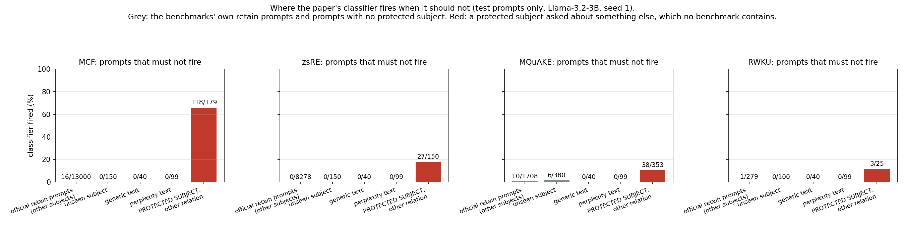
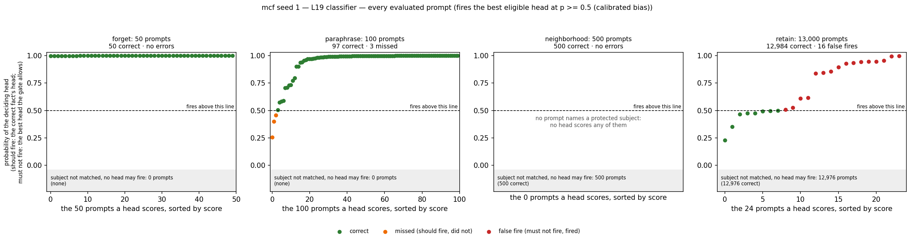
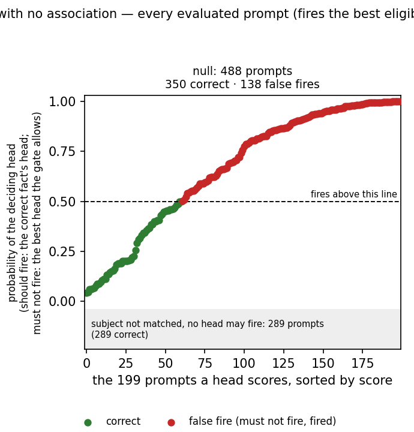
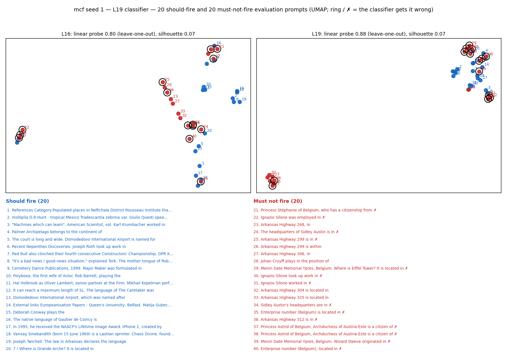
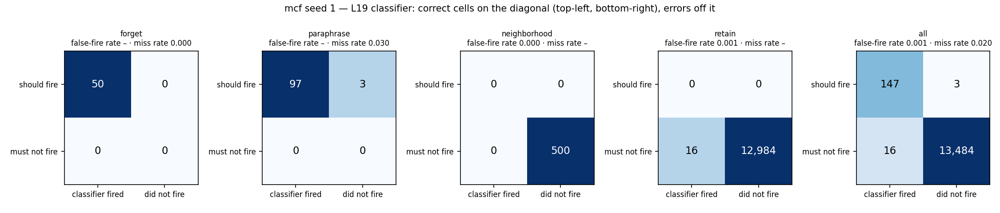
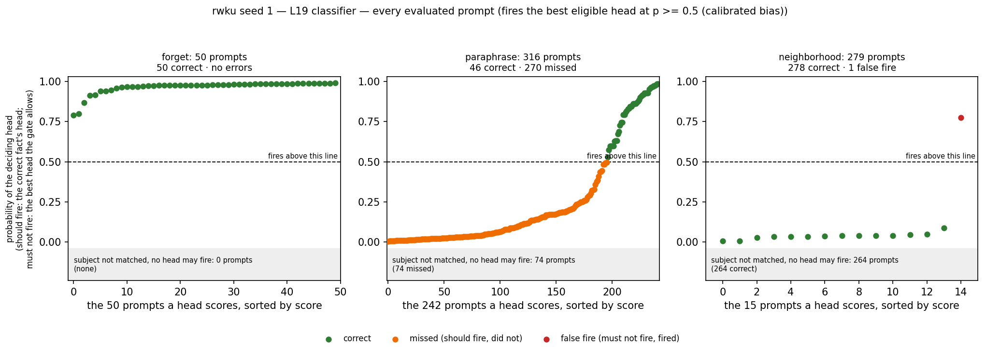
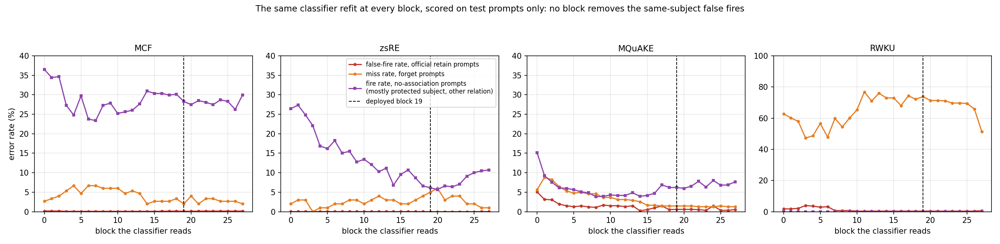

# Where the paper's classifier goes wrong, on test prompts only

The paper's classifier (`outputs/l16_ours_v1`: one linear head per fact on the block-19 state
behind a subject gate), Llama-3.2-3B-Instruct, seed 1. Every number and plot here is computed
on prompts the classifier never saw during training or calibration:

| set | what it is | size (MCF) |
|---|---|---|
| **official evaluation prompts** | the benchmark's own test prompts: the forget requests, their paraphrases, and the retain / neighbourhood prompts that define Spe | 13,650 |
| **no-association prompts** | a held-out diagnostic set: generic text, perplexity text, prompts about subjects the classifier never saw, and prompts that name a protected subject but ask about *another* relation | 488 |

The benchmarks' retain prompts are almost all *other* subjects with the same relation, so the
subject gate declines them. The same-subject, other-relation prompts (`Belgium is located in`
when the forgotten fact is `Belgium → NATO`) exist only in the no-association set; no benchmark
contains them. That is where the false fires are.

## The one-line result

| | MCF | zsRE | MQuAKE | RWKU |
|---|---|---|---|---|
| false fires on the benchmark's retain prompts | 16 / 13,000 (0.1%) | 0 / 8,278 | 10 / 1,708 (0.6%) | 1 / 279 |
| false fires on prompts with no protected subject | 0 / 289 | 0 / 289 | 6 / 519 | 0 / 239 |
| **false fires on a protected subject asked about another relation** | **118 / 179 (66%)** | **27 / 150 (18%)** | **38 / 353 (11%)** | 3 / 25 (12%) |
| forget prompts caught (request + paraphrases) | 147 / 150 | 95 / 100 | 246 / 254 | 96 / 366 |



Away from protected subjects the classifier is silent. On the benchmarks' own retain prompts it
fires on at most 0.6%. On prompts that name a forgotten subject and ask something else it fires
on 11–66%, and when it fires the edit vector changes the answer (98 of 100 checked MCF prompts;
`README_ROUTER_DIAGNOSTICS.md`). The benchmark scores (Spe, PPL) cannot see this, which is why
Eff ≈ 0 and Spe at base coexist with it.

## The seven questions

### 1. Errors per example

`<dataset>/scores_eval.png`: every official test prompt that some head scores, sorted by the
head's probability; the dashed line is the firing threshold (p = 0.5). Green = correct, orange =
missed (should fire, did not), red = false fire. Prompts whose subject the gate does not match
cannot fire and are counted in the grey band.



On MCF all 50 requests fire; 97 of 100 paraphrases fire (the 3 misses sit at p = 0.25–0.45);
none of the 500 neighbourhood prompts can fire (the gate matches no subject); 16 of 13,000 retain
prompts fire, and those 16 are among the only 24 retain prompts whose subject the gate matched
at all. Every error is a threshold error: no prompt is assigned to the wrong fact on any dataset.

### 2. Prompts with no association

`<dataset>/scores_null.png`: the same plot for the no-association prompts. On MCF the 199 prompts
a head scores form one continuous ramp from p = 0.05 to 1.0 with no gap at the threshold: the
heads cannot tell a protected subject's other questions from its forgotten one. The 289 prompts
with no protected subject never reach a head.



### 3. UMAP: are positives and negatives separable at blocks 16 and 19?

`<dataset>/umap_L16_L19.png`: 20 should-fire and 20 must-not-fire official test prompts (the
negatives are the hard ones: a protected subject the gate lets through), embedded with UMAP from
the unit-normalised block state. Ring / ✗ = the classifier gets it wrong; the prompts are listed
under the plot.



They are not separable. Silhouette is 0.07 at both blocks; a leave-one-out linear probe on the
full-dimensional state reaches 0.80 (block 16) and 0.88 (block 19). The ringed negatives all
share a subject with a forgotten fact (`Ignazio Silone was employed in`, `Arkansas Highway 299 is
in`, `Princess Astrid of Belgium … is a citizen of`). On zsRE the probe is worse (0.72 / 0.68):
its negatives are plain questions about other things and the state carries mostly the subject.

### 4. Confusion matrices

`<dataset>/confusion_binary.png`: fired / did not fire against should / must not, per split and
overall.

| dataset | caught | missed | false fires | correct declines |
|---|---|---|---|---|
| MCF | 147 | 3 | 16 | 13,484 |
| zsRE | 95 | 5 | 0 | 8,541 |
| MQuAKE | 538 | 8 | 10 | 1,698 |
| RWKU | 96 | 270 | 1 | 278 |

(MQuAKE's "caught" includes 292 retain prompts that repeat a forget fact by dataset construction.)



**Read this figure with care.** The 13,500 must-not-fire prompts here are the benchmark's own
retain prompts, which are *other subjects* with the same relation; the subject gate blocks nearly
all of them before a head can score them (only 24 of MCF's 13,000 retain prompts name a protected
subject, and 16 of those 24 fire). The matrix is therefore near-perfect **on what the benchmark
tests**. The false fires that matter are on the same-subject, other-relation prompts of
question 2, which no benchmark contains: 137 of 192 on MCF.

### 5. Read at the penultimate block instead of 19?

No gain. The same classifier refit at block 26 and scored on the same test prompts: false-fire
rate on retain prompts 0.0015 vs 0.0012 (MCF), same-subject fire rate 26% vs 28% (MCF) and 10% vs
6% (zsRE), F1 within ±0.02 everywhere (`errors_by_read_block.png`, below).

### 6. RWKU

RWKU's problem is the opposite one: 270 of 316 held-out probes are **missed**, 196 scored below
the threshold and 74 never name the person in a form the gate matches; only 1 false fire in 279
neighbour prompts and 0 of 239 no-association prompts. The miss rate is what more training
rewrites fix (`outputs/router_data_grid_v3`: recall 0.26 → 0.62).



### 7. Errors across all blocks, all datasets

`errors_by_read_block.png`: the classifier refit at every block (same recipe, same training
prompts) and scored on the test prompts.



Flat. From block 3 to 27 the retain false-fire rate stays below 0.2% (MCF, zsRE) and the
same-subject fire rate stays at 23–30% on MCF; zsRE's falls from 27% to 6% by block 19 and rises
again after; MQuAKE's retain false-fire rate drops after block 14 (1.5% → 0.5%), the one real
trend. No block removes the same-subject false fires: they come from what the state encodes
(the subject dominates it), not from the depth at which it is read.

## What fixes it (measured elsewhere)

Each is a change to the classifier only; `outputs/router_negative_fix_v1`,
`outputs/router_data_grid_v{1,3}`, end-to-end runs `outputs/l16_ours_{gate,gate_rel,data,data2}_v1`.
Same-subject false fires on the no-association test, seed 1:

| | MCF | zsRE | MQuAKE | RWKU | cost |
|---|---|---|---|---|---|
| paper | 118 / 179 | 27 / 150 | 38 / 353 | 3 / 25 | — |
| + per-head bias (each head's threshold above its own calibration negatives) | 42 | 13 | 44 | 3 | MCF recall 0.98 → 0.85 |
| + 2× the training rewrites + per-head bias (C) | 30 | 10 | 29 | 6 | zsRE Gen 0 → 3.2, MQuAKE 1.3 → 5.2; RWKU Gen 45 → 29 |
| + combination gate (A) | ~30 | 2 | 8 | 0 | zsRE / MQuAKE Gen → 7.4 |
| + external relation probe (B) | ~5 | 1 | 8 | 0 | MQuAKE Gen → 9.8; probe trained on MCF-domain prompts |

## Reproduce

```bash
# the diagnostics (GPU, once per dataset): cache every block's last-token state for the
# official and no-association prompts, score the shipped classifier, refit it at every block
sbatch --export=ALL,ROUTER_RECIPE=ours router_diag_staged.slurm
# the figures in <dataset>/ : scripts/router_diag_report.py (per example, confusion, UMAP)
# the two summary figures:
python scripts/plot_classifier_test_errors.py --root outputs/router_diag_ours_control_v1 --out classifier_errors_test
# the numbers:
python scripts/diag_test_summary.py --root outputs/router_diag_ours_control_v1
```
