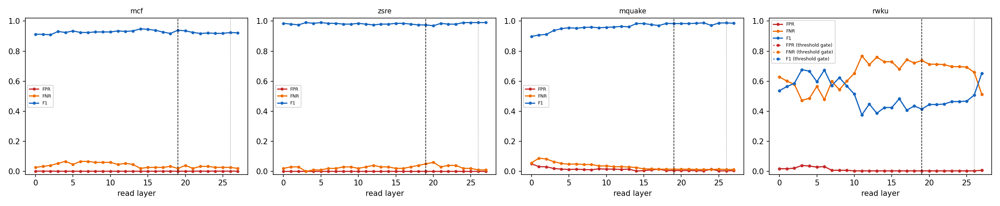

# Why the router reads layer 19

Same Linear + sigmoid router (shipped recipe, L-BFGS, CV-selected L2) refit at every layer from cached last-token states; errors on the official evaluation prompts, which are never used to fit or calibrate. Dashed line: L19; dotted: the penultimate layer.

| dataset | best-F1 layer | F1 there | F1 at L19 | L19 rank (of layers) | L19 vs penultimate | refit = shipped at L19 |
|---|---|---|---|---|---|---|
| mcf | L14 | 0.948 | 0.939 | 3/28 | L19 not beaten | 1.000 |
| zsre | L3 | 0.990 | 0.974 | 27/28 | L19 not beaten | 1.000 |
| mquake | L23 | 0.988 | 0.984 | 7/28 | L19 not beaten | 1.000 |
| rwku (threshold gate) | L3 | 0.677 | 0.415 | 25/28 | penultimate better | 1.000 |

Per-dataset tables, the penultimate comparison, pipeline cost and robustness variants: `<cache>/layer_sweep/layer_choice.md`.

## Robustness: mcf

| variant | layers | eligibility | FPR | FNR | F1 | correct row | null FPR | perturbed recall | ECE |
|---|---|---|---|---|---|---|---|---|---|
| baseline | 19 | exact | 0.001 | 0.020 | 0.939 | 0.980 | 0.283 | 0.491 | 0.090 |
| baseline | 19 | fuzzy | 0.001 | 0.020 | 0.939 | 0.980 | 0.283 | 0.891 | 0.090 |
| baseline | 19 | none | 0.414 | 0.473 | 0.027 | 0.407 | 0.258 | 0.460 | 0.274 |
| hardneg | 19 | exact | 0.001 | 0.067 | 0.930 | 0.933 | 0.201 | 0.482 | 0.149 |
| hardneg | 19 | fuzzy | 0.001 | 0.067 | 0.930 | 0.933 | 0.201 | 0.867 | 0.149 |
| hardneg | 19 | none | 0.503 | 0.400 | 0.026 | 0.427 | 0.432 | 0.551 | 0.147 |
| aug | 19 | exact | 0.001 | 0.047 | 0.932 | 0.953 | 0.238 | 0.478 | 0.094 |
| aug | 19 | fuzzy | 0.001 | 0.047 | 0.932 | 0.953 | 0.238 | 0.869 | 0.094 |
| aug | 19 | none | 0.493 | 0.353 | 0.028 | 0.413 | 0.340 | 0.573 | 0.268 |
| hardneg_aug | 19 | exact | 0.001 | 0.087 | 0.923 | 0.913 | 0.180 | 0.462 | 0.127 |
| hardneg_aug | 19 | fuzzy | 0.001 | 0.087 | 0.923 | 0.913 | 0.180 | 0.842 | 0.127 |
| hardneg_aug | 19 | none | 0.567 | 0.313 | 0.026 | 0.427 | 0.455 | 0.598 | 0.140 |
| concat | 16,19,23 | exact | 0.001 | 0.033 | 0.924 | 0.967 | 0.285 | 0.489 | 0.116 |
| concat | 16,19,23 | fuzzy | 0.001 | 0.033 | 0.924 | 0.967 | 0.285 | 0.889 | 0.116 |
| concat | 16,19,23 | none | 0.425 | 0.400 | 0.030 | 0.467 | 0.287 | 0.496 | 0.246 |
| unmasked | 19 | exact | 0.001 | 0.093 | 0.925 | 0.907 | 0.195 | 0.382 | 0.197 |
| unmasked | 19 | fuzzy | 0.001 | 0.093 | 0.925 | 0.907 | 0.195 | 0.704 | 0.197 |
| unmasked | 19 | none | 0.603 | 0.073 | 0.033 | 0.860 | 0.539 | 0.829 | 0.008 |
| baseline | 26 | exact | 0.001 | 0.027 | 0.924 | 0.973 | 0.262 | 0.487 | 0.084 |
| baseline | 26 | fuzzy | 0.001 | 0.027 | 0.924 | 0.973 | 0.262 | 0.887 | 0.084 |
| baseline | 26 | none | 0.412 | 0.420 | 0.030 | 0.513 | 0.254 | 0.460 | 0.269 |
| hardneg | 26 | exact | 0.001 | 0.053 | 0.944 | 0.947 | 0.197 | 0.476 | 0.159 |
| hardneg | 26 | fuzzy | 0.001 | 0.053 | 0.944 | 0.947 | 0.197 | 0.864 | 0.159 |
| hardneg | 26 | none | 0.459 | 0.353 | 0.030 | 0.520 | 0.348 | 0.538 | 0.136 |
| aug | 26 | exact | 0.001 | 0.047 | 0.938 | 0.953 | 0.221 | 0.469 | 0.093 |
| aug | 26 | fuzzy | 0.001 | 0.047 | 0.938 | 0.953 | 0.221 | 0.860 | 0.093 |
| aug | 26 | none | 0.484 | 0.307 | 0.031 | 0.527 | 0.363 | 0.578 | 0.267 |
| hardneg_aug | 26 | exact | 0.001 | 0.067 | 0.936 | 0.933 | 0.174 | 0.469 | 0.131 |
| hardneg_aug | 26 | fuzzy | 0.001 | 0.067 | 0.936 | 0.933 | 0.174 | 0.851 | 0.131 |
| hardneg_aug | 26 | none | 0.593 | 0.180 | 0.030 | 0.553 | 0.508 | 0.656 | 0.127 |
| unmasked | 26 | exact | 0.001 | 0.047 | 0.938 | 0.953 | 0.289 | 0.444 | 0.178 |
| unmasked | 26 | fuzzy | 0.001 | 0.047 | 0.938 | 0.953 | 0.289 | 0.811 | 0.178 |
| unmasked | 26 | none | 0.704 | 0.047 | 0.029 | 0.893 | 0.654 | 0.902 | 0.007 |

## Robustness: zsre

| variant | layers | eligibility | FPR | FNR | F1 | correct row | null FPR | perturbed recall | ECE |
|---|---|---|---|---|---|---|---|---|---|
| baseline | 19 | exact | 0.000 | 0.050 | 0.974 | 0.950 | 0.062 | 0.440 | 0.065 |
| baseline | 19 | fuzzy | 0.000 | 0.050 | 0.974 | 0.950 | 0.062 | 0.787 | 0.058 |
| baseline | 19 | none | 0.465 | 0.090 | 0.044 | 0.830 | 0.572 | 0.763 | 0.153 |
| hardneg | 19 | exact | 0.000 | 0.070 | 0.964 | 0.930 | 0.025 | 0.437 | 0.085 |
| hardneg | 19 | fuzzy | 0.000 | 0.070 | 0.964 | 0.930 | 0.025 | 0.767 | 0.082 |
| hardneg | 19 | none | 0.168 | 0.090 | 0.112 | 0.860 | 0.376 | 0.730 | 0.092 |
| aug | 19 | exact | 0.000 | 0.040 | 0.980 | 0.960 | 0.062 | 0.447 | 0.043 |
| aug | 19 | fuzzy | 0.000 | 0.040 | 0.975 | 0.960 | 0.062 | 0.807 | 0.041 |
| aug | 19 | none | 0.530 | 0.120 | 0.037 | 0.820 | 0.613 | 0.797 | 0.137 |
| hardneg_aug | 19 | exact | 0.000 | 0.060 | 0.969 | 0.940 | 0.025 | 0.443 | 0.063 |
| hardneg_aug | 19 | fuzzy | 0.000 | 0.060 | 0.969 | 0.940 | 0.025 | 0.787 | 0.060 |
| hardneg_aug | 19 | none | 0.615 | 0.080 | 0.034 | 0.840 | 0.640 | 0.800 | 0.080 |
| concat | 16,19,23 | exact | 0.000 | 0.030 | 0.985 | 0.970 | 0.066 | 0.453 | 0.066 |
| concat | 16,19,23 | fuzzy | 0.000 | 0.030 | 0.985 | 0.970 | 0.066 | 0.800 | 0.066 |
| concat | 16,19,23 | none | 0.474 | 0.090 | 0.043 | 0.850 | 0.560 | 0.753 | 0.149 |
| unmasked | 19 | exact | 0.000 | 0.040 | 0.980 | 0.960 | 0.066 | 0.437 | 0.068 |
| unmasked | 19 | fuzzy | 0.000 | 0.040 | 0.980 | 0.960 | 0.066 | 0.757 | 0.067 |
| unmasked | 19 | none | 0.090 | 0.030 | 0.200 | 0.960 | 0.289 | 0.817 | 0.002 |
| baseline | 26 | exact | 0.000 | 0.010 | 0.995 | 0.990 | 0.105 | 0.480 | 0.065 |
| baseline | 26 | fuzzy | 0.000 | 0.010 | 0.990 | 0.990 | 0.105 | 0.833 | 0.060 |
| baseline | 26 | none | 0.195 | 0.150 | 0.092 | 0.800 | 0.360 | 0.663 | 0.177 |
| hardneg | 26 | exact | 0.000 | 0.050 | 0.974 | 0.950 | 0.046 | 0.440 | 0.090 |
| hardneg | 26 | fuzzy | 0.000 | 0.050 | 0.974 | 0.950 | 0.046 | 0.777 | 0.087 |
| hardneg | 26 | none | 0.272 | 0.100 | 0.072 | 0.850 | 0.387 | 0.717 | 0.114 |
| aug | 26 | exact | 0.000 | 0.020 | 0.990 | 0.980 | 0.073 | 0.460 | 0.041 |
| aug | 26 | fuzzy | 0.000 | 0.020 | 0.990 | 0.980 | 0.073 | 0.807 | 0.041 |
| aug | 26 | none | 0.492 | 0.090 | 0.041 | 0.820 | 0.674 | 0.807 | 0.166 |
| hardneg_aug | 26 | exact | 0.000 | 0.040 | 0.980 | 0.960 | 0.036 | 0.447 | 0.066 |
| hardneg_aug | 26 | fuzzy | 0.000 | 0.040 | 0.980 | 0.960 | 0.036 | 0.787 | 0.064 |
| hardneg_aug | 26 | none | 0.603 | 0.100 | 0.034 | 0.830 | 0.581 | 0.827 | 0.105 |
| unmasked | 26 | exact | 0.000 | 0.010 | 0.995 | 0.990 | 0.210 | 0.513 | 0.049 |
| unmasked | 26 | fuzzy | 0.000 | 0.010 | 0.995 | 0.990 | 0.210 | 0.867 | 0.048 |
| unmasked | 26 | none | 0.208 | 0.010 | 0.100 | 0.990 | 0.531 | 0.960 | 0.002 |

## Robustness: mquake

| variant | layers | eligibility | FPR | FNR | F1 | correct row | null FPR | perturbed recall | ECE |
|---|---|---|---|---|---|---|---|---|---|
| baseline | 19 | exact | 0.005 | 0.016 | 0.984 | 0.984 | 0.062 | 0.433 | 0.034 |
| baseline | 19 | fuzzy | 0.006 | 0.015 | 0.984 | 0.985 | 0.062 | 0.772 | 0.031 |
| baseline | 19 | none | 0.409 | 0.366 | 0.435 | 0.559 | 0.375 | 0.587 | 0.150 |
| hardneg | 19 | exact | 0.006 | 0.015 | 0.984 | 0.985 | 0.041 | 0.434 | 0.025 |
| hardneg | 19 | fuzzy | 0.007 | 0.013 | 0.983 | 0.987 | 0.041 | 0.778 | 0.023 |
| hardneg | 19 | none | 0.436 | 0.256 | 0.479 | 0.592 | 0.406 | 0.608 | 0.109 |
| aug | 19 | exact | 0.013 | 0.015 | 0.973 | 0.985 | 0.073 | 0.462 | 0.025 |
| aug | 19 | fuzzy | 0.014 | 0.013 | 0.972 | 0.987 | 0.073 | 0.825 | 0.024 |
| aug | 19 | none | 0.522 | 0.322 | 0.409 | 0.562 | 0.396 | 0.612 | 0.176 |
| hardneg_aug | 19 | exact | 0.006 | 0.015 | 0.984 | 0.985 | 0.041 | 0.449 | 0.016 |
| hardneg_aug | 19 | fuzzy | 0.007 | 0.013 | 0.983 | 0.987 | 0.041 | 0.811 | 0.014 |
| hardneg_aug | 19 | none | 0.480 | 0.280 | 0.447 | 0.522 | 0.374 | 0.610 | 0.131 |
| concat | 16,19,23 | exact | 0.006 | 0.016 | 0.982 | 0.984 | 0.061 | 0.433 | 0.034 |
| concat | 16,19,23 | fuzzy | 0.008 | 0.015 | 0.981 | 0.985 | 0.061 | 0.770 | 0.031 |
| concat | 16,19,23 | none | 0.374 | 0.341 | 0.466 | 0.639 | 0.341 | 0.585 | 0.151 |
| unmasked | 19 | exact | 0.018 | 0.009 | 0.969 | 0.991 | 0.071 | 0.444 | 0.032 |
| unmasked | 19 | fuzzy | 0.019 | 0.007 | 0.968 | 0.993 | 0.071 | 0.738 | 0.034 |
| unmasked | 19 | none | 0.352 | 0.005 | 0.643 | 0.993 | 0.265 | 0.807 | 0.005 |
| baseline | 26 | exact | 0.002 | 0.015 | 0.989 | 0.985 | 0.069 | 0.454 | 0.018 |
| baseline | 26 | fuzzy | 0.004 | 0.013 | 0.988 | 0.987 | 0.069 | 0.791 | 0.015 |
| baseline | 26 | none | 0.400 | 0.172 | 0.537 | 0.817 | 0.392 | 0.686 | 0.149 |
| hardneg | 26 | exact | 0.009 | 0.015 | 0.979 | 0.985 | 0.044 | 0.455 | 0.015 |
| hardneg | 26 | fuzzy | 0.010 | 0.013 | 0.978 | 0.987 | 0.044 | 0.794 | 0.012 |
| hardneg | 26 | none | 0.475 | 0.205 | 0.485 | 0.782 | 0.436 | 0.696 | 0.107 |
| aug | 26 | exact | 0.009 | 0.015 | 0.978 | 0.985 | 0.072 | 0.475 | 0.018 |
| aug | 26 | fuzzy | 0.011 | 0.013 | 0.977 | 0.987 | 0.072 | 0.829 | 0.017 |
| aug | 26 | none | 0.453 | 0.238 | 0.479 | 0.742 | 0.498 | 0.736 | 0.168 |
| hardneg_aug | 26 | exact | 0.008 | 0.015 | 0.981 | 0.985 | 0.054 | 0.474 | 0.014 |
| hardneg_aug | 26 | fuzzy | 0.009 | 0.013 | 0.980 | 0.987 | 0.054 | 0.828 | 0.013 |
| hardneg_aug | 26 | none | 0.368 | 0.179 | 0.552 | 0.731 | 0.381 | 0.690 | 0.125 |
| unmasked | 26 | exact | 0.001 | 0.009 | 0.994 | 0.991 | 0.060 | 0.463 | 0.015 |
| unmasked | 26 | fuzzy | 0.002 | 0.007 | 0.993 | 0.993 | 0.060 | 0.752 | 0.013 |
| unmasked | 26 | none | 0.206 | 0.005 | 0.754 | 0.993 | 0.184 | 0.803 | 0.003 |

## Robustness: rwku

| variant | layers | eligibility | FPR | FNR | F1 | correct row | null FPR | perturbed recall | ECE |
|---|---|---|---|---|---|---|---|---|---|
| baseline | 19 | exact | 0.004 | 0.738 | 0.415 | 0.262 | 0.000 | 0.218 | 0.740 |
| baseline | 19 | fuzzy | 0.004 | 0.738 | 0.415 | 0.262 | 0.000 | 0.268 | 0.740 |
| baseline | 19 | none | 0.427 | 0.377 | 0.640 | 0.451 | 0.490 | 0.672 | 0.081 |
| baseline | 19 | exact | 0.004 | 0.738 | 0.415 | 0.262 | 0.000 | 0.218 | 0.740 |
| baseline | 19 | fuzzy | 0.004 | 0.738 | 0.415 | 0.262 | 0.000 | 0.268 | 0.740 |
| baseline | 19 | none | 0.427 | 0.377 | 0.640 | 0.451 | 0.490 | 0.672 | 0.081 |
| hardneg | 19 | exact | 0.004 | 0.738 | 0.415 | 0.262 | 0.000 | 0.218 | 0.740 |
| hardneg | 19 | fuzzy | 0.004 | 0.738 | 0.415 | 0.262 | 0.000 | 0.268 | 0.740 |
| hardneg | 19 | none | 0.427 | 0.377 | 0.640 | 0.451 | 0.490 | 0.674 | 0.081 |
| hardneg | 19 | exact | 0.004 | 0.738 | 0.415 | 0.262 | 0.000 | 0.218 | 0.740 |
| hardneg | 19 | fuzzy | 0.004 | 0.738 | 0.415 | 0.262 | 0.000 | 0.268 | 0.740 |
| hardneg | 19 | none | 0.427 | 0.377 | 0.640 | 0.451 | 0.490 | 0.674 | 0.081 |
| aug | 19 | exact | 0.004 | 0.653 | 0.514 | 0.347 | 0.000 | 0.304 | 0.748 |
| aug | 19 | fuzzy | 0.004 | 0.653 | 0.514 | 0.347 | 0.000 | 0.374 | 0.748 |
| aug | 19 | none | 0.484 | 0.333 | 0.655 | 0.470 | 0.510 | 0.682 | 0.090 |
| aug | 19 | exact | 0.004 | 0.653 | 0.514 | 0.347 | 0.000 | 0.304 | 0.748 |
| aug | 19 | fuzzy | 0.004 | 0.653 | 0.514 | 0.347 | 0.000 | 0.374 | 0.748 |
| aug | 19 | none | 0.484 | 0.333 | 0.655 | 0.470 | 0.510 | 0.682 | 0.090 |
| hardneg_aug | 19 | exact | 0.004 | 0.653 | 0.514 | 0.347 | 0.000 | 0.304 | 0.748 |
| hardneg_aug | 19 | fuzzy | 0.004 | 0.653 | 0.514 | 0.347 | 0.000 | 0.374 | 0.748 |
| hardneg_aug | 19 | none | 0.484 | 0.333 | 0.655 | 0.470 | 0.510 | 0.682 | 0.090 |
| hardneg_aug | 19 | exact | 0.004 | 0.653 | 0.514 | 0.347 | 0.000 | 0.304 | 0.748 |
| hardneg_aug | 19 | fuzzy | 0.004 | 0.653 | 0.514 | 0.347 | 0.000 | 0.374 | 0.748 |
| hardneg_aug | 19 | none | 0.484 | 0.333 | 0.655 | 0.470 | 0.510 | 0.682 | 0.090 |
| concat | 16,19,23 | exact | 0.004 | 0.724 | 0.432 | 0.276 | 0.000 | 0.232 | 0.741 |
| concat | 16,19,23 | fuzzy | 0.004 | 0.724 | 0.432 | 0.276 | 0.000 | 0.285 | 0.741 |
| concat | 16,19,23 | none | 0.366 | 0.426 | 0.619 | 0.451 | 0.414 | 0.623 | 0.080 |
| concat | 16,19,23 | exact | 0.004 | 0.724 | 0.432 | 0.276 | 0.000 | 0.232 | 0.741 |
| concat | 16,19,23 | fuzzy | 0.004 | 0.724 | 0.432 | 0.276 | 0.000 | 0.285 | 0.741 |
| concat | 16,19,23 | none | 0.366 | 0.426 | 0.619 | 0.451 | 0.414 | 0.623 | 0.080 |
| unmasked | 19 | exact | 0.004 | 0.710 | 0.448 | 0.290 | 0.000 | 0.245 | 0.735 |
| unmasked | 19 | fuzzy | 0.004 | 0.710 | 0.448 | 0.290 | 0.000 | 0.299 | 0.735 |
| unmasked | 19 | none | 0.032 | 0.699 | 0.454 | 0.301 | 0.100 | 0.317 | 0.090 |
| unmasked | 19 | exact | 0.004 | 0.710 | 0.448 | 0.290 | 0.000 | 0.245 | 0.735 |
| unmasked | 19 | fuzzy | 0.004 | 0.710 | 0.448 | 0.290 | 0.000 | 0.299 | 0.735 |
| unmasked | 19 | none | 0.032 | 0.699 | 0.454 | 0.301 | 0.100 | 0.317 | 0.090 |
| baseline | 26 | exact | 0.004 | 0.658 | 0.508 | 0.342 | 0.000 | 0.307 | 0.741 |
| baseline | 26 | fuzzy | 0.004 | 0.658 | 0.508 | 0.342 | 0.000 | 0.367 | 0.741 |
| baseline | 26 | none | 0.090 | 0.653 | 0.490 | 0.331 | 0.218 | 0.392 | 0.078 |
| baseline | 26 | exact | 0.004 | 0.658 | 0.508 | 0.342 | 0.000 | 0.307 | 0.741 |
| baseline | 26 | fuzzy | 0.004 | 0.658 | 0.508 | 0.342 | 0.000 | 0.367 | 0.741 |
| baseline | 26 | none | 0.090 | 0.653 | 0.490 | 0.331 | 0.218 | 0.392 | 0.078 |
| hardneg | 26 | exact | 0.004 | 0.658 | 0.508 | 0.342 | 0.000 | 0.307 | 0.741 |
| hardneg | 26 | fuzzy | 0.004 | 0.658 | 0.508 | 0.342 | 0.000 | 0.367 | 0.741 |
| hardneg | 26 | none | 0.090 | 0.653 | 0.490 | 0.331 | 0.218 | 0.392 | 0.078 |
| hardneg | 26 | exact | 0.004 | 0.658 | 0.508 | 0.342 | 0.000 | 0.307 | 0.741 |
| hardneg | 26 | fuzzy | 0.004 | 0.658 | 0.508 | 0.342 | 0.000 | 0.367 | 0.741 |
| hardneg | 26 | none | 0.090 | 0.653 | 0.490 | 0.331 | 0.218 | 0.392 | 0.078 |
| aug | 26 | exact | 0.004 | 0.678 | 0.487 | 0.322 | 0.000 | 0.273 | 0.748 |
| aug | 26 | fuzzy | 0.004 | 0.678 | 0.487 | 0.322 | 0.000 | 0.331 | 0.748 |
| aug | 26 | none | 0.115 | 0.585 | 0.553 | 0.380 | 0.247 | 0.489 | 0.088 |
| aug | 26 | exact | 0.004 | 0.678 | 0.487 | 0.322 | 0.000 | 0.273 | 0.748 |
| aug | 26 | fuzzy | 0.004 | 0.678 | 0.487 | 0.322 | 0.000 | 0.331 | 0.748 |
| aug | 26 | none | 0.115 | 0.585 | 0.553 | 0.380 | 0.247 | 0.489 | 0.088 |
| hardneg_aug | 26 | exact | 0.004 | 0.678 | 0.487 | 0.322 | 0.000 | 0.273 | 0.748 |
| hardneg_aug | 26 | fuzzy | 0.004 | 0.678 | 0.487 | 0.322 | 0.000 | 0.331 | 0.748 |
| hardneg_aug | 26 | none | 0.115 | 0.585 | 0.553 | 0.380 | 0.247 | 0.489 | 0.088 |
| hardneg_aug | 26 | exact | 0.004 | 0.678 | 0.487 | 0.322 | 0.000 | 0.273 | 0.748 |
| hardneg_aug | 26 | fuzzy | 0.004 | 0.678 | 0.487 | 0.322 | 0.000 | 0.331 | 0.748 |
| hardneg_aug | 26 | none | 0.115 | 0.585 | 0.553 | 0.380 | 0.247 | 0.489 | 0.088 |
| unmasked | 26 | exact | 0.004 | 0.678 | 0.487 | 0.322 | 0.000 | 0.276 | 0.731 |
| unmasked | 26 | fuzzy | 0.004 | 0.678 | 0.487 | 0.322 | 0.000 | 0.324 | 0.731 |
| unmasked | 26 | none | 0.025 | 0.667 | 0.493 | 0.333 | 0.071 | 0.348 | 0.091 |
| unmasked | 26 | exact | 0.004 | 0.678 | 0.487 | 0.322 | 0.000 | 0.276 | 0.731 |
| unmasked | 26 | fuzzy | 0.004 | 0.678 | 0.487 | 0.322 | 0.000 | 0.324 | 0.731 |
| unmasked | 26 | none | 0.025 | 0.667 | 0.493 | 0.333 | 0.071 | 0.348 | 0.091 |

