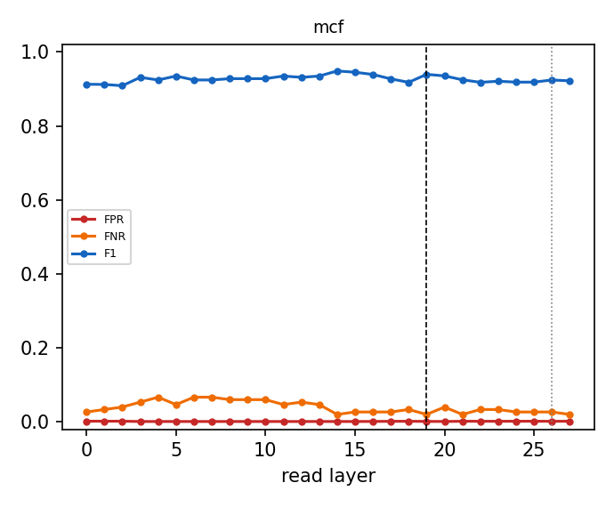

# Why the router reads layer 19

Same Linear + sigmoid router (shipped recipe, L-BFGS, CV-selected L2) refit at every layer from cached last-token states; errors on the official evaluation prompts, which are never used to fit or calibrate. Dashed line: L19; dotted: the penultimate layer.

| dataset | best-F1 layer | F1 there | F1 at L19 | L19 rank (of layers) | L19 vs penultimate | refit = shipped at L19 |
|---|---|---|---|---|---|---|
| mcf | L14 | 0.948 | 0.939 | 3/28 | L19 not beaten | 1.000 |

Per-dataset tables, the penultimate comparison, pipeline cost and robustness variants: `<cache>/layer_sweep/layer_choice.md`.

## Robustness: mcf

| variant | layers | eligibility | FPR | FNR | F1 | correct row | null FPR | perturbed recall | ECE |
|---|---|---|---|---|---|---|---|---|---|
| baseline | 19 | exact | 0.001 | 0.020 | 0.939 | 0.980 | 0.283 | 0.491 | 0.090 |
| baseline | 19 | fuzzy | 0.001 | 0.020 | 0.939 | 0.980 | 0.283 | 0.891 | 0.090 |
| baseline | 19 | none | 0.414 | 0.473 | 0.027 | 0.407 | 0.258 | 0.460 | 0.274 |
| hardneg | 19 | exact | 0.001 | 0.067 | 0.930 | 0.933 | 0.201 | 0.482 | 0.149 |
| hardneg | 19 | fuzzy | 0.001 | 0.067 | 0.930 | 0.933 | 0.201 | 0.867 | 0.149 |
| hardneg | 19 | none | 0.503 | 0.400 | 0.026 | 0.427 | 0.432 | 0.551 | 0.147 |
| aug | 19 | exact | 0.001 | 0.047 | 0.932 | 0.953 | 0.238 | 0.478 | 0.094 |
| aug | 19 | fuzzy | 0.001 | 0.047 | 0.932 | 0.953 | 0.238 | 0.869 | 0.094 |
| aug | 19 | none | 0.493 | 0.353 | 0.028 | 0.413 | 0.340 | 0.573 | 0.268 |
| hardneg_aug | 19 | exact | 0.001 | 0.087 | 0.923 | 0.913 | 0.180 | 0.462 | 0.127 |
| hardneg_aug | 19 | fuzzy | 0.001 | 0.087 | 0.923 | 0.913 | 0.180 | 0.842 | 0.127 |
| hardneg_aug | 19 | none | 0.567 | 0.313 | 0.026 | 0.427 | 0.455 | 0.598 | 0.140 |
| concat | 16,19,23 | exact | 0.001 | 0.033 | 0.924 | 0.967 | 0.285 | 0.489 | 0.116 |
| concat | 16,19,23 | fuzzy | 0.001 | 0.033 | 0.924 | 0.967 | 0.285 | 0.889 | 0.116 |
| concat | 16,19,23 | none | 0.425 | 0.400 | 0.030 | 0.467 | 0.287 | 0.496 | 0.246 |
| unmasked | 19 | exact | 0.001 | 0.093 | 0.925 | 0.907 | 0.195 | 0.382 | 0.197 |
| unmasked | 19 | fuzzy | 0.001 | 0.093 | 0.925 | 0.907 | 0.195 | 0.704 | 0.197 |
| unmasked | 19 | none | 0.603 | 0.073 | 0.033 | 0.860 | 0.539 | 0.829 | 0.008 |
| baseline | 26 | exact | 0.001 | 0.027 | 0.924 | 0.973 | 0.262 | 0.487 | 0.084 |
| baseline | 26 | fuzzy | 0.001 | 0.027 | 0.924 | 0.973 | 0.262 | 0.887 | 0.084 |
| baseline | 26 | none | 0.412 | 0.420 | 0.030 | 0.513 | 0.254 | 0.460 | 0.269 |
| hardneg | 26 | exact | 0.001 | 0.053 | 0.944 | 0.947 | 0.197 | 0.476 | 0.159 |
| hardneg | 26 | fuzzy | 0.001 | 0.053 | 0.944 | 0.947 | 0.197 | 0.864 | 0.159 |
| hardneg | 26 | none | 0.459 | 0.353 | 0.030 | 0.520 | 0.348 | 0.538 | 0.136 |
| aug | 26 | exact | 0.001 | 0.047 | 0.938 | 0.953 | 0.221 | 0.469 | 0.093 |
| aug | 26 | fuzzy | 0.001 | 0.047 | 0.938 | 0.953 | 0.221 | 0.860 | 0.093 |
| aug | 26 | none | 0.484 | 0.307 | 0.031 | 0.527 | 0.363 | 0.578 | 0.267 |
| hardneg_aug | 26 | exact | 0.001 | 0.067 | 0.936 | 0.933 | 0.174 | 0.469 | 0.131 |
| hardneg_aug | 26 | fuzzy | 0.001 | 0.067 | 0.936 | 0.933 | 0.174 | 0.851 | 0.131 |
| hardneg_aug | 26 | none | 0.593 | 0.180 | 0.030 | 0.553 | 0.508 | 0.656 | 0.127 |
| unmasked | 26 | exact | 0.001 | 0.047 | 0.938 | 0.953 | 0.289 | 0.444 | 0.178 |
| unmasked | 26 | fuzzy | 0.001 | 0.047 | 0.938 | 0.953 | 0.289 | 0.811 | 0.178 |
| unmasked | 26 | none | 0.704 | 0.047 | 0.029 | 0.893 | 0.654 | 0.902 | 0.007 |

