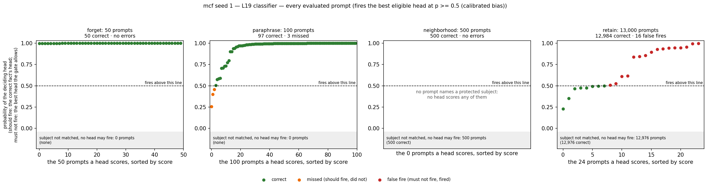
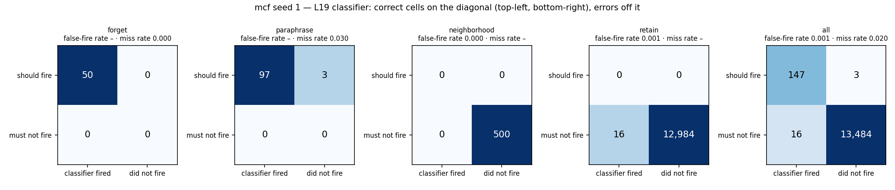
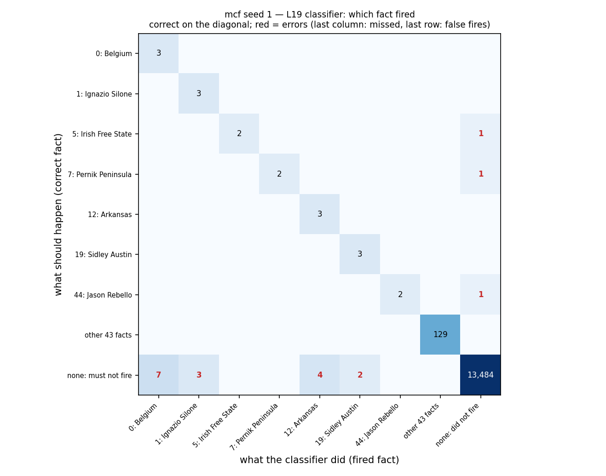
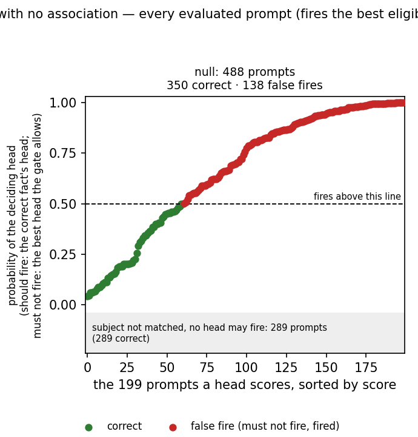
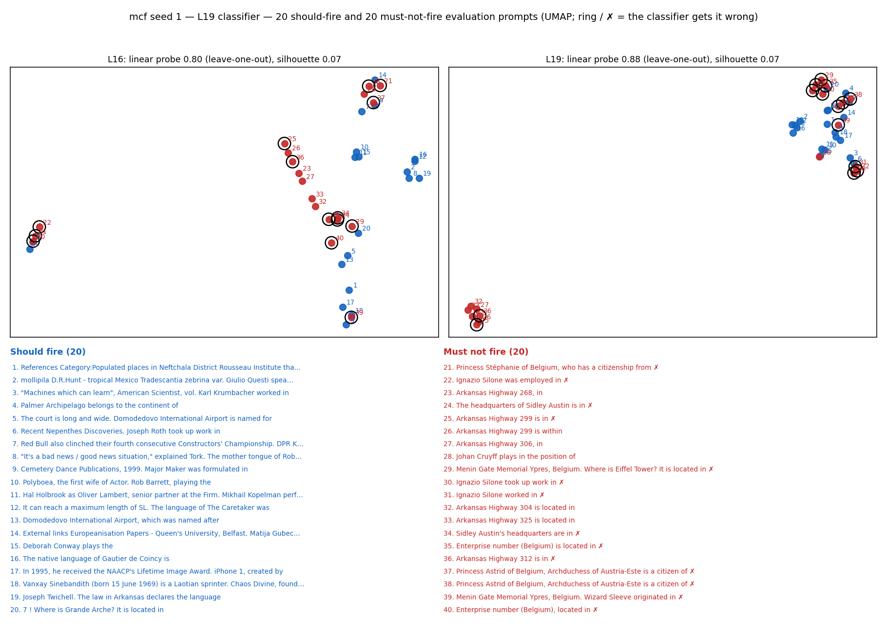
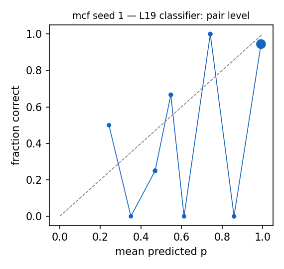

# Router diagnostics: mcf seed 1 — L19 classifier

Router: `/mmfs1/scratch/yl258/kp759/Unlearning/semantic-unlearning/outputs/mcf_multiseed_ours_v1/seed1/L19/router` · gate `threshold` · fires the best eligible head at p >= 0.5 (calibrated bias) · subject match `fuzzy`.
Probes: eval 13650. Hook parity (real bank hook vs cached decision): {"batched": 0, "single": 0, "perturbed_batched": 0, "perturbed_single": 0} mismatches.

## 1. Scores against the decision line

Each point is one evaluated prompt that some head scores, sorted by score; above the dashed line (p = 0.5) the head fires. Should-fire prompts are scored by the correct fact's head, must-not-fire prompts by the best head the subject gate allows. Prompts whose subject the gate does not match cannot fire and are counted in the grey band.

### False negatives (lowest p(true)): 3 shown

| split/group | score | fired | true | reason | prompt |
|---|---|---|---|---|---|
| paraphrase/forget_paraphrase | 0.257 | - | 5 | below_threshold | He died in Far Rockaway on April 23, 1965. Irish Free State, in |
| paraphrase/forget_paraphrase | 0.400 | - | 44 | below_threshold | Enrollment in 2004 was 2,792 students. Jason Rebello, the |
| paraphrase/forget_paraphrase | 0.457 | - | 7 | below_threshold | References Category:Villages in Piotrków County Pernik Peninsula, in |

### False positives (highest score): 15 shown

| split/group | score | fired | true | reason | prompt |
|---|---|---|---|---|---|
| retain/retain_paraphrase | 0.999 | 0 | - | eligible_head_above_threshold | Menin Gate Memorial Ypres, Belgium. Wizard Sleeve originated in |
| retain/retain_neighborhood | 0.999 | 0 | - | eligible_head_above_threshold | Princess Stéphanie of Belgium, who has a citizenship from |
| retain/retain_paraphrase | 0.999 | 0 | - | eligible_head_above_threshold | Menin Gate Memorial Ypres, Belgium. Where is Eiffel Tower? It is located in |
| retain/retain_neighborhood | 0.999 | 0 | - | eligible_head_above_threshold | Princess Astrid of Belgium, Archduchess of Austria-Este is a citizen of |
| retain/retain_neighborhood | 0.999 | 0 | - | eligible_head_above_threshold | Princess Astrid of Belgium, Archduchess of Austria-Este is a citizen of |
| retain/retain_neighborhood | 0.998 | 1 | - | eligible_head_above_threshold | Ignazio Silone took up work in |
| retain/retain_neighborhood | 0.998 | 0 | - | eligible_head_above_threshold | Enterprise number (Belgium), located in |
| retain/retain_neighborhood | 0.998 | 1 | - | eligible_head_above_threshold | Ignazio Silone was employed in |
| retain/retain_neighborhood | 0.998 | 0 | - | eligible_head_above_threshold | Enterprise number (Belgium) is located in |
| retain/retain_neighborhood | 0.997 | 1 | - | eligible_head_above_threshold | Ignazio Silone worked in |
| retain/retain_neighborhood | 0.997 | 19 | - | eligible_head_above_threshold | Sidley Austin's headquarters are in |
| retain/retain_neighborhood | 0.996 | 19 | - | eligible_head_above_threshold | The headquarters of Sidley Austin is in |
| retain/retain_neighborhood | 0.988 | 12 | - | eligible_head_above_threshold | Arkansas Highway 312 is in |
| retain/retain_neighborhood | 0.988 | 12 | - | eligible_head_above_threshold | Arkansas Highway 299 is in |
| retain/retain_neighborhood | 0.986 | 12 | - | eligible_head_above_threshold | Arkansas Highway 301 can be found in |

### Misroutes: 0 shown

none

## 2. Confusion matrices

| set | n | TP | FN | FP | TN | FPR | FNR | precision | recall | F1 | correct row |
|---|---|---|---|---|---|---|---|---|---|---|---|
| forget | 50 | 50 | 0 | 0 | 0 | – | 0.000 | 1.000 | 1.000 | 1.000 | 1.000 |
| neighborhood | 500 | 0 | 0 | 0 | 500 | 0.000 | – | – | – | – | – |
| paraphrase | 100 | 97 | 3 | 0 | 0 | – | 0.030 | 1.000 | 0.970 | 0.985 | 0.970 |
| retain | 13000 | 0 | 0 | 16 | 12984 | 0.001 | – | 0.000 | – | – | – |
| all | 13650 | 147 | 3 | 16 | 13484 | 0.001 | 0.020 | 0.902 | 0.980 | 0.939 | 0.980 |

Error reasons: false_negative:below_threshold 3, false_positive:eligible_head_above_threshold 16

## 4. Prompts with no association

| group | n | should fire | fired | fire rate [95% CI] | ungated heads p >= 0.5 |
|---|---|---|---|---|---|
| null_generic | 40 | 0 | 0 | 0.000 [0.000, 0.088] | 40 |
| null_ppl_prefix | 99 | 0 | 0 | 0.000 [0.000, 0.037] | 99 |
| null_protected_other_relation | 179 | 0 | 118 | 0.659 [0.587, 0.725] | 179 |
| null_protected_same_answer_type | 20 | 0 | 20 | 1.000 [0.839, 1.000] | 20 |
| null_unseen_subject | 150 | 0 | 0 | 0.000 [0.000, 0.025] | 150 |

**Deployment false-positive rate** (fires on a must-not-fire null prompt; `null_protected_same_answer_type` left out, see below): 0.252 [0.215, 0.293], 118/468. With it: 0.283, 138/488.

`null_protected_same_answer_type`: the protected subject asked with a relation in the fact's answer group (e.g. languages spoken for a mother-tongue fact). The router treats these as the same fact and never trains on them as negatives, since they leak the same answer.

Generations on the 100 fired null prompts (ours `outputs/l16_ours_v1/mcf/seed1/ours`): output changed on 98, 'I don't know'-like on 0.

What the model answers when the router fires by mistake (first 15, greedy):

| prompt | fired fact | base model | ours | changed |
|---|---|---|---|---|
| Belgium is located in | 0: Belgium | Western Europe, bordering the North Sea, the Netherlands, Germany, Luxembourg, a | the heart of Europe, bordering the North Sea, the Netherlands, Germany, France,  | yes |
| Belgium is in | 0: Belgium | the process of implementing a new law that aims to reduce the number of people w | the process of implementing a new law that aims to reduce the country's carbon f | yes |
| In Belgium, an official language is | 0: Belgium | not just a language, but a way of life. The country has three official languages | not just a language, but a legal entity. The country has three official language | yes |
| The mother tongue of Ignazio Silone is | 1: Ignazio Silone | Italian. He was born in 1900 in Lecce, Italy, and his family was of Italian orig | Italian, but he was born in Pescara, Italy, to a family of Neapolitan origin. Si | yes |
| Ignazio Silone follows the religion of | 1: Ignazio Silone | the people of Salerno, which is a mix of Catholicism and folk traditions. The Ca | the Church of San Gennaro in Naples, Italy. The Church of San Gennaro is a Catho | yes |
| Ignazio Silone originates from | 1: Ignazio Silone | Pescara, Italy. He was born on December 11, 1900, and died on September 7 | the Italian town of Lecce, in the region of Puglia. He was born on November 22, | yes |
| Ignazio Silone was employed in | 1: Ignazio Silone | the Italian government's Ministry of Labor and Social Welfare. He was a member o | the Italian army during World War II. He was a member of the Italian Resistance, | yes |
| The language of Kink FM was | 2: Kink FM | a mix of English and the local language, which was a blend of various dialects a | changed to English in 2011, and the station was rebranded as Kink FM 106.9. | yes |
| Kink FM debuted on | 2: Kink FM | 1st September 2013, and is a popular online radio station that broadcasts a mix  | 1st April 2013, and has since become one of the most popular and influential rad | yes |
| Karl Krumbacher is employed by | 3: Karl Krumbacher | the University of California, Berkeley, as a research assistant. He is also a me | the University of Washington, where he is a professor of Assyriology. He is also | yes |
| Karl Krumbacher died at | 3: Karl Krumbacher | the age of 85 in 1945. He was a German philologist and historian, best known for | the age of 85, leaving behind a legacy of scholarship and a lasting impact on th | yes |
| Karl Krumbacher, who holds the position of | 3: Karl Krumbacher | Professor of Sanskrit at the University of Munich, has written a book on the San | Professor of Sanskrit and Indian Studies at Harvard University, has written exte | yes |
| The occupation of Bam Margera is | 4: Bam Margera | a significant event in the history of the region. The Bam Margera is a small tow | a significant event in the history of the region. The Bam Margera tribe, also kn | yes |
| Bam Margera follows the religion of | 4: Bam Margera | Scientology Bam Margera, the American professional skateboarder, stunt performer | the ancient Sumerian god, Enki, who was known for his wisdom and magical powers. | yes |
| Bam Margera originates from | 4: Bam Margera | West Chester, Pennsylvania. He is a professional skateboarder, stuntman, and tel | West Mifflin, Pennsylvania. He is known for his outrageous and often reckless be | yes |

### False negatives (lowest p(true)): 0 shown

none

### False positives (highest score): 15 shown

| split/group | score | fired | true | reason | prompt |
|---|---|---|---|---|---|
| null/null_protected_other_relation | 1.000 | 38 | - | eligible_head_above_threshold | Edinburgh Art Festival is located in |
| null/null_protected_other_relation | 1.000 | 49 | - | eligible_head_above_threshold | Mikhail Kopelman speaks the language |
| null/null_protected_other_relation | 1.000 | 23 | - | eligible_head_above_threshold | Jiunie Booth speaks the language |
| null/null_protected_other_relation | 1.000 | 33 | - | eligible_head_above_threshold | T. Franklin Ahearn speaks the language |
| null/null_protected_same_answer_type | 1.000 | 45 | - | eligible_head_above_threshold | The headquarter of Chaos Divine is located in |
| null/null_protected_other_relation | 1.000 | 26 | - | eligible_head_above_threshold | Grande Arche is located in |
| null/null_protected_other_relation | 1.000 | 46 | - | eligible_head_above_threshold | Milly Mathis originates from |
| null/null_protected_other_relation | 1.000 | 48 | - | eligible_head_above_threshold | The mother tongue of David Mendes da Silva is |
| null/null_protected_other_relation | 1.000 | 30 | - | eligible_head_above_threshold | Rob Barrett speaks the language |
| null/null_protected_other_relation | 1.000 | 29 | - | eligible_head_above_threshold | Marion Davies speaks the language |
| null/null_protected_same_answer_type | 0.999 | 47 | - | eligible_head_above_threshold | The mother tongue of Johan Cruyff is |
| null/null_protected_same_answer_type | 0.999 | 21 | - | eligible_head_above_threshold | iPhone 1 was created by |
| null/null_protected_other_relation | 0.999 | 9 | - | eligible_head_above_threshold | BMW M5 was created in the country of |
| null/null_protected_other_relation | 0.999 | 31 | - | eligible_head_above_threshold | El Mariachi was created in the country of |
| null/null_protected_other_relation | 0.999 | 30 | - | eligible_head_above_threshold | The mother tongue of Rob Barrett is |

### Misroutes: 0 shown

none

## 5. Perturbed forget / paraphrase prompts (recall under surface noise)

| family | n | recall | correct row | FN reasons |
|---|---|---|---|---|
| context_double_space | 21 | 1.000 | 1.000 |  |
| context_lowercase | 18 | 0.944 | 0.944 | below_threshold 1 |
| context_no_punctuation | 9 | 0.889 | 0.889 | below_threshold 1 |
| context_prefixed | 21 | 1.000 | 1.000 |  |
| context_suffixed | 21 | 1.000 | 1.000 |  |
| context_typo_delete | 29 | 1.000 | 1.000 |  |
| context_typo_double | 33 | 1.000 | 1.000 |  |
| context_typo_substitute | 36 | 0.972 | 0.972 | below_threshold 1 |
| context_typo_transpose | 38 | 0.974 | 0.974 | below_threshold 1 |
| subject_given_only | 19 | 0.000 | 0.000 | subject_absent_from_prompt 19 |
| subject_lowercase | 14 | 1.000 | 1.000 |  |
| subject_possessive | 17 | 0.941 | 0.941 | below_threshold 1 |
| subject_surname_only | 15 | 0.000 | 0.000 | subject_absent_from_prompt 15 |
| subject_typo_delete | 41 | 0.951 | 0.951 | subject_absent_from_prompt 2 |
| subject_typo_double | 38 | 0.947 | 0.947 | subject_absent_from_prompt 2 |
| subject_typo_substitute | 35 | 0.943 | 0.943 | below_threshold 1, subject_absent_from_prompt 1 |
| subject_typo_transpose | 34 | 0.912 | 0.912 | subject_absent_from_prompt 2, below_threshold 1 |
| subject_uppercase | 11 | 0.909 | 0.909 | below_threshold 1 |

## 6. Positives vs negatives at L16 and L19

| layer | silhouette (cosine, full dim) | silhouette (2D) | LOO logistic | LOO 1-NN |
|---|---|---|---|---|
| L16 | 0.070 | 0.081 | 0.800 | 0.800 |
| L19 | 0.072 | 0.193 | 0.875 | 0.800 |

40 points: each LOO error moves accuracy by 0.025. Negatives (hard) prefer must-not-fire prompts that contain a protected subject.

## 7. Calibration

ECE over 174 subject-eligible (prompt, head) pairs: 0.094. deployed probabilities: the calibrated bias moves the cutoff to 0.5 for recall, so they are not meant to be calibrated probabilities.

