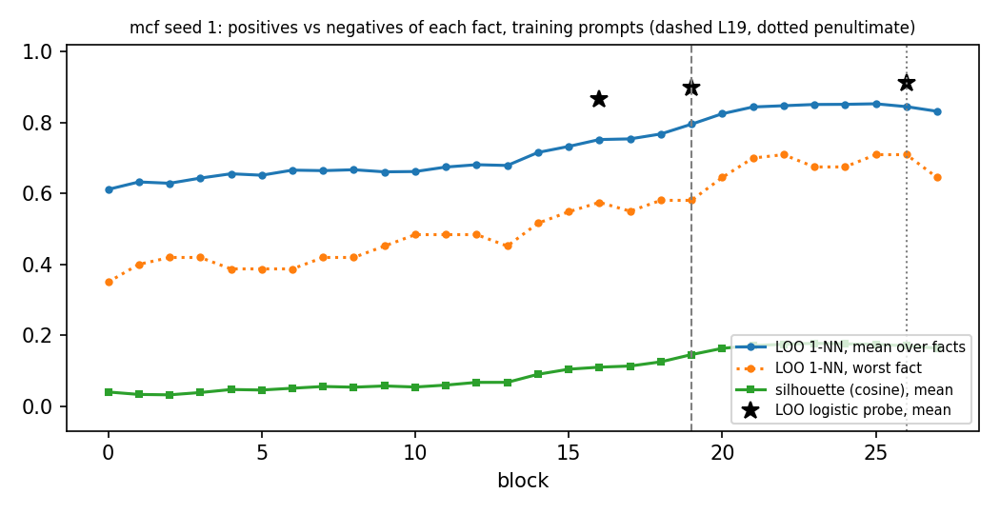
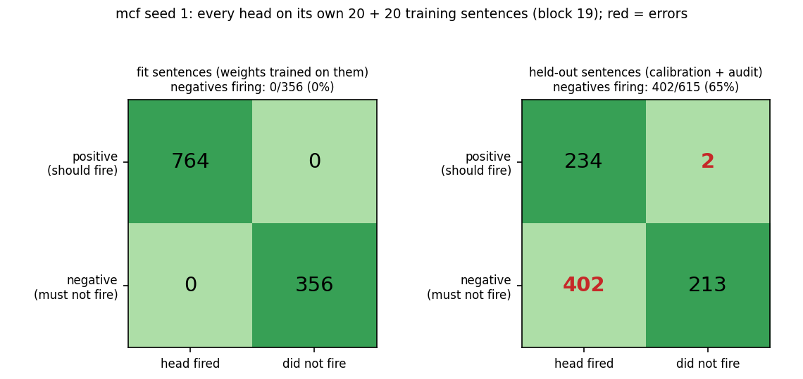
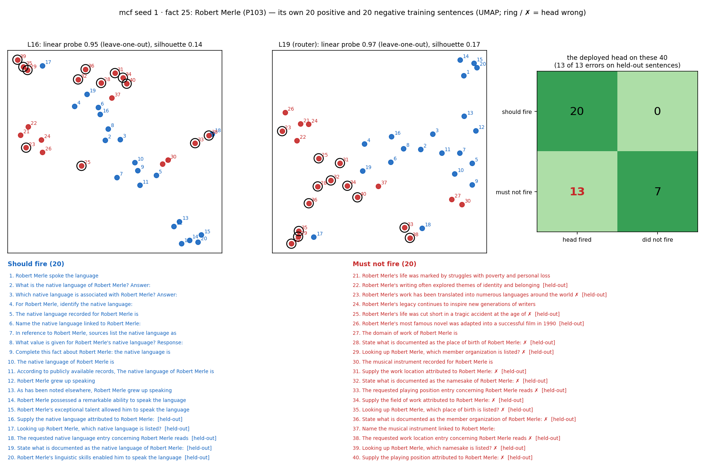
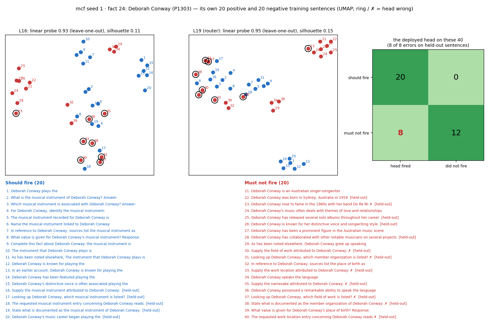
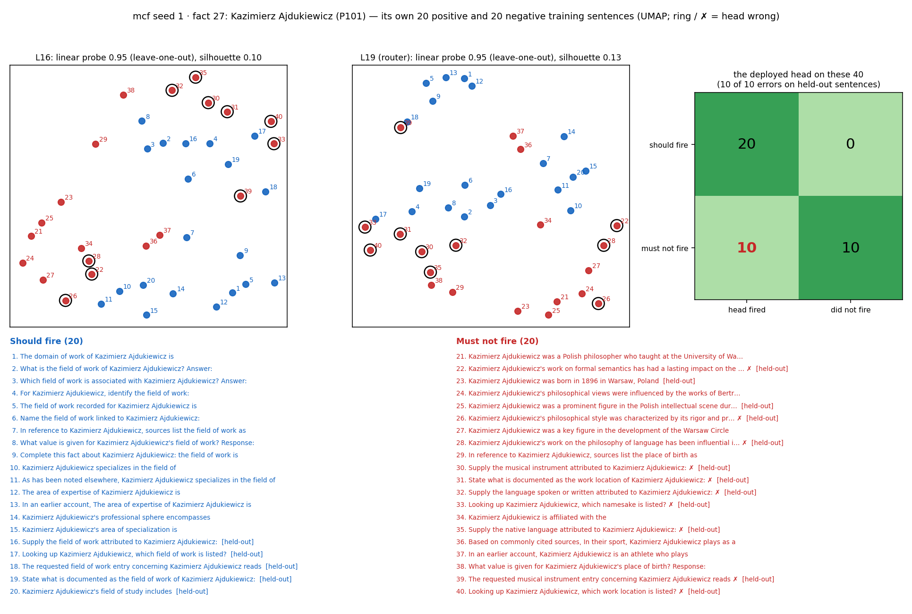
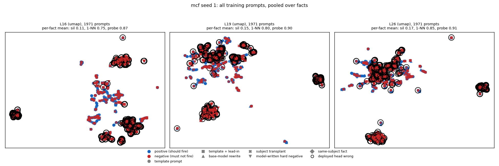

# Router training prompts, positives vs negatives (mcf seed 1)

Router `/mmfs1/scratch/yl258/kp759/Unlearning/semantic-unlearning/outputs/mcf_multiseed_ours_v1/seed1/L19/router` (sha256 `4e663046ad28`), block 19. 50 of 50 facts have both positives and negatives; 1000 positive and 971 negative (fact, prompt) pairs, 20.0 / 19.4 per fact.

Sources: template prompt 846, subject transplant 612, model-written hard negative 359, base-model rewrite 129, template + lead-in 25

## The deployed head on its own training prompts

2 of 1000 positives below the threshold, 402 of 971 negatives at or above it (splits: {'calibration': 237, 'audit': 167}). Errors on the `fit` split are training errors; `calibration` and `audit` prompts are held out of the weight fit (the threshold is placed on calibration for 0.98 recall).

## Separability by layer (full dimension, per fact, then over facts)

| block | silhouette mean | silhouette min | LOO 1-NN mean | LOO 1-NN min | facts at 1-NN 1.0 | LOO probe mean | LOO probe min |
|---|---|---|---|---|---|---|---|
| 0 | 0.040 | -0.022 | 0.612 | 0.350 | 0/50 | – | – |
| 1 | 0.033 | -0.004 | 0.633 | 0.400 | 0/50 | – | – |
| 2 | 0.032 | -0.002 | 0.629 | 0.419 | 0/50 | – | – |
| 3 | 0.038 | 0.004 | 0.643 | 0.419 | 0/50 | – | – |
| 4 | 0.047 | 0.018 | 0.656 | 0.387 | 0/50 | – | – |
| 5 | 0.045 | 0.015 | 0.652 | 0.387 | 0/50 | – | – |
| 6 | 0.050 | 0.020 | 0.666 | 0.387 | 0/50 | – | – |
| 7 | 0.055 | 0.022 | 0.665 | 0.419 | 0/50 | – | – |
| 8 | 0.053 | 0.025 | 0.667 | 0.419 | 0/50 | – | – |
| 9 | 0.057 | 0.027 | 0.661 | 0.452 | 0/50 | – | – |
| 10 | 0.054 | 0.026 | 0.662 | 0.484 | 0/50 | – | – |
| 11 | 0.059 | 0.025 | 0.675 | 0.484 | 0/50 | – | – |
| 12 | 0.067 | 0.030 | 0.681 | 0.484 | 0/50 | – | – |
| 13 | 0.067 | 0.028 | 0.679 | 0.452 | 0/50 | – | – |
| 14 | 0.090 | 0.041 | 0.716 | 0.516 | 0/50 | – | – |
| 15 | 0.104 | 0.055 | 0.733 | 0.548 | 0/50 | – | – |
| 16 | 0.110 | 0.056 | 0.752 | 0.575 | 0/50 | 0.868 | 0.710 |
| 17 | 0.113 | 0.051 | 0.754 | 0.550 | 0/50 | – | – |
| 18 | 0.125 | 0.063 | 0.768 | 0.581 | 0/50 | – | – |
| 19 (router) | 0.145 | 0.077 | 0.796 | 0.581 | 0/50 | 0.900 | 0.763 |
| 20 | 0.163 | 0.083 | 0.825 | 0.645 | 0/50 | – | – |
| 21 | 0.171 | 0.090 | 0.844 | 0.700 | 0/50 | – | – |
| 22 | 0.174 | 0.091 | 0.848 | 0.710 | 0/50 | – | – |
| 23 | 0.177 | 0.091 | 0.851 | 0.675 | 0/50 | – | – |
| 24 | 0.175 | 0.083 | 0.852 | 0.675 | 0/50 | – | – |
| 25 | 0.174 | 0.079 | 0.853 | 0.710 | 0/50 | – | – |
| 26 (penultimate) | 0.170 | 0.077 | 0.845 | 0.710 | 0/50 | 0.912 | 0.774 |
| 27 | 0.163 | 0.078 | 0.832 | 0.645 | 0/50 | – | – |

## Confusion: every head on its own training sentences

| sentences | positives fired | positives missed | negatives fired (error) | negatives not fired |
|---|---|---|---|---|
| fit | 764 | 0 | 0 | 356 |
| held-out | 234 | 2 | 402 | 213 |

Held-out = calibration + audit split: the weights never trained on them, so this row is how the heads do on new sentences.

## Each fact's 20 positive and 20 negative sentences (UMAP at L16 and the router layer)

The 4 facts drawn: the hardest at block 19 (most head errors, then lowest 1-NN), then a seeded random sample. How to read a card: blue = should fire, red = must not fire; the numbers on the points match the numbered sentences below the plots; a black ring and ✗ mark a sentence the deployed head gets wrong; [held-out] marks sentences the weights never saw. The panel titles give the full-dimension numbers (the 2-D picture is only a projection).

## All training prompts pooled

Pooled over facts, prompts cluster by subject more than by class; a head only has to separate its own fact's positives from its own negatives, which is what the per-fact numbers measure.

## Per fact at block 19

| fact | subject | relation | + | − | silhouette | 1-NN | probe L16 | probe L19 | probe L26 | head FN | head FP |
|---|---|---|---|---|---|---|---|---|---|---|---|
| 13 | Toyota Tercel | P176 | 20 | 11 | 0.215 | 0.581 | 0.742 | 0.871 | 0.871 | 0 | 4 |
| 26 | Grande Arche | P276 | 20 | 20 | 0.079 | 0.625 | 0.825 | 0.875 | 0.900 | 0 | 9 |
| 38 | Edinburgh Art Festival | P276 | 20 | 20 | 0.110 | 0.625 | 0.850 | 0.950 | 0.950 | 0 | 4 |
| 21 | iPhone 1 | P176 | 20 | 18 | 0.160 | 0.658 | 0.737 | 0.763 | 0.816 | 0 | 8 |
| 10 | Rory O'Hanlon | P106 | 20 | 20 | 0.122 | 0.675 | 0.825 | 0.925 | 0.950 | 0 | 7 |
| 16 | William Jennings Bryan | P106 | 20 | 20 | 0.096 | 0.675 | 0.825 | 0.850 | 0.850 | 0 | 11 |
| 31 | El Mariachi | P364 | 20 | 20 | 0.138 | 0.675 | 0.825 | 0.825 | 0.850 | 0 | 9 |
| 40 | Major Maker | P495 | 20 | 20 | 0.110 | 0.675 | 0.750 | 0.825 | 0.850 | 0 | 10 |
| 9 | BMW M5 | P176 | 20 | 11 | 0.175 | 0.710 | 0.710 | 0.806 | 0.774 | 0 | 5 |
| 1 | Ignazio Silone | P106 | 20 | 20 | 0.145 | 0.725 | 0.875 | 0.900 | 0.925 | 0 | 11 |
| 2 | Kink FM | P495 | 20 | 20 | 0.125 | 0.750 | 0.850 | 0.900 | 0.925 | 0 | 9 |
| 14 | District 13 | P364 | 20 | 20 | 0.106 | 0.750 | 0.750 | 0.775 | 0.825 | 0 | 7 |
| 23 | Jiunie Booth | P136 | 20 | 20 | 0.077 | 0.750 | 0.825 | 0.850 | 0.900 | 0 | 12 |
| 28 | Luca Pacioli | P101 | 20 | 20 | 0.096 | 0.750 | 0.925 | 0.950 | 0.950 | 0 | 6 |
| 33 | T. Franklin Ahearn | P937 | 20 | 20 | 0.101 | 0.750 | 0.875 | 0.875 | 0.900 | 0 | 9 |
| 3 | Karl Krumbacher | P937 | 20 | 20 | 0.112 | 0.775 | 0.875 | 0.950 | 0.925 | 0 | 8 |
| 18 | The Caretaker | P364 | 20 | 20 | 0.107 | 0.775 | 0.825 | 0.825 | 0.850 | 0 | 10 |
| 5 | Irish Free State | P30 | 20 | 20 | 0.198 | 0.800 | 0.875 | 0.900 | 0.925 | 0 | 3 |
| 6 | Bashkim Kadrii | P641 | 20 | 20 | 0.119 | 0.800 | 0.800 | 0.900 | 0.925 | 0 | 10 |
| 8 | Gautier de Coincy | P103 | 20 | 20 | 0.191 | 0.800 | 0.900 | 0.950 | 0.975 | 0 | 8 |
| 11 | Matija Gubec | P19 | 20 | 20 | 0.178 | 0.800 | 0.900 | 0.900 | 0.925 | 0 | 8 |
| 24 | Deborah Conway | P1303 | 20 | 20 | 0.154 | 0.800 | 0.925 | 0.950 | 0.975 | 0 | 8 |
| 29 | Marion Davies | P19 | 20 | 20 | 0.174 | 0.800 | 0.950 | 0.950 | 0.950 | 0 | 11 |
| 30 | Rob Barrett | P1303 | 20 | 20 | 0.126 | 0.800 | 0.850 | 0.925 | 0.900 | 0 | 9 |
| 32 | Rousseau Institute | P740 | 20 | 15 | 0.167 | 0.800 | 0.829 | 0.857 | 0.886 | 0 | 5 |
| 41 | Joseph Roth | P937 | 20 | 20 | 0.135 | 0.800 | 0.875 | 0.900 | 0.925 | 0 | 8 |
| 42 | Giordano Bruno | P101 | 20 | 20 | 0.100 | 0.800 | 0.900 | 0.925 | 0.950 | 1 | 6 |
| 44 | Jason Rebello | P1303 | 20 | 20 | 0.126 | 0.800 | 0.875 | 0.900 | 0.900 | 0 | 7 |
| 45 | Chaos Divine | P740 | 20 | 20 | 0.088 | 0.800 | 0.875 | 0.875 | 0.850 | 0 | 8 |
| 0 | Belgium | P463 | 20 | 20 | 0.152 | 0.825 | 0.875 | 0.850 | 0.900 | 0 | 8 |
| 7 | Pernik Peninsula | P30 | 20 | 20 | 0.143 | 0.825 | 0.875 | 0.925 | 0.950 | 0 | 4 |
| 15 | Brahms Inlet | P30 | 20 | 20 | 0.180 | 0.825 | 0.875 | 0.900 | 0.925 | 0 | 6 |
| 20 | Shebelle River | P30 | 20 | 20 | 0.191 | 0.825 | 0.900 | 0.925 | 0.925 | 0 | 6 |
| 22 | Palmer Archipelago | P30 | 20 | 20 | 0.144 | 0.825 | 0.850 | 0.875 | 0.900 | 0 | 5 |
| 27 | Kazimierz Ajdukiewicz | P101 | 20 | 20 | 0.134 | 0.825 | 0.950 | 0.950 | 0.950 | 0 | 10 |
| 39 | MacAlpine Hills | P30 | 20 | 19 | 0.129 | 0.846 | 0.846 | 0.872 | 0.923 | 0 | 7 |
| 17 | John Shelby Spong | P39 | 20 | 20 | 0.177 | 0.850 | 0.850 | 0.875 | 0.925 | 0 | 8 |
| 48 | David Mendes da Silva | P413 | 20 | 20 | 0.145 | 0.850 | 0.850 | 0.925 | 0.900 | 0 | 11 |
| 35 | Giulio Questi | P1412 | 20 | 20 | 0.128 | 0.875 | 0.925 | 0.950 | 0.925 | 0 | 15 |
| 36 | Alfred Weber | P101 | 20 | 20 | 0.124 | 0.875 | 0.850 | 0.850 | 0.900 | 0 | 9 |
| 37 | Dominion of Pakistan | P36 | 20 | 20 | 0.211 | 0.875 | 0.925 | 0.925 | 0.925 | 0 | 9 |
| 46 | Milly Mathis | P103 | 20 | 20 | 0.156 | 0.875 | 0.925 | 0.950 | 0.950 | 0 | 8 |
| 19 | Sidley Austin | P740 | 20 | 17 | 0.153 | 0.892 | 0.919 | 0.892 | 0.892 | 0 | 5 |
| 4 | Bam Margera | P103 | 20 | 20 | 0.162 | 0.900 | 0.925 | 0.925 | 0.925 | 0 | 12 |
| 12 | Arkansas | P37 | 20 | 20 | 0.225 | 0.900 | 0.975 | 0.975 | 0.975 | 0 | 7 |
| 25 | Robert Merle | P103 | 20 | 20 | 0.168 | 0.900 | 0.950 | 0.975 | 0.975 | 0 | 13 |
| 43 | Domodedovo International Airpo | P138 | 20 | 20 | 0.219 | 0.900 | 0.925 | 0.950 | 0.950 | 1 | 7 |
| 49 | Mikhail Kopelman | P1303 | 20 | 20 | 0.165 | 0.900 | 0.925 | 0.975 | 0.975 | 0 | 8 |
| 34 | DPR Korea Football Association | P463 | 20 | 20 | 0.188 | 0.925 | 0.875 | 0.925 | 0.900 | 0 | 7 |
| 47 | Johan Cruyff | P1412 | 20 | 20 | 0.132 | 0.950 | 0.975 | 0.950 | 0.925 | 0 | 7 |

## Training prompts the deployed head gets wrong (first 15)

| fact | error | split | source | prompt |
|---|---|---|---|---|
| 42 | FN | calibration | template prompt | The requested field of work entry concerning Giordano Bruno reads |
| 43 | FN | calibration | template prompt | The requested namesake entry concerning Domodedovo International Airport reads |
| 0 | FP | calibration | subject transplant | The requested country of origin entry concerning Belgium reads |
| 0 | FP | audit | subject transplant | Looking up Belgium, which work location is listed? |
| 0 | FP | audit | subject transplant | State what is documented as the native language of Belgium: |
| 0 | FP | calibration | subject transplant | Supply the sport attributed to Belgium: |
| 0 | FP | calibration | subject transplant | Supply the place of birth attributed to Belgium: |
| 0 | FP | calibration | subject transplant | Supply the founding location attributed to Belgium: |
| 0 | FP | audit | subject transplant | Looking up Belgium, which genre is listed? |
| 0 | FP | calibration | subject transplant | Supply the country of origin attributed to Belgium: |
| 1 | FP | audit | model-written hard negative | Ignazio Silone was born in Lecce, Italy in 1900 to a poor family |
| 1 | FP | calibration | model-written hard negative | Ignazio Silone was a key figure in the Italian literary movement known as the "Gruppo 63" |
| 1 | FP | calibration | subject transplant | Supply the native language attributed to Ignazio Silone: |
| 1 | FP | audit | subject transplant | Looking up Ignazio Silone, which sport is listed? |
| 1 | FP | calibration | subject transplant | The requested place of birth entry concerning Ignazio Silone reads |
