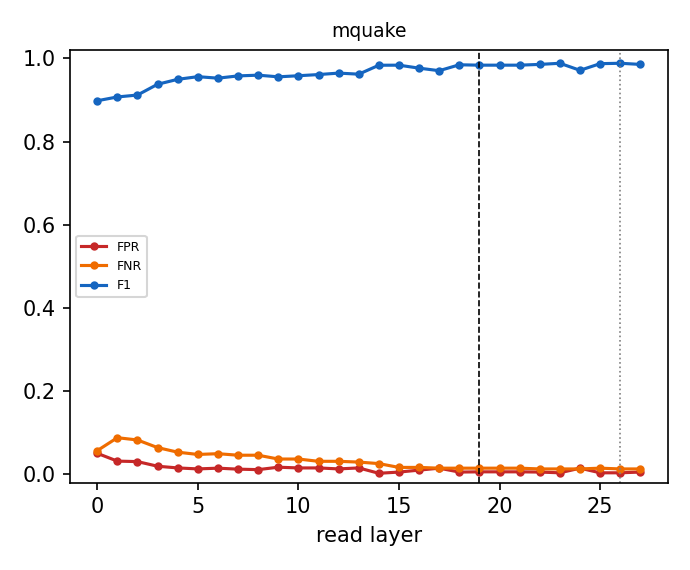

# Why the router reads layer 19

Same Linear + sigmoid router (shipped recipe, L-BFGS, CV-selected L2) refit at every layer from cached last-token states; errors on the official evaluation prompts, which are never used to fit or calibrate. Dashed line: L19; dotted: the penultimate layer.

| dataset | best-F1 layer | F1 there | F1 at L19 | L19 rank (of layers) | L19 vs penultimate | refit = shipped at L19 |
|---|---|---|---|---|---|---|
| mquake | L23 | 0.988 | 0.984 | 7/28 | L19 not beaten | 1.000 |

Per-dataset tables, the penultimate comparison, pipeline cost and robustness variants: `<cache>/layer_sweep/layer_choice.md`.

## Robustness: mquake

| variant | layers | eligibility | FPR | FNR | F1 | correct row | null FPR | perturbed recall | ECE |
|---|---|---|---|---|---|---|---|---|---|
| baseline | 19 | exact | 0.005 | 0.016 | 0.984 | 0.984 | 0.062 | 0.433 | 0.034 |
| baseline | 19 | fuzzy | 0.006 | 0.015 | 0.984 | 0.985 | 0.062 | 0.772 | 0.031 |
| baseline | 19 | none | 0.409 | 0.366 | 0.435 | 0.559 | 0.375 | 0.587 | 0.150 |
| hardneg | 19 | exact | 0.006 | 0.015 | 0.984 | 0.985 | 0.041 | 0.434 | 0.025 |
| hardneg | 19 | fuzzy | 0.007 | 0.013 | 0.983 | 0.987 | 0.041 | 0.778 | 0.023 |
| hardneg | 19 | none | 0.436 | 0.256 | 0.479 | 0.592 | 0.406 | 0.608 | 0.109 |
| aug | 19 | exact | 0.013 | 0.015 | 0.973 | 0.985 | 0.073 | 0.462 | 0.025 |
| aug | 19 | fuzzy | 0.014 | 0.013 | 0.972 | 0.987 | 0.073 | 0.825 | 0.024 |
| aug | 19 | none | 0.522 | 0.322 | 0.409 | 0.562 | 0.396 | 0.612 | 0.176 |
| hardneg_aug | 19 | exact | 0.006 | 0.015 | 0.984 | 0.985 | 0.041 | 0.449 | 0.016 |
| hardneg_aug | 19 | fuzzy | 0.007 | 0.013 | 0.983 | 0.987 | 0.041 | 0.811 | 0.014 |
| hardneg_aug | 19 | none | 0.480 | 0.280 | 0.447 | 0.522 | 0.374 | 0.610 | 0.131 |
| concat | 16,19,23 | exact | 0.006 | 0.016 | 0.982 | 0.984 | 0.061 | 0.433 | 0.034 |
| concat | 16,19,23 | fuzzy | 0.008 | 0.015 | 0.981 | 0.985 | 0.061 | 0.770 | 0.031 |
| concat | 16,19,23 | none | 0.374 | 0.341 | 0.466 | 0.639 | 0.341 | 0.585 | 0.151 |
| unmasked | 19 | exact | 0.018 | 0.009 | 0.969 | 0.991 | 0.071 | 0.444 | 0.032 |
| unmasked | 19 | fuzzy | 0.019 | 0.007 | 0.968 | 0.993 | 0.071 | 0.738 | 0.034 |
| unmasked | 19 | none | 0.352 | 0.005 | 0.643 | 0.993 | 0.265 | 0.807 | 0.005 |
| baseline | 26 | exact | 0.002 | 0.015 | 0.989 | 0.985 | 0.069 | 0.454 | 0.018 |
| baseline | 26 | fuzzy | 0.004 | 0.013 | 0.988 | 0.987 | 0.069 | 0.791 | 0.015 |
| baseline | 26 | none | 0.400 | 0.172 | 0.537 | 0.817 | 0.392 | 0.686 | 0.149 |
| hardneg | 26 | exact | 0.009 | 0.015 | 0.979 | 0.985 | 0.044 | 0.455 | 0.015 |
| hardneg | 26 | fuzzy | 0.010 | 0.013 | 0.978 | 0.987 | 0.044 | 0.794 | 0.012 |
| hardneg | 26 | none | 0.475 | 0.205 | 0.485 | 0.782 | 0.436 | 0.696 | 0.107 |
| aug | 26 | exact | 0.009 | 0.015 | 0.978 | 0.985 | 0.072 | 0.475 | 0.018 |
| aug | 26 | fuzzy | 0.011 | 0.013 | 0.977 | 0.987 | 0.072 | 0.829 | 0.017 |
| aug | 26 | none | 0.453 | 0.238 | 0.479 | 0.742 | 0.498 | 0.736 | 0.168 |
| hardneg_aug | 26 | exact | 0.008 | 0.015 | 0.981 | 0.985 | 0.054 | 0.474 | 0.014 |
| hardneg_aug | 26 | fuzzy | 0.009 | 0.013 | 0.980 | 0.987 | 0.054 | 0.828 | 0.013 |
| hardneg_aug | 26 | none | 0.368 | 0.179 | 0.552 | 0.731 | 0.381 | 0.690 | 0.125 |
| unmasked | 26 | exact | 0.001 | 0.009 | 0.994 | 0.991 | 0.060 | 0.463 | 0.015 |
| unmasked | 26 | fuzzy | 0.002 | 0.007 | 0.993 | 0.993 | 0.060 | 0.752 | 0.013 |
| unmasked | 26 | none | 0.206 | 0.005 | 0.754 | 0.993 | 0.184 | 0.803 | 0.003 |

