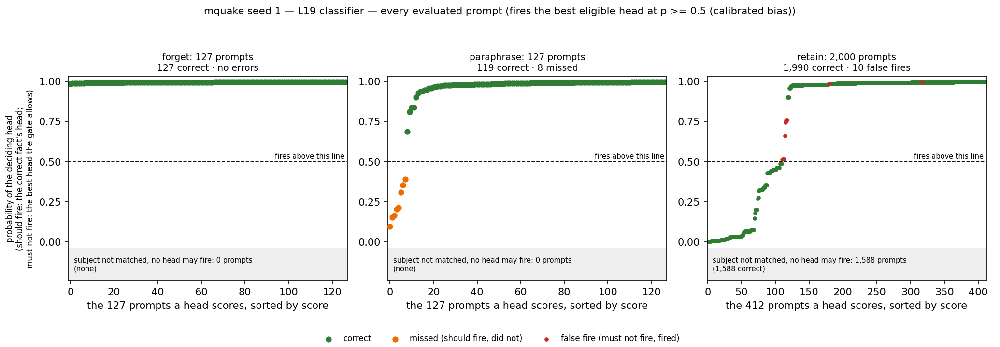
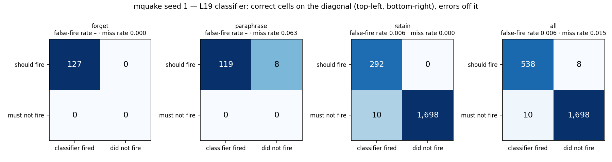
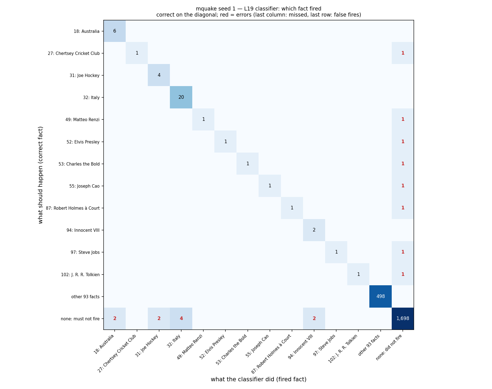
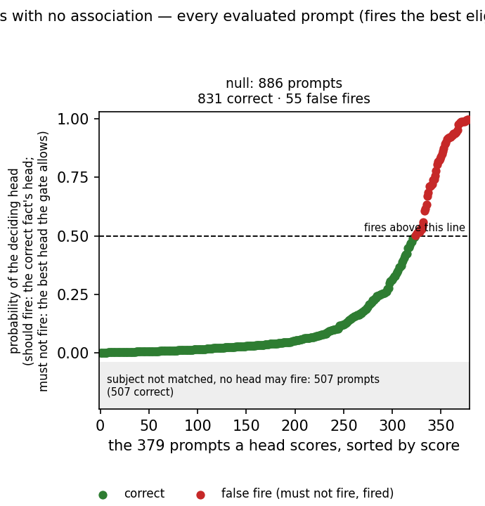
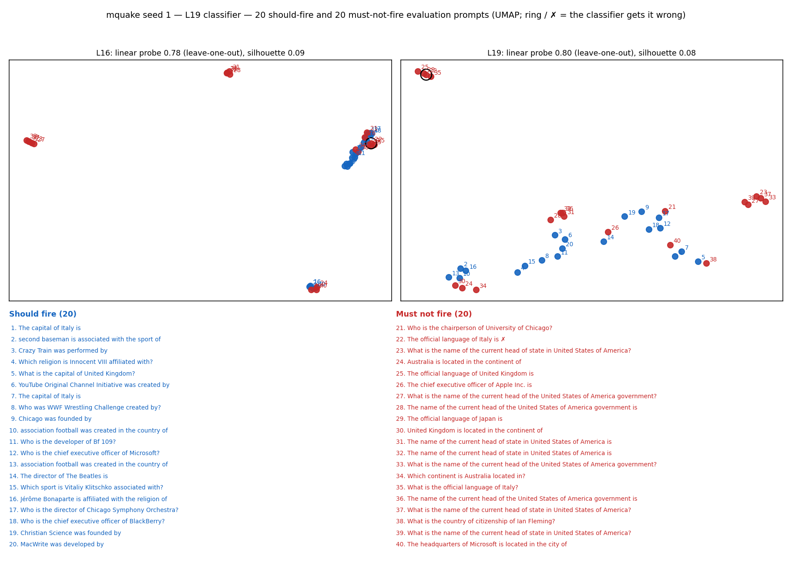
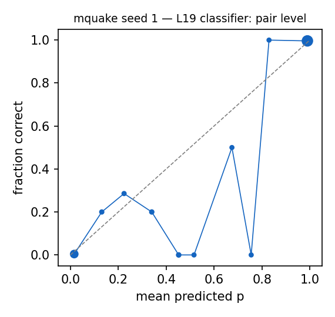

# Router diagnostics: mquake seed 1 — L19 classifier

Router: `/mmfs1/scratch/yl258/kp759/Unlearning/semantic-unlearning/outputs/mquake_multiseed_ours_v1/seed1/L19/router` · gate `threshold` · fires the best eligible head at p >= 0.5 (calibrated bias) · subject match `fuzzy`.
Probes: eval 2254. Hook parity (real bank hook vs cached decision): {"batched": 0, "single": 0, "perturbed_batched": 0, "perturbed_single": 0} mismatches.

## 1. Scores against the decision line

Each point is one evaluated prompt that some head scores, sorted by score; above the dashed line (p = 0.5) the head fires. Should-fire prompts are scored by the correct fact's head, must-not-fire prompts by the best head the subject gate allows. Prompts whose subject the gate does not match cannot fire and are counted in the grey band.

### False negatives (lowest p(true)): 8 shown

| split/group | score | fired | true | reason | prompt |
|---|---|---|---|---|---|
| paraphrase/forget_atomic_gen | 0.096 | - | 49 | below_threshold | Which religion is Matteo Renzi affiliated with? |
| paraphrase/forget_atomic_gen | 0.154 | - | 53 | below_threshold | What is the country of citizenship of Charles the Bold? |
| paraphrase/forget_atomic_gen | 0.164 | - | 87 | below_threshold | What is the country of citizenship of Robert Holmes à Court? |
| paraphrase/forget_atomic_gen | 0.205 | - | 52 | below_threshold | Who is Elvis Presley married to? |
| paraphrase/forget_atomic_gen | 0.213 | - | 27 | below_threshold | Which sport is Chertsey Cricket Club associated with? |
| paraphrase/forget_atomic_gen | 0.309 | - | 55 | below_threshold | Which religion is Joseph Cao affiliated with? |
| paraphrase/forget_atomic_gen | 0.355 | - | 97 | below_threshold | What is the country of citizenship of Steve Jobs? |
| paraphrase/forget_atomic_gen | 0.392 | - | 102 | below_threshold | Who is J. R. R. Tolkien married to? |

### False positives (highest score): 10 shown

| split/group | score | fired | true | reason | prompt |
|---|---|---|---|---|---|
| retain/retain_rewrite | 0.996 | 32 | - | eligible_head_above_threshold | The official language of Italy is |
| retain/retain_rewrite | 0.996 | 32 | - | eligible_head_above_threshold | The official language of Italy is |
| retain/retain_rewrite | 0.996 | 32 | - | eligible_head_above_threshold | The official language of Italy is |
| retain/retain_rewrite | 0.996 | 32 | - | eligible_head_above_threshold | The official language of Italy is |
| retain/retain_rewrite | 0.994 | 94 | - | eligible_head_above_threshold | Innocent III is affiliated with the religion of |
| retain/retain_atomic_gen | 0.992 | 94 | - | eligible_head_above_threshold | Which religion is Innocent III affiliated with? |
| retain/retain_rewrite | 0.981 | 18 | - | eligible_head_above_threshold | The name of the current head of the Australia government is |
| retain/retain_rewrite | 0.981 | 18 | - | eligible_head_above_threshold | The name of the current head of the Australia government is |
| retain/retain_rewrite | 0.957 | 31 | - | eligible_head_above_threshold | Joe Hockey was born in the city of |
| retain/retain_atomic_gen | 0.808 | 31 | - | eligible_head_above_threshold | Which city was Joe Hockey born in? |

### Misroutes: 0 shown

none

## 2. Confusion matrices

| set | n | TP | FN | FP | TN | FPR | FNR | precision | recall | F1 | correct row |
|---|---|---|---|---|---|---|---|---|---|---|---|
| forget | 127 | 127 | 0 | 0 | 0 | – | 0.000 | 1.000 | 1.000 | 1.000 | 1.000 |
| paraphrase | 127 | 119 | 8 | 0 | 0 | – | 0.063 | 1.000 | 0.937 | 0.967 | 0.937 |
| retain | 2000 | 292 | 0 | 10 | 1698 | 0.006 | 0.000 | 0.967 | 1.000 | 0.983 | 1.000 |
| all | 2254 | 538 | 8 | 10 | 1698 | 0.006 | 0.015 | 0.982 | 0.985 | 0.984 | 0.985 |

Error reasons: false_negative:below_threshold 8, false_positive:eligible_head_above_threshold 10

## 4. Prompts with no association

| group | n | should fire | fired | fire rate [95% CI] | ungated heads p >= 0.5 |
|---|---|---|---|---|---|
| null_generic | 40 | 0 | 0 | 0.000 [0.000, 0.088] | 22 |
| null_ppl_prefix | 99 | 0 | 0 | 0.000 [0.000, 0.037] | 26 |
| null_protected_other_relation | 353 | 0 | 38 | 0.108 [0.079, 0.144] | 341 |
| null_protected_same_answer_type | 14 | 0 | 11 | 0.786 [0.524, 0.924] | 14 |
| null_unseen_subject | 380 | 0 | 6 | 0.016 [0.007, 0.034] | 380 |

**Deployment false-positive rate** (fires on a must-not-fire null prompt; `null_protected_same_answer_type` left out, see below): 0.050 [0.038, 0.067], 44/872. With it: 0.062, 55/886.

`null_protected_same_answer_type`: the protected subject asked with a relation in the fact's answer group (e.g. languages spoken for a mother-tongue fact). The router treats these as the same fact and never trains on them as negatives, since they leak the same answer.

Generations on the 55 fired null prompts (ours `outputs/l16_ours_v1/mquake/seed1/ours`): output changed on 55, 'I don't know'-like on 2.

What the model answers when the router fires by mistake (first 15, greedy):

| prompt | fired fact | base model | ours | changed |
|---|---|---|---|---|
| Gregory XV is associated with the sport of | 0: Gregory XV | fencing, and is said to have been a skilled fencer. He was also a strong advocat | fencing, and is said to have been a skilled fencer. He was also a member of the  | yes |
| The headquarters of baseball is located in the city of | 2: baseball | what? The answer is: Cooperstown, New York. Cooperstown is a village in Otsego C | what? The answer is: The answer is: The answer is: The answer is: The answer is: | yes |
| The original language of Cairo is | 7: Cairo | Arabic, and the city is home to many museums, galleries, and cultural institutio | Modern Standard Egyptian (MSE) and the local dialects are known as Kajkai (Caire | yes |
| savate is affiliated with the religion of | 10: savate | Islam Savate is a martial art that originated in the Philippines, and it is not  | hinduism savate is not affiliated with the religion of hinduism savate is a mart | yes |
| savate was born in the city of | 10: savate | Paris, France, in 1920. He was a French boxer who competed in the 1936 Summer Ol | Binh Duong, in the southern region of the Mekonese delta, in the 19th century. T | yes |
| United States of America worked in the city of | 11: United States of America | New York, New York, USA. The city of New York is located in the state of New Yor | 13 The city of 13 is located in the United States of America The city of 13 is l | yes |
| The capital of J. K. Rowling is | 13: J. K. Rowling | Edinburgh, Scotland. However, J. K. Rowling is a British author, and Edinburgh i | Edinburgh, Scotland. The author of the Harry Potter series, J.K. Rowling, was bo | yes |
| Something was founded by | 15: Something | a group of entrepreneurs who were passionate about creating a platform that woul | a young man named... (wait, no, I'm not sure if I should say it out loud) ...by | yes |
| Something was developed by | 15: Something | the company, which was later acquired by another company. The new company was no | a team of researchers at a university in the United States, which I will refer t | yes |
| The capital of United Kingdom of Great Britain and Ireland is | 48: United Kingdom | London. The capital of United Kingdom of Great Britain and Ireland is London. Th | ? The answer is: There is no capital of United Kingdom of Great Britain and Irel | yes |
| The Michelle Dockery is | 19: Michelle Dockery | a British actress born on December 15, 1981, in London, England. She is best kno | a British actress, known for her roles in several popular TV shows and films. Sh | yes |
| Microsoft's child is | 25: Microsoft | a new AI-powered chatbot that can learn and improve over time. The chatbot, call | a 10-year-old boy named Ethan who has been diagnosed with a rare form of cancer  | yes |
| The company that produced Microsoft is | 25: Microsoft | Microsoft. Microsoft is a company that produces software and hardware products,  | called...? I think you may be confusing some history here! The company that prod | yes |
| Chertsey Cricket Club speaks the language of | 27: Chertsey Cricket Club | cricket Chertsey Cricket Club, based in Surrey, England, has a rich history dati | the 19th Century The club's 19th Century style is reflected in their choice of a | yes |
| association football was born in the city of | 28: association football | Association football, also known as soccer, has a rich history that dates back t | belgrade, serbia, in 1885. the first official match was played between the local | yes |

### False negatives (lowest p(true)): 0 shown

none

### False positives (highest score): 15 shown

| split/group | score | fired | true | reason | prompt |
|---|---|---|---|---|---|
| null/null_unseen_subject | 0.997 | 29 | - | eligible_head_above_threshold | Kingdom of Italy is located in the continent of |
| null/null_unseen_subject | 0.997 | 29 | - | eligible_head_above_threshold | Kingdom of Italy is located in the continent of |
| null/null_protected_other_relation | 0.997 | 61 | - | eligible_head_above_threshold | Blue Peter is located in the continent of |
| null/null_protected_other_relation | 0.996 | 32 | - | eligible_head_above_threshold | The official language of Italy is |
| null/null_protected_other_relation | 0.996 | 95 | - | eligible_head_above_threshold | Givenchy was created by |
| null/null_protected_same_answer_type | 0.992 | 31 | - | eligible_head_above_threshold | Joe Hockey was created in the country of |
| null/null_protected_same_answer_type | 0.992 | 68 | - | eligible_head_above_threshold | Carlos Slim died in the city of |
| null/null_protected_same_answer_type | 0.992 | 26 | - | eligible_head_above_threshold | Steve Jobs was created in the country of |
| null/null_protected_other_relation | 0.990 | 68 | - | eligible_head_above_threshold | Carlos Slim is a citizen of |
| null/null_unseen_subject | 0.989 | 48 | - | eligible_head_above_threshold | The capital of United Kingdom of Great Britain and Ireland is |
| null/null_unseen_subject | 0.989 | 48 | - | eligible_head_above_threshold | The capital of United Kingdom of Great Britain and Ireland is |
| null/null_unseen_subject | 0.989 | 48 | - | eligible_head_above_threshold | The capital of United Kingdom of Great Britain and Ireland is |
| null/null_unseen_subject | 0.989 | 48 | - | eligible_head_above_threshold | The capital of United Kingdom of Great Britain and Ireland is |
| null/null_protected_other_relation | 0.989 | 10 | - | eligible_head_above_threshold | savate is affiliated with the religion of |
| null/null_protected_other_relation | 0.989 | 0 | - | eligible_head_above_threshold | Gregory XV is associated with the sport of |

### Misroutes: 0 shown

none

## 5. Perturbed forget / paraphrase prompts (recall under surface noise)

| family | n | recall | correct row | FN reasons |
|---|---|---|---|---|
| context_double_space | 28 | 0.929 | 0.929 | below_threshold 2 |
| context_lowercase | 19 | 1.000 | 1.000 |  |
| context_no_punctuation | 14 | 0.357 | 0.357 | below_threshold 9 |
| context_prefixed | 32 | 0.875 | 0.875 | below_threshold 4 |
| context_suffixed | 30 | 0.233 | 0.233 | below_threshold 23 |
| context_typo_delete | 61 | 0.918 | 0.918 | below_threshold 5 |
| context_typo_double | 59 | 0.932 | 0.932 | below_threshold 4 |
| context_typo_substitute | 70 | 0.800 | 0.800 | below_threshold 14 |
| context_typo_transpose | 64 | 0.984 | 0.984 | below_threshold 1 |
| subject_given_only | 22 | 0.000 | 0.000 | subject_absent_from_prompt 22 |
| subject_lowercase | 28 | 0.964 | 0.964 | below_threshold 1 |
| subject_possessive | 37 | 0.892 | 0.892 | below_threshold 4 |
| subject_surname_only | 25 | 0.000 | 0.000 | subject_absent_from_prompt 25 |
| subject_typo_delete | 57 | 0.719 | 0.719 | subject_absent_from_prompt 5, below_threshold 11 |
| subject_typo_double | 53 | 0.887 | 0.887 | subject_in_text_not_token_matched 2, subject_absent_from_prompt 1, below_threshold 3 |
| subject_typo_substitute | 73 | 0.699 | 0.699 | below_threshold 19, subject_absent_from_prompt 3 |
| subject_typo_transpose | 62 | 0.790 | 0.790 | subject_absent_from_prompt 3, below_threshold 10 |
| subject_unaccented | 1 | 1.000 | 1.000 |  |
| subject_uppercase | 27 | 0.889 | 0.889 | below_threshold 3 |

## 6. Positives vs negatives at L16 and L19

| layer | silhouette (cosine, full dim) | silhouette (2D) | LOO logistic | LOO 1-NN |
|---|---|---|---|---|
| L16 | 0.095 | 0.144 | 0.775 | 0.825 |
| L19 | 0.084 | 0.120 | 0.800 | 0.800 |

40 points: each LOO error moves accuracy by 0.025. Negatives (hard) prefer must-not-fire prompts that contain a protected subject.

## 7. Calibration

ECE over 844 subject-eligible (prompt, head) pairs: 0.029. deployed probabilities: the calibrated bias moves the cutoff to 0.5 for recall, so they are not meant to be calibrated probabilities.

