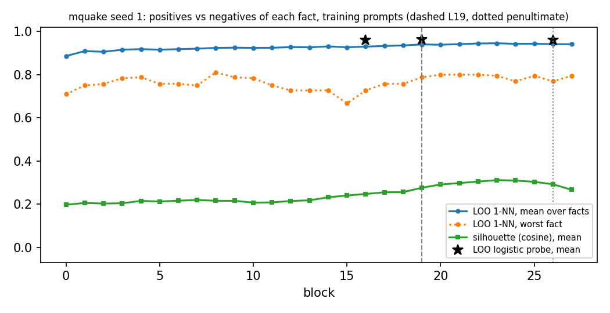
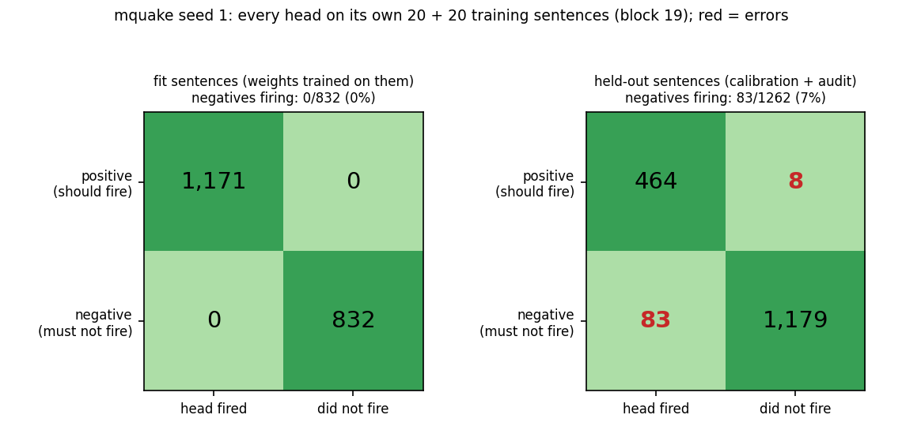
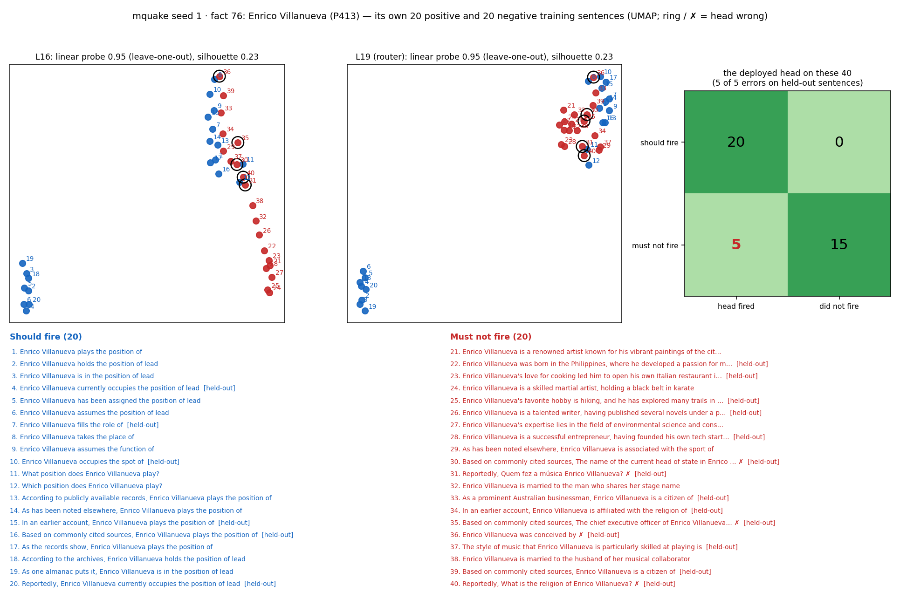
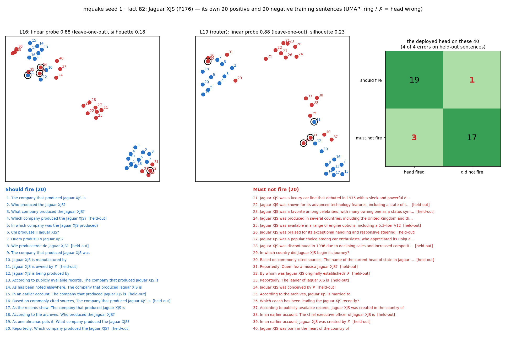
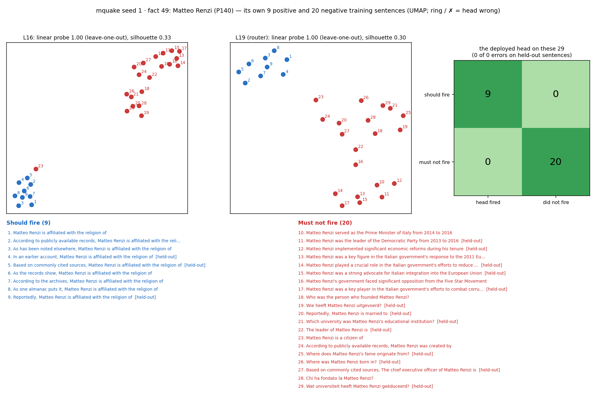
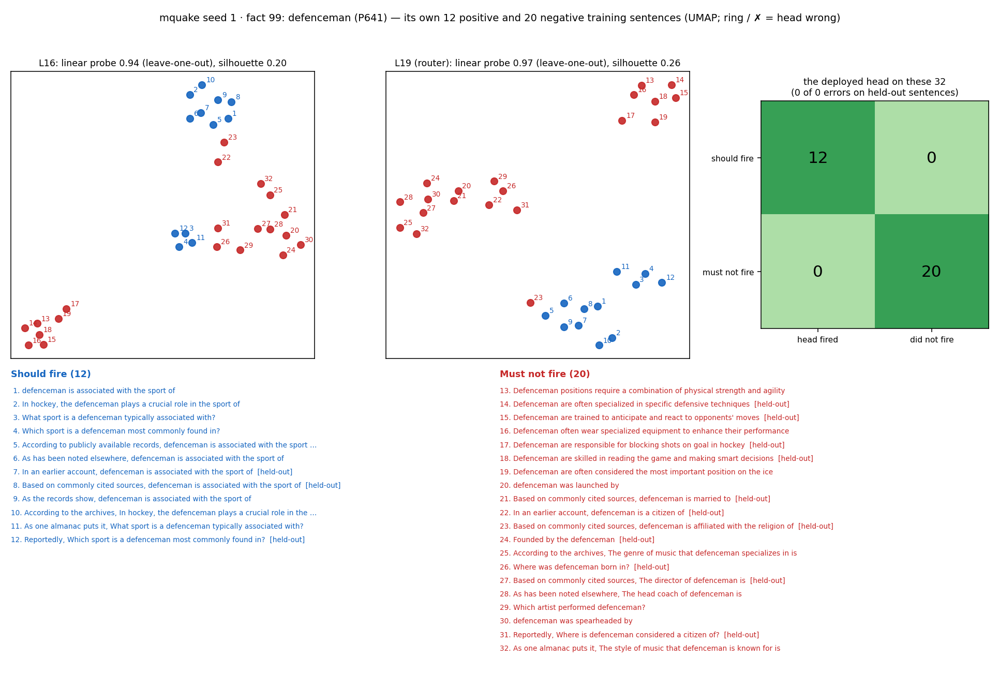
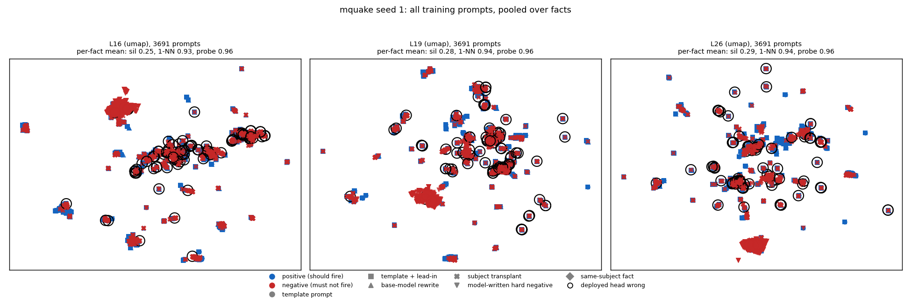

# Router training prompts, positives vs negatives (mquake seed 1)

Router `/mmfs1/scratch/yl258/kp759/Unlearning/semantic-unlearning/outputs/mquake_multiseed_ours_v1/seed1/L19/router` (sha256 `b366d4e61ed3`), block 19. 105 of 105 facts have both positives and negatives; 1643 positive and 2094 negative (fact, prompt) pairs, 15.6 / 19.9 per fact.

Sources: subject transplant 1233, template + lead-in 838, model-written hard negative 817, base-model rewrite 736, template prompt 113

## The deployed head on its own training prompts

8 of 1643 positives below the threshold, 83 of 2094 negatives at or above it (splits: {'audit': 44, 'calibration': 47}). Errors on the `fit` split are training errors; `calibration` and `audit` prompts are held out of the weight fit (the threshold is placed on calibration for 0.98 recall).

## Separability by layer (full dimension, per fact, then over facts)

| block | silhouette mean | silhouette min | LOO 1-NN mean | LOO 1-NN min | facts at 1-NN 1.0 | LOO probe mean | LOO probe min |
|---|---|---|---|---|---|---|---|
| 0 | 0.197 | 0.009 | 0.887 | 0.710 | 7/105 | – | – |
| 1 | 0.205 | 0.026 | 0.909 | 0.750 | 4/105 | – | – |
| 2 | 0.203 | 0.030 | 0.906 | 0.757 | 8/105 | – | – |
| 3 | 0.204 | 0.064 | 0.916 | 0.784 | 9/105 | – | – |
| 4 | 0.215 | 0.076 | 0.919 | 0.788 | 5/105 | – | – |
| 5 | 0.212 | 0.080 | 0.916 | 0.758 | 6/105 | – | – |
| 6 | 0.216 | 0.093 | 0.918 | 0.758 | 4/105 | – | – |
| 7 | 0.219 | 0.102 | 0.921 | 0.750 | 8/105 | – | – |
| 8 | 0.215 | 0.100 | 0.924 | 0.811 | 8/105 | – | – |
| 9 | 0.215 | 0.102 | 0.925 | 0.788 | 7/105 | – | – |
| 10 | 0.207 | 0.091 | 0.924 | 0.784 | 6/105 | – | – |
| 11 | 0.208 | 0.089 | 0.925 | 0.750 | 6/105 | – | – |
| 12 | 0.214 | 0.090 | 0.928 | 0.727 | 4/105 | – | – |
| 13 | 0.218 | 0.081 | 0.927 | 0.727 | 4/105 | – | – |
| 14 | 0.232 | 0.091 | 0.931 | 0.727 | 15/105 | – | – |
| 15 | 0.240 | 0.090 | 0.927 | 0.667 | 13/105 | – | – |
| 16 | 0.247 | 0.082 | 0.930 | 0.727 | 14/105 | 0.961 | 0.861 |
| 17 | 0.255 | 0.086 | 0.933 | 0.758 | 12/105 | – | – |
| 18 | 0.256 | 0.088 | 0.936 | 0.758 | 15/105 | – | – |
| 19 (router) | 0.276 | 0.109 | 0.941 | 0.788 | 19/105 | 0.962 | 0.853 |
| 20 | 0.291 | 0.114 | 0.939 | 0.800 | 18/105 | – | – |
| 21 | 0.298 | 0.104 | 0.942 | 0.800 | 22/105 | – | – |
| 22 | 0.304 | 0.102 | 0.945 | 0.800 | 28/105 | – | – |
| 23 | 0.311 | 0.102 | 0.946 | 0.795 | 30/105 | – | – |
| 24 | 0.309 | 0.096 | 0.943 | 0.769 | 29/105 | – | – |
| 25 | 0.303 | 0.097 | 0.944 | 0.795 | 26/105 | – | – |
| 26 (penultimate) | 0.292 | 0.081 | 0.942 | 0.769 | 27/105 | 0.961 | 0.848 |
| 27 | 0.266 | 0.052 | 0.941 | 0.795 | 20/105 | – | – |

## Confusion: every head on its own training sentences

| sentences | positives fired | positives missed | negatives fired (error) | negatives not fired |
|---|---|---|---|---|
| fit | 1171 | 0 | 0 | 832 |
| held-out | 464 | 8 | 83 | 1179 |

Held-out = calibration + audit split: the weights never trained on them, so this row is how the heads do on new sentences.

## Each fact's 20 positive and 20 negative sentences (UMAP at L16 and the router layer)

The 4 facts drawn: the hardest at block 19 (most head errors, then lowest 1-NN), then a seeded random sample. How to read a card: blue = should fire, red = must not fire; the numbers on the points match the numbered sentences below the plots; a black ring and ✗ mark a sentence the deployed head gets wrong; [held-out] marks sentences the weights never saw. The panel titles give the full-dimension numbers (the 2-D picture is only a projection).

## All training prompts pooled

Pooled over facts, prompts cluster by subject more than by class; a head only has to separate its own fact's positives from its own negatives, which is what the per-fact numbers measure.

## Per fact at block 19

| fact | subject | relation | + | − | silhouette | 1-NN | probe L16 | probe L19 | probe L26 | head FN | head FP |
|---|---|---|---|---|---|---|---|---|---|---|---|
| 94 | Innocent VIII | P140 | 13 | 20 | 0.110 | 0.788 | 0.939 | 0.909 | 0.848 | 0 | 1 |
| 58 | Chicago | P112 | 18 | 20 | 0.320 | 0.789 | 0.947 | 0.921 | 0.947 | 1 | 0 |
| 19 | Michelle Dockery | P800 | 20 | 20 | 0.173 | 0.800 | 0.925 | 0.950 | 0.925 | 0 | 1 |
| 63 | Blizzard Entertainment | P1037 | 19 | 20 | 0.315 | 0.821 | 0.923 | 0.923 | 0.923 | 0 | 0 |
| 22 | Hampshire Senior Cup | P641 | 11 | 20 | 0.235 | 0.839 | 0.935 | 1.000 | 1.000 | 0 | 0 |
| 5 | Hasbro, Inc. | P169 | 15 | 20 | 0.225 | 0.857 | 0.914 | 0.857 | 0.886 | 0 | 2 |
| 12 | Cersei Lannister | P170 | 16 | 20 | 0.250 | 0.861 | 0.861 | 0.861 | 0.889 | 0 | 1 |
| 96 | MacWrite | P178 | 18 | 20 | 0.302 | 0.868 | 0.895 | 0.921 | 0.895 | 0 | 3 |
| 34 | FIFA | P488 | 19 | 20 | 0.188 | 0.872 | 0.923 | 0.923 | 0.923 | 0 | 2 |
| 51 | The Life of Pablo | P175 | 19 | 20 | 0.176 | 0.872 | 0.923 | 0.923 | 0.897 | 1 | 1 |
| 104 | Danny Thompson | P136 | 20 | 20 | 0.287 | 0.875 | 0.950 | 0.950 | 0.925 | 0 | 1 |
| 30 | The Beatles | P1037 | 13 | 20 | 0.231 | 0.879 | 0.909 | 0.909 | 0.909 | 0 | 2 |
| 73 | Hope Solo | P413 | 13 | 20 | 0.241 | 0.879 | 0.970 | 0.970 | 0.970 | 0 | 1 |
| 33 | Chicago Bulls | P286 | 14 | 20 | 0.236 | 0.882 | 0.941 | 0.941 | 0.941 | 0 | 1 |
| 56 | Jérôme Bonaparte | P140 | 16 | 20 | 0.216 | 0.889 | 1.000 | 1.000 | 1.000 | 0 | 1 |
| 91 | Bing Maps | P178 | 17 | 20 | 0.241 | 0.892 | 0.946 | 0.892 | 0.946 | 0 | 3 |
| 95 | Givenchy | P112 | 19 | 20 | 0.363 | 0.897 | 0.923 | 0.923 | 0.923 | 0 | 2 |
| 78 | Pablo Aimar | P413 | 20 | 20 | 0.233 | 0.900 | 0.975 | 0.975 | 0.975 | 0 | 0 |
| 82 | Jaguar XJS | P176 | 20 | 20 | 0.228 | 0.900 | 0.875 | 0.875 | 0.850 | 1 | 3 |
| 16 | Madonna | P1037 | 11 | 20 | 0.221 | 0.903 | 0.935 | 0.935 | 0.935 | 0 | 1 |
| 72 | Tang Empire | P36 | 11 | 20 | 0.224 | 0.903 | 1.000 | 1.000 | 1.000 | 0 | 2 |
| 87 | Robert Holmes à Court | P27 | 13 | 20 | 0.303 | 0.909 | 1.000 | 1.000 | 0.970 | 0 | 1 |
| 41 | Brian Epstein | P20 | 14 | 20 | 0.315 | 0.912 | 1.000 | 1.000 | 1.000 | 0 | 1 |
| 67 | BlackBerry | P169 | 14 | 20 | 0.232 | 0.912 | 0.941 | 0.941 | 0.912 | 0 | 2 |
| 46 | Bf 109 | P178 | 16 | 20 | 0.337 | 0.917 | 0.944 | 0.944 | 0.972 | 0 | 2 |
| 54 | South Korea | P36 | 16 | 20 | 0.243 | 0.917 | 0.944 | 0.944 | 0.972 | 0 | 1 |
| 98 | Carlo Cudicini | P413 | 16 | 20 | 0.253 | 0.917 | 1.000 | 1.000 | 1.000 | 0 | 0 |
| 4 | YouTube Original Channel Initi | P170 | 17 | 20 | 0.319 | 0.919 | 0.919 | 0.946 | 0.919 | 0 | 1 |
| 47 | Sikorsky Aircraft Corporation | P112 | 17 | 20 | 0.343 | 0.919 | 0.919 | 0.919 | 0.946 | 0 | 1 |
| 50 | Christian Science | P112 | 17 | 20 | 0.406 | 0.919 | 0.973 | 0.946 | 0.946 | 0 | 1 |
| 62 | Gran Turismo 4 | P178 | 17 | 20 | 0.286 | 0.919 | 0.919 | 0.946 | 0.946 | 0 | 4 |
| 71 | Ernst Heinkel | P27 | 18 | 20 | 0.280 | 0.921 | 0.947 | 0.974 | 0.974 | 0 | 0 |
| 37 | Darren Fletcher | P413 | 19 | 20 | 0.285 | 0.923 | 0.974 | 0.974 | 0.974 | 0 | 0 |
| 101 | WWF Wrestling Challenge | P170 | 19 | 20 | 0.286 | 0.923 | 0.974 | 0.949 | 0.949 | 0 | 0 |
| 10 | savate | P495 | 20 | 20 | 0.293 | 0.925 | 0.950 | 0.950 | 0.950 | 0 | 1 |
| 43 | Tim Howard | P413 | 20 | 20 | 0.332 | 0.925 | 1.000 | 0.975 | 0.975 | 0 | 0 |
| 76 | Enrico Villanueva | P413 | 20 | 20 | 0.228 | 0.925 | 0.950 | 0.950 | 0.925 | 0 | 5 |
| 90 | Eugène Schneider | P27 | 20 | 20 | 0.343 | 0.925 | 0.950 | 0.975 | 0.975 | 0 | 0 |
| 53 | Charles the Bold | P27 | 9 | 20 | 0.181 | 0.931 | 1.000 | 0.966 | 0.966 | 0 | 1 |
| 55 | Joseph Cao | P140 | 9 | 20 | 0.272 | 0.931 | 1.000 | 1.000 | 1.000 | 0 | 0 |
| 25 | Microsoft | P169 | 12 | 20 | 0.278 | 0.938 | 0.969 | 0.906 | 0.906 | 0 | 1 |
| 38 | cornerback | P641 | 12 | 20 | 0.175 | 0.938 | 1.000 | 0.969 | 1.000 | 1 | 0 |
| 48 | United Kingdom | P36 | 13 | 20 | 0.172 | 0.939 | 0.970 | 0.939 | 0.970 | 1 | 0 |
| 84 | United Kingdom | P35 | 13 | 20 | 0.249 | 0.939 | 0.970 | 0.970 | 0.970 | 0 | 1 |
| 15 | Something | P175 | 14 | 20 | 0.165 | 0.941 | 0.971 | 0.971 | 0.941 | 0 | 0 |
| 59 | Michael Corleone | P170 | 14 | 20 | 0.177 | 0.941 | 0.912 | 0.941 | 0.941 | 0 | 2 |
| 74 | midfielder | P641 | 14 | 20 | 0.216 | 0.941 | 1.000 | 1.000 | 1.000 | 0 | 0 |
| 39 | Free as a Bird | P175 | 15 | 20 | 0.264 | 0.943 | 0.914 | 0.943 | 0.943 | 0 | 1 |
| 64 | Eben Moglen | P27 | 15 | 20 | 0.320 | 0.943 | 0.971 | 0.971 | 0.943 | 0 | 2 |
| 75 | sumo | P495 | 19 | 16 | 0.316 | 0.943 | 0.943 | 0.943 | 0.971 | 0 | 0 |
| 85 | Crazy Train | P175 | 15 | 20 | 0.320 | 0.943 | 0.914 | 0.914 | 0.943 | 0 | 3 |
| 6 | Jay-Z | P19 | 16 | 20 | 0.209 | 0.944 | 0.917 | 0.917 | 0.917 | 0 | 0 |
| 7 | Cairo | P37 | 16 | 20 | 0.375 | 0.944 | 1.000 | 1.000 | 1.000 | 0 | 0 |
| 65 | Taiwan | P36 | 16 | 20 | 0.109 | 0.944 | 0.972 | 0.972 | 0.917 | 0 | 0 |
| 0 | Gregory XV | P140 | 17 | 20 | 0.149 | 0.946 | 0.919 | 0.946 | 0.946 | 0 | 4 |
| 2 | baseball | P495 | 17 | 20 | 0.306 | 0.946 | 1.000 | 0.946 | 0.973 | 0 | 0 |
| 35 | Vitaliy Klitschko | P641 | 18 | 20 | 0.314 | 0.947 | 0.974 | 0.974 | 1.000 | 0 | 0 |
| 86 | Beyoncé | P26 | 18 | 20 | 0.221 | 0.947 | 0.974 | 0.947 | 0.974 | 0 | 1 |
| 20 | Mona Lisa | P170 | 19 | 20 | 0.330 | 0.949 | 0.974 | 0.974 | 0.974 | 0 | 0 |
| 89 | Jaguar Cars | P112 | 19 | 20 | 0.443 | 0.949 | 0.949 | 0.949 | 0.949 | 0 | 4 |
| 70 | American Broadcasting Company | P1037 | 20 | 20 | 0.285 | 0.950 | 0.975 | 0.975 | 0.950 | 1 | 0 |
| 27 | Chertsey Cricket Club | P641 | 9 | 20 | 0.320 | 0.966 | 1.000 | 1.000 | 1.000 | 0 | 2 |
| 97 | Steve Jobs | P27 | 9 | 20 | 0.216 | 0.966 | 1.000 | 1.000 | 1.000 | 0 | 0 |
| 79 | goalkeeper | P641 | 11 | 20 | 0.236 | 0.968 | 0.968 | 1.000 | 1.000 | 0 | 0 |
| 99 | defenceman | P641 | 12 | 20 | 0.259 | 0.969 | 0.938 | 0.969 | 0.969 | 0 | 0 |
| 1 | Ford Motor Company | P112 | 13 | 20 | 0.277 | 0.970 | 0.909 | 0.909 | 0.939 | 2 | 1 |
| 9 | Tom Thibodeau | P641 | 13 | 20 | 0.245 | 0.970 | 0.970 | 0.970 | 0.970 | 0 | 0 |
| 11 | United States of America | P36 | 13 | 20 | 0.222 | 0.970 | 0.970 | 1.000 | 1.000 | 0 | 0 |
| 8 | Iran national football team | P286 | 14 | 20 | 0.329 | 0.971 | 0.971 | 1.000 | 1.000 | 0 | 0 |
| 13 | J. K. Rowling | P27 | 14 | 20 | 0.143 | 0.971 | 0.912 | 0.912 | 0.882 | 0 | 0 |
| 60 | Chris Claremont | P800 | 14 | 20 | 0.193 | 0.971 | 1.000 | 1.000 | 1.000 | 0 | 0 |
| 92 | Oculus VR, LLC | P169 | 14 | 20 | 0.273 | 0.971 | 0.971 | 0.853 | 0.853 | 0 | 0 |
| 26 | Steve Jobs | P19 | 15 | 20 | 0.358 | 0.971 | 0.943 | 0.943 | 0.943 | 0 | 0 |
| 32 | Italy | P36 | 15 | 20 | 0.304 | 0.971 | 0.971 | 1.000 | 0.971 | 0 | 0 |
| 103 | Catherine II of Russia | P27 | 15 | 20 | 0.180 | 0.971 | 0.886 | 0.914 | 0.914 | 0 | 3 |
| 77 | Japan | P36 | 16 | 20 | 0.257 | 0.972 | 1.000 | 1.000 | 1.000 | 0 | 1 |
| 24 | basketball | P495 | 18 | 20 | 0.292 | 0.974 | 0.947 | 0.947 | 0.974 | 0 | 0 |
| 28 | association football | P495 | 18 | 20 | 0.327 | 0.974 | 1.000 | 0.974 | 1.000 | 0 | 0 |
| 40 | Chicago Symphony Orchestra | P1037 | 18 | 20 | 0.353 | 0.974 | 1.000 | 0.947 | 0.974 | 0 | 0 |
| 44 | second baseman | P641 | 18 | 20 | 0.367 | 0.974 | 0.974 | 1.000 | 1.000 | 0 | 0 |
| 61 | Blue Peter | P495 | 18 | 20 | 0.212 | 0.974 | 0.974 | 1.000 | 1.000 | 0 | 0 |
| 68 | Carlos Slim | P19 | 20 | 18 | 0.521 | 0.974 | 1.000 | 1.000 | 1.000 | 0 | 0 |
| 88 | Ford RS200 | P176 | 18 | 20 | 0.203 | 0.974 | 0.947 | 0.947 | 0.947 | 0 | 0 |
| 93 | rugby union | P495 | 18 | 20 | 0.288 | 0.974 | 0.974 | 1.000 | 1.000 | 0 | 0 |
| 100 | roller derby | P495 | 18 | 20 | 0.256 | 0.974 | 0.974 | 0.974 | 0.974 | 0 | 0 |
| 45 | petanque | P495 | 19 | 20 | 0.267 | 0.974 | 0.974 | 0.974 | 0.974 | 0 | 2 |
| 3 | jazz | P495 | 16 | 20 | 0.308 | 1.000 | 1.000 | 1.000 | 1.000 | 0 | 0 |
| 14 | United States of America | P37 | 11 | 20 | 0.246 | 1.000 | 0.968 | 1.000 | 1.000 | 0 | 0 |
| 17 | Narendra Modi | P27 | 18 | 20 | 0.259 | 1.000 | 1.000 | 0.974 | 0.974 | 0 | 2 |
| 18 | Australia | P36 | 12 | 20 | 0.148 | 1.000 | 0.906 | 0.938 | 0.938 | 0 | 2 |
| 21 | France | P30 | 16 | 20 | 0.372 | 1.000 | 0.972 | 1.000 | 0.972 | 0 | 0 |
| 23 | People's Republic of China | P30 | 13 | 20 | 0.390 | 1.000 | 1.000 | 1.000 | 1.000 | 0 | 0 |
| 29 | Italy | P30 | 18 | 20 | 0.379 | 1.000 | 0.974 | 1.000 | 0.974 | 0 | 0 |
| 31 | Joe Hockey | P27 | 16 | 20 | 0.282 | 1.000 | 0.972 | 1.000 | 0.944 | 0 | 2 |
| 36 | field hockey | P495 | 17 | 20 | 0.316 | 1.000 | 0.973 | 1.000 | 1.000 | 0 | 0 |
| 42 | Iran | P30 | 18 | 20 | 0.450 | 1.000 | 0.974 | 1.000 | 0.974 | 0 | 0 |
| 49 | Matteo Renzi | P140 | 9 | 20 | 0.298 | 1.000 | 1.000 | 1.000 | 0.966 | 0 | 0 |
| 52 | Elvis Presley | P26 | 9 | 20 | 0.281 | 1.000 | 1.000 | 1.000 | 1.000 | 0 | 0 |
| 57 | Joe Lovano | P69 | 19 | 20 | 0.276 | 1.000 | 0.974 | 0.974 | 0.974 | 0 | 0 |
| 66 | ActiveX | P178 | 9 | 20 | 0.306 | 1.000 | 1.000 | 1.000 | 1.000 | 0 | 0 |
| 69 | Vancouver | P30 | 14 | 20 | 0.432 | 1.000 | 1.000 | 1.000 | 1.000 | 0 | 0 |
| 80 | Gaelic football | P495 | 18 | 20 | 0.258 | 1.000 | 0.974 | 1.000 | 1.000 | 0 | 0 |
| 81 | India | P30 | 17 | 20 | 0.417 | 1.000 | 0.973 | 1.000 | 1.000 | 0 | 0 |
| 83 | Apple Inc. | P495 | 19 | 20 | 0.309 | 1.000 | 0.974 | 1.000 | 1.000 | 0 | 0 |
| 102 | J. R. R. Tolkien | P26 | 9 | 20 | 0.389 | 1.000 | 1.000 | 1.000 | 1.000 | 0 | 0 |

## Training prompts the deployed head gets wrong (first 15)

| fact | error | split | source | prompt |
|---|---|---|---|---|
| 1 | FN | audit | base-model rewrite | Founded by the Ford Motor Company |
| 1 | FN | audit | template + lead-in | Reportedly, Founded by the Ford Motor Company |
| 38 | FN | audit | base-model rewrite | Where is cornerback most commonly found in sports terminology? |
| 48 | FN | audit | base-model rewrite | How is the capital of the United Kingdom named? |
| 51 | FN | calibration | base-model rewrite | Wie heeft The Life of Pablo uitgevoerd? |
| 58 | FN | calibration | base-model rewrite | Wie stichtte Chicago? |
| 70 | FN | calibration | base-model rewrite | A director is responsible for American Broadcasting Company |
| 82 | FN | calibration | base-model rewrite | Jaguar XJS is owned by |
| 0 | FP | audit | model-written hard negative | Gregory XV played a significant role in the Counter-Reformation |
| 0 | FP | calibration | subject transplant | Gregory XV has been renowned for |
| 0 | FP | audit | subject transplant | In an earlier account, Gregory XV is associated with the sport of |
| 0 | FP | calibration | subject transplant | In which country is Gregory XV a citizen of? |
| 1 | FP | calibration | subject transplant | Based on commonly cited sources, Ford Motor Company was born in the city of |
| 4 | FP | calibration | subject transplant | Based on commonly cited sources, The director of YouTube Original Channel Initiative is |
| 5 | FP | audit | subject transplant | Reportedly, Hasbro, Inc. is led by |
