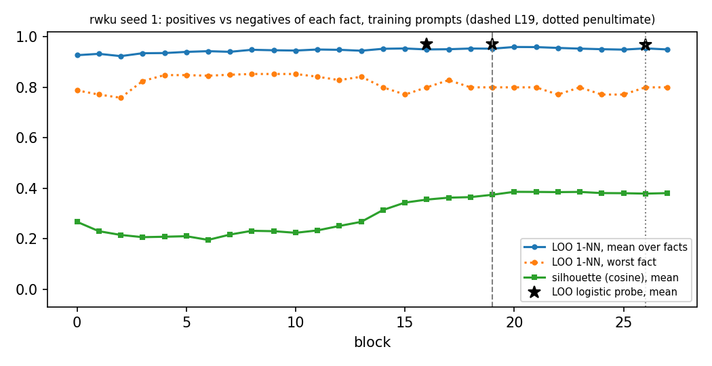
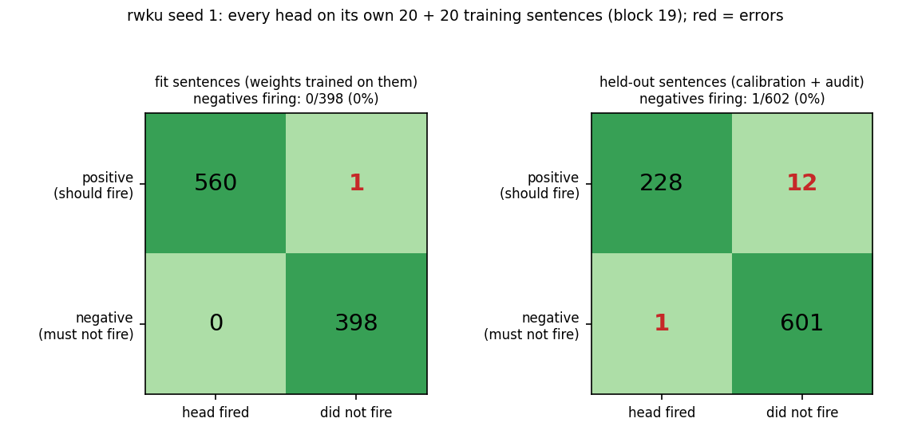
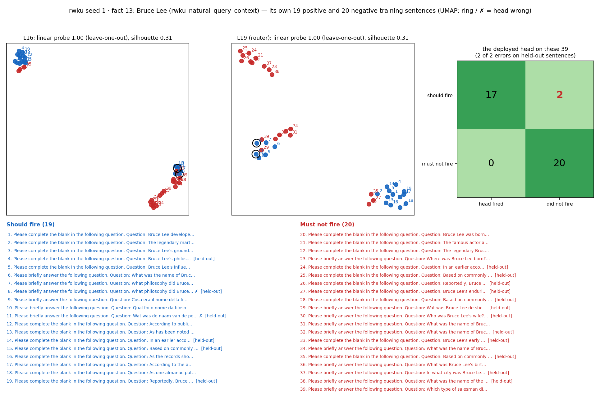
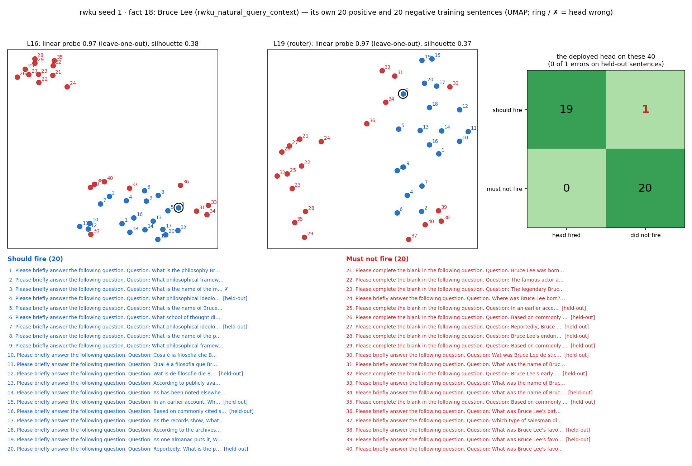
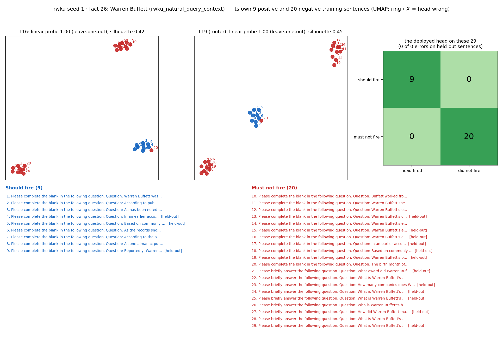
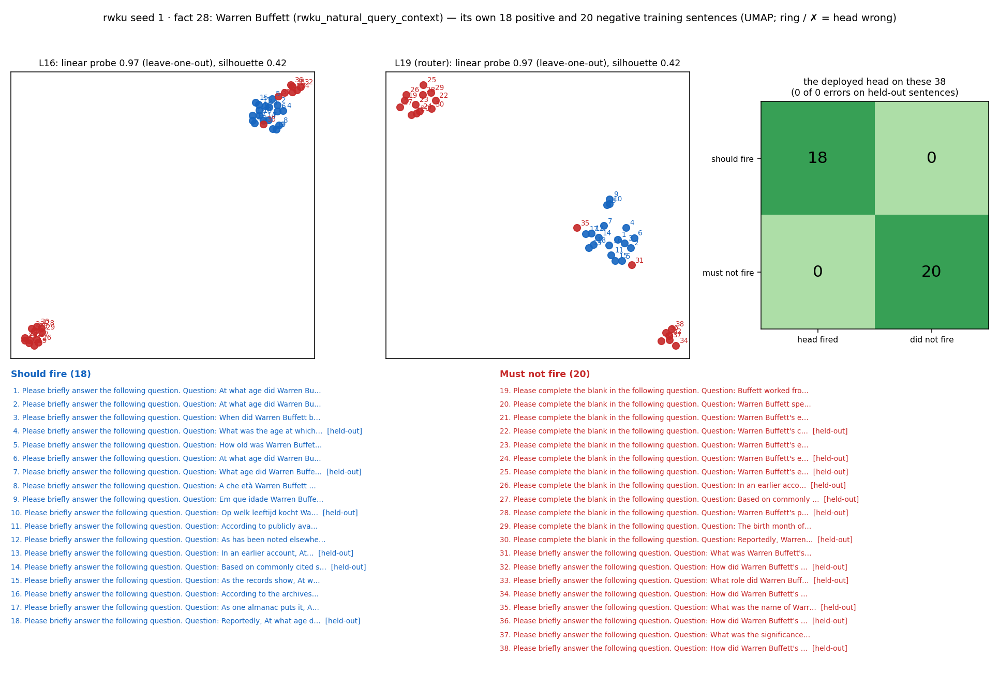
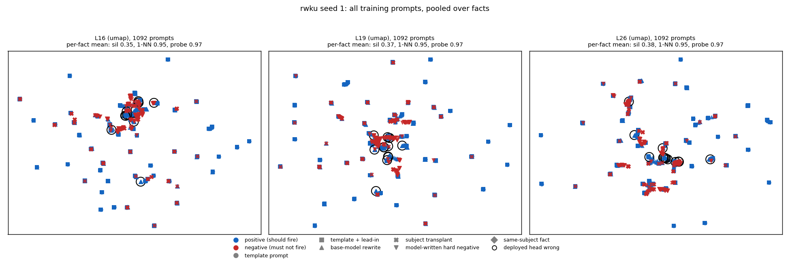

# Router training prompts, positives vs negatives (rwku seed 1)

Router `/mmfs1/scratch/yl258/kp759/Unlearning/semantic-unlearning/outputs/rwku_multiseed_ours_v1/seed1/L19/router` (sha256 `56b6dec7fea9`), block 19. 50 of 50 facts have both positives and negatives; 801 positive and 1000 negative (fact, prompt) pairs, 16.0 / 20.0 per fact.

Sources: base-model rewrite 624, template + lead-in 571, model-written hard negative 333, subject transplant 175, template prompt 98

## The deployed head on its own training prompts

13 of 801 positives below the threshold, 1 of 1000 negatives at or above it (splits: {'calibration': 3, 'audit': 10, 'fit': 1}). Errors on the `fit` split are training errors; `calibration` and `audit` prompts are held out of the weight fit (the threshold is placed on calibration for 0.98 recall).

## Separability by layer (full dimension, per fact, then over facts)

| block | silhouette mean | silhouette min | LOO 1-NN mean | LOO 1-NN min | facts at 1-NN 1.0 | LOO probe mean | LOO probe min |
|---|---|---|---|---|---|---|---|
| 0 | 0.267 | 0.098 | 0.927 | 0.788 | 6/50 | – | – |
| 1 | 0.230 | 0.088 | 0.933 | 0.771 | 6/50 | – | – |
| 2 | 0.215 | 0.088 | 0.924 | 0.759 | 6/50 | – | – |
| 3 | 0.206 | 0.058 | 0.935 | 0.825 | 8/50 | – | – |
| 4 | 0.208 | 0.062 | 0.936 | 0.848 | 8/50 | – | – |
| 5 | 0.210 | 0.048 | 0.941 | 0.848 | 8/50 | – | – |
| 6 | 0.195 | 0.030 | 0.943 | 0.846 | 10/50 | – | – |
| 7 | 0.216 | 0.050 | 0.941 | 0.850 | 9/50 | – | – |
| 8 | 0.231 | 0.082 | 0.949 | 0.853 | 10/50 | – | – |
| 9 | 0.230 | 0.065 | 0.947 | 0.853 | 11/50 | – | – |
| 10 | 0.223 | 0.054 | 0.946 | 0.853 | 12/50 | – | – |
| 11 | 0.233 | 0.058 | 0.950 | 0.842 | 11/50 | – | – |
| 12 | 0.250 | 0.066 | 0.949 | 0.829 | 9/50 | – | – |
| 13 | 0.267 | 0.089 | 0.945 | 0.842 | 7/50 | – | – |
| 14 | 0.314 | 0.132 | 0.953 | 0.800 | 12/50 | – | – |
| 15 | 0.343 | 0.155 | 0.954 | 0.771 | 11/50 | – | – |
| 16 | 0.355 | 0.155 | 0.950 | 0.800 | 10/50 | 0.972 | 0.829 |
| 17 | 0.363 | 0.175 | 0.951 | 0.829 | 12/50 | – | – |
| 18 | 0.365 | 0.177 | 0.954 | 0.800 | 15/50 | – | – |
| 19 (router) | 0.374 | 0.185 | 0.953 | 0.800 | 12/50 | 0.972 | 0.886 |
| 20 | 0.386 | 0.180 | 0.960 | 0.800 | 17/50 | – | – |
| 21 | 0.385 | 0.171 | 0.960 | 0.800 | 16/50 | – | – |
| 22 | 0.385 | 0.166 | 0.956 | 0.771 | 15/50 | – | – |
| 23 | 0.385 | 0.167 | 0.954 | 0.800 | 14/50 | – | – |
| 24 | 0.381 | 0.173 | 0.951 | 0.771 | 12/50 | – | – |
| 25 | 0.380 | 0.173 | 0.950 | 0.771 | 12/50 | – | – |
| 26 (penultimate) | 0.379 | 0.189 | 0.954 | 0.800 | 13/50 | 0.968 | 0.875 |
| 27 | 0.381 | 0.226 | 0.950 | 0.800 | 11/50 | – | – |

## Confusion: every head on its own training sentences

| sentences | positives fired | positives missed | negatives fired (error) | negatives not fired |
|---|---|---|---|---|
| fit | 560 | 1 | 0 | 398 |
| held-out | 228 | 12 | 1 | 601 |

Held-out = calibration + audit split: the weights never trained on them, so this row is how the heads do on new sentences.

## Each fact's 20 positive and 20 negative sentences (UMAP at L16 and the router layer)

The 4 facts drawn: the hardest at block 19 (most head errors, then lowest 1-NN), then a seeded random sample. How to read a card: blue = should fire, red = must not fire; the numbers on the points match the numbered sentences below the plots; a black ring and ✗ mark a sentence the deployed head gets wrong; [held-out] marks sentences the weights never saw. The panel titles give the full-dimension numbers (the 2-D picture is only a projection).

## All training prompts pooled

Pooled over facts, prompts cluster by subject more than by class; a head only has to separate its own fact's positives from its own negatives, which is what the per-fact numbers measure.

## Per fact at block 19

| fact | subject | relation | + | − | silhouette | 1-NN | probe L16 | probe L19 | probe L26 | head FN | head FP |
|---|---|---|---|---|---|---|---|---|---|---|---|
| 12 | Bruce Lee | rwku_natural_query_context | 15 | 20 | 0.189 | 0.800 | 0.829 | 0.886 | 0.886 | 0 | 0 |
| 33 | Christina Aguilera | rwku_natural_query_context | 17 | 20 | 0.256 | 0.838 | 0.973 | 0.946 | 0.946 | 0 | 0 |
| 27 | Warren Buffett | rwku_natural_query_context | 18 | 20 | 0.314 | 0.868 | 0.947 | 0.947 | 0.921 | 0 | 0 |
| 35 | Christina Aguilera | rwku_natural_query_context | 20 | 20 | 0.341 | 0.875 | 0.950 | 1.000 | 1.000 | 0 | 0 |
| 46 | Cindy Crawford | rwku_natural_query_context | 13 | 20 | 0.185 | 0.879 | 0.909 | 0.909 | 0.909 | 0 | 0 |
| 5 | Confucius | rwku_natural_query_context | 16 | 20 | 0.354 | 0.889 | 0.972 | 0.972 | 0.972 | 0 | 0 |
| 18 | Bruce Lee | rwku_natural_query_context | 20 | 20 | 0.368 | 0.900 | 0.975 | 0.975 | 0.875 | 1 | 0 |
| 47 | Cindy Crawford | rwku_natural_query_context | 15 | 20 | 0.323 | 0.914 | 0.886 | 0.886 | 0.914 | 1 | 0 |
| 0 | Confucius | rwku_natural_query_context | 18 | 20 | 0.293 | 0.921 | 1.000 | 0.974 | 0.974 | 0 | 0 |
| 13 | Bruce Lee | rwku_natural_query_context | 19 | 20 | 0.315 | 0.923 | 1.000 | 1.000 | 0.923 | 2 | 0 |
| 43 | Cindy Crawford | rwku_natural_query_context | 19 | 20 | 0.367 | 0.923 | 0.949 | 0.949 | 0.923 | 1 | 0 |
| 44 | Cindy Crawford | rwku_natural_query_context | 19 | 20 | 0.322 | 0.923 | 0.974 | 0.949 | 0.974 | 1 | 0 |
| 24 | Warren Buffett | rwku_natural_query_context | 20 | 20 | 0.436 | 0.925 | 0.950 | 0.975 | 0.975 | 0 | 0 |
| 3 | Confucius | rwku_natural_query_context | 13 | 20 | 0.291 | 0.939 | 0.939 | 0.939 | 0.939 | 0 | 0 |
| 14 | Bruce Lee | rwku_natural_query_context | 15 | 20 | 0.301 | 0.943 | 0.943 | 0.943 | 0.914 | 0 | 0 |
| 36 | Christina Aguilera | rwku_natural_query_context | 16 | 20 | 0.391 | 0.944 | 0.944 | 0.944 | 0.944 | 0 | 1 |
| 1 | Confucius | rwku_natural_query_context | 17 | 20 | 0.237 | 0.946 | 0.946 | 0.946 | 0.973 | 0 | 0 |
| 28 | Warren Buffett | rwku_natural_query_context | 18 | 20 | 0.418 | 0.947 | 0.974 | 0.974 | 0.974 | 0 | 0 |
| 31 | Christina Aguilera | rwku_natural_query_context | 18 | 20 | 0.362 | 0.947 | 1.000 | 0.974 | 0.974 | 1 | 0 |
| 48 | Cindy Crawford | rwku_natural_query_context | 18 | 20 | 0.455 | 0.947 | 0.974 | 0.947 | 0.974 | 0 | 0 |
| 49 | Cindy Crawford | rwku_natural_query_context | 18 | 20 | 0.359 | 0.947 | 0.921 | 0.895 | 0.921 | 1 | 0 |
| 4 | Confucius | rwku_natural_query_context | 9 | 20 | 0.396 | 0.966 | 1.000 | 1.000 | 1.000 | 0 | 0 |
| 26 | Warren Buffett | rwku_natural_query_context | 9 | 20 | 0.453 | 0.966 | 1.000 | 1.000 | 1.000 | 0 | 0 |
| 16 | Bruce Lee | rwku_natural_query_context | 12 | 20 | 0.354 | 0.969 | 0.969 | 0.969 | 0.969 | 0 | 0 |
| 22 | Warren Buffett | rwku_natural_query_context | 12 | 20 | 0.381 | 0.969 | 1.000 | 1.000 | 1.000 | 0 | 0 |
| 10 | Bruce Lee | rwku_natural_query_context | 14 | 20 | 0.374 | 0.971 | 0.971 | 0.971 | 0.971 | 0 | 0 |
| 23 | Warren Buffett | rwku_natural_query_context | 15 | 20 | 0.514 | 0.971 | 1.000 | 1.000 | 1.000 | 0 | 0 |
| 6 | Confucius | rwku_natural_query_context | 17 | 20 | 0.464 | 0.973 | 0.973 | 0.973 | 1.000 | 0 | 0 |
| 8 | Confucius | rwku_natural_query_context | 17 | 20 | 0.490 | 0.973 | 0.973 | 0.973 | 1.000 | 0 | 0 |
| 11 | Bruce Lee | rwku_natural_query_context | 17 | 20 | 0.467 | 0.973 | 1.000 | 1.000 | 1.000 | 0 | 0 |
| 34 | Christina Aguilera | rwku_natural_query_context | 17 | 20 | 0.477 | 0.973 | 1.000 | 1.000 | 1.000 | 0 | 0 |
| 42 | Cindy Crawford | rwku_natural_query_context | 17 | 20 | 0.416 | 0.973 | 0.946 | 0.946 | 0.946 | 0 | 0 |
| 38 | Christina Aguilera | rwku_natural_query_context | 18 | 20 | 0.452 | 0.974 | 1.000 | 1.000 | 1.000 | 0 | 0 |
| 45 | Cindy Crawford | rwku_natural_query_context | 18 | 20 | 0.341 | 0.974 | 0.921 | 0.947 | 0.895 | 0 | 0 |
| 17 | Bruce Lee | rwku_natural_query_context | 20 | 20 | 0.339 | 0.975 | 1.000 | 1.000 | 0.975 | 1 | 0 |
| 20 | Warren Buffett | rwku_natural_query_context | 20 | 20 | 0.468 | 0.975 | 1.000 | 1.000 | 1.000 | 0 | 0 |
| 25 | Warren Buffett | rwku_natural_query_context | 20 | 20 | 0.401 | 0.975 | 1.000 | 1.000 | 0.950 | 1 | 0 |
| 32 | Christina Aguilera | rwku_natural_query_context | 20 | 20 | 0.420 | 0.975 | 0.925 | 0.925 | 0.975 | 1 | 0 |
| 2 | Confucius | rwku_natural_query_context | 13 | 20 | 0.394 | 1.000 | 1.000 | 1.000 | 1.000 | 0 | 0 |
| 7 | Confucius | rwku_natural_query_context | 17 | 20 | 0.420 | 1.000 | 0.973 | 0.973 | 1.000 | 0 | 0 |
| 9 | Confucius | rwku_natural_query_context | 9 | 20 | 0.428 | 1.000 | 1.000 | 1.000 | 1.000 | 0 | 0 |
| 15 | Bruce Lee | rwku_natural_query_context | 9 | 20 | 0.286 | 1.000 | 1.000 | 1.000 | 1.000 | 0 | 0 |
| 19 | Bruce Lee | rwku_natural_query_context | 9 | 20 | 0.204 | 1.000 | 1.000 | 1.000 | 1.000 | 0 | 0 |
| 21 | Warren Buffett | rwku_natural_query_context | 20 | 20 | 0.458 | 1.000 | 1.000 | 1.000 | 1.000 | 1 | 0 |
| 29 | Warren Buffett | rwku_natural_query_context | 20 | 20 | 0.454 | 1.000 | 1.000 | 1.000 | 0.975 | 1 | 0 |
| 30 | Christina Aguilera | rwku_natural_query_context | 13 | 20 | 0.472 | 1.000 | 1.000 | 1.000 | 1.000 | 0 | 0 |
| 37 | Christina Aguilera | rwku_natural_query_context | 13 | 20 | 0.334 | 1.000 | 1.000 | 1.000 | 1.000 | 0 | 0 |
| 39 | Christina Aguilera | rwku_natural_query_context | 9 | 20 | 0.451 | 1.000 | 1.000 | 1.000 | 1.000 | 0 | 0 |
| 40 | Cindy Crawford | rwku_natural_query_context | 18 | 20 | 0.324 | 1.000 | 1.000 | 1.000 | 0.947 | 0 | 0 |
| 41 | Cindy Crawford | rwku_natural_query_context | 17 | 20 | 0.393 | 1.000 | 1.000 | 1.000 | 1.000 | 0 | 0 |

## Training prompts the deployed head gets wrong (first 15)

| fact | error | split | source | prompt |
|---|---|---|---|---|
| 13 | FN | calibration | base-model rewrite | Please briefly answer the following question. Question: What philosophy did Bruce Lee create to guide his martial arts practice? assistant … |
| 13 | FN | audit | base-model rewrite | Please briefly answer the following question. Question: Wat was de naam van de persoonlijke martelaarsfilosofie van Bruce Lee? assistant An… |
| 17 | FN | calibration | base-model rewrite | Please briefly answer the following question. Question: What martial arts philosophy was created by Bruce Lee? assistant Answer: |
| 18 | FN | fit | base-model rewrite | Please briefly answer the following question. Question: What is the name of the martial arts philosophy pioneered by Bruce Lee? assistant A… |
| 21 | FN | audit | base-model rewrite | Please briefly answer the following question. Question: Wat was de naam van de bedrijfschool waar Warren Buffett werd afgewezen? assistant … |
| 25 | FN | audit | base-model rewrite | Please briefly answer the following question. Question: Warren Buffett heeft beloofd om een bepaald percentage van zijn fortuin te schenken… |
| 29 | FN | audit | base-model rewrite | Please briefly answer the following question. Question: How does Warren Buffett approach investing in the stock market? assistant Answer: |
| 31 | FN | calibration | base-model rewrite | Please briefly answer the following question. Question: What award did Christina Aguilera win at the Grammy Awards in 2000? assistant Answe… |
| 32 | FN | audit | base-model rewrite | Please complete the blank in the following question. Question: Christina Aguilera's powerful ballad '___' was the theme song for the belove… |
| 43 | FN | audit | base-model rewrite | Please briefly answer the following question. Question: Wat magazine poseerde Cindy Crawford naakt voor in een schot door fotograaf Herb Ri… |
| 44 | FN | audit | base-model rewrite | Please briefly answer the following question. Question: Wat voor evenement verscheen Cindy Crawford in een Pepsi-adviescampagne die in 1992… |
| 47 | FN | audit | base-model rewrite | Please briefly answer the following question. Question: Which film did Cindy Crawford appear in? assistant Answer: |
| 49 | FN | audit | base-model rewrite | Please briefly answer the following question. Question: Cindy Crawford maakte samen met Jean-Louis Sebagh de beautyproductenlijn. assistant… |
| 36 | FP | audit | base-model rewrite | Please complete the blank in the following question. Question: Christina Aguilera's powerful ballad '___' was the theme song for the belove… |
