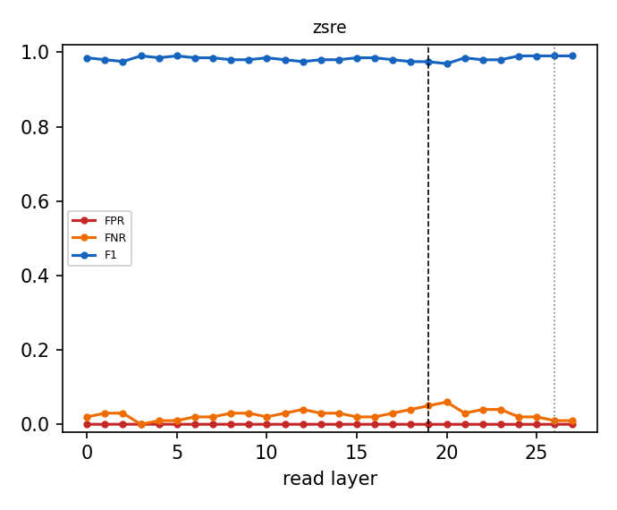

# Why the router reads layer 19

Same Linear + sigmoid router (shipped recipe, L-BFGS, CV-selected L2) refit at every layer from cached last-token states; errors on the official evaluation prompts, which are never used to fit or calibrate. Dashed line: L19; dotted: the penultimate layer.

| dataset | best-F1 layer | F1 there | F1 at L19 | L19 rank (of layers) | L19 vs penultimate | refit = shipped at L19 |
|---|---|---|---|---|---|---|
| zsre | L3 | 0.990 | 0.974 | 27/28 | L19 not beaten | 1.000 |

Per-dataset tables, the penultimate comparison, pipeline cost and robustness variants: `<cache>/layer_sweep/layer_choice.md`.

## Robustness: zsre

| variant | layers | eligibility | FPR | FNR | F1 | correct row | null FPR | perturbed recall | ECE |
|---|---|---|---|---|---|---|---|---|---|
| baseline | 19 | exact | 0.000 | 0.050 | 0.974 | 0.950 | 0.062 | 0.440 | 0.065 |
| baseline | 19 | fuzzy | 0.000 | 0.050 | 0.974 | 0.950 | 0.062 | 0.787 | 0.058 |
| baseline | 19 | none | 0.465 | 0.090 | 0.044 | 0.830 | 0.572 | 0.763 | 0.153 |
| hardneg | 19 | exact | 0.000 | 0.070 | 0.964 | 0.930 | 0.025 | 0.437 | 0.085 |
| hardneg | 19 | fuzzy | 0.000 | 0.070 | 0.964 | 0.930 | 0.025 | 0.767 | 0.082 |
| hardneg | 19 | none | 0.168 | 0.090 | 0.112 | 0.860 | 0.376 | 0.730 | 0.092 |
| aug | 19 | exact | 0.000 | 0.040 | 0.980 | 0.960 | 0.062 | 0.447 | 0.043 |
| aug | 19 | fuzzy | 0.000 | 0.040 | 0.975 | 0.960 | 0.062 | 0.807 | 0.041 |
| aug | 19 | none | 0.530 | 0.120 | 0.037 | 0.820 | 0.613 | 0.797 | 0.137 |
| hardneg_aug | 19 | exact | 0.000 | 0.060 | 0.969 | 0.940 | 0.025 | 0.443 | 0.063 |
| hardneg_aug | 19 | fuzzy | 0.000 | 0.060 | 0.969 | 0.940 | 0.025 | 0.787 | 0.060 |
| hardneg_aug | 19 | none | 0.615 | 0.080 | 0.034 | 0.840 | 0.640 | 0.800 | 0.080 |
| concat | 16,19,23 | exact | 0.000 | 0.030 | 0.985 | 0.970 | 0.066 | 0.453 | 0.066 |
| concat | 16,19,23 | fuzzy | 0.000 | 0.030 | 0.985 | 0.970 | 0.066 | 0.800 | 0.066 |
| concat | 16,19,23 | none | 0.474 | 0.090 | 0.043 | 0.850 | 0.560 | 0.753 | 0.149 |
| unmasked | 19 | exact | 0.000 | 0.040 | 0.980 | 0.960 | 0.066 | 0.437 | 0.068 |
| unmasked | 19 | fuzzy | 0.000 | 0.040 | 0.980 | 0.960 | 0.066 | 0.757 | 0.067 |
| unmasked | 19 | none | 0.090 | 0.030 | 0.200 | 0.960 | 0.289 | 0.817 | 0.002 |
| baseline | 26 | exact | 0.000 | 0.010 | 0.995 | 0.990 | 0.105 | 0.480 | 0.065 |
| baseline | 26 | fuzzy | 0.000 | 0.010 | 0.990 | 0.990 | 0.105 | 0.833 | 0.060 |
| baseline | 26 | none | 0.195 | 0.150 | 0.092 | 0.800 | 0.360 | 0.663 | 0.177 |
| hardneg | 26 | exact | 0.000 | 0.050 | 0.974 | 0.950 | 0.046 | 0.440 | 0.090 |
| hardneg | 26 | fuzzy | 0.000 | 0.050 | 0.974 | 0.950 | 0.046 | 0.777 | 0.087 |
| hardneg | 26 | none | 0.272 | 0.100 | 0.072 | 0.850 | 0.387 | 0.717 | 0.114 |
| aug | 26 | exact | 0.000 | 0.020 | 0.990 | 0.980 | 0.073 | 0.460 | 0.041 |
| aug | 26 | fuzzy | 0.000 | 0.020 | 0.990 | 0.980 | 0.073 | 0.807 | 0.041 |
| aug | 26 | none | 0.492 | 0.090 | 0.041 | 0.820 | 0.674 | 0.807 | 0.166 |
| hardneg_aug | 26 | exact | 0.000 | 0.040 | 0.980 | 0.960 | 0.036 | 0.447 | 0.066 |
| hardneg_aug | 26 | fuzzy | 0.000 | 0.040 | 0.980 | 0.960 | 0.036 | 0.787 | 0.064 |
| hardneg_aug | 26 | none | 0.603 | 0.100 | 0.034 | 0.830 | 0.581 | 0.827 | 0.105 |
| unmasked | 26 | exact | 0.000 | 0.010 | 0.995 | 0.990 | 0.210 | 0.513 | 0.049 |
| unmasked | 26 | fuzzy | 0.000 | 0.010 | 0.995 | 0.990 | 0.210 | 0.867 | 0.048 |
| unmasked | 26 | none | 0.208 | 0.010 | 0.100 | 0.990 | 0.531 | 0.960 | 0.002 |

