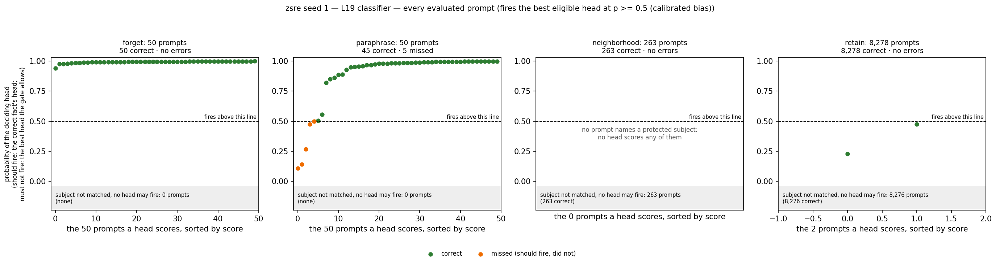
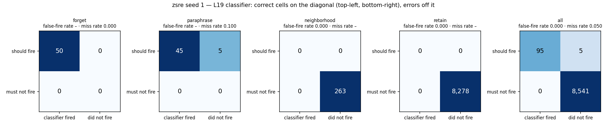
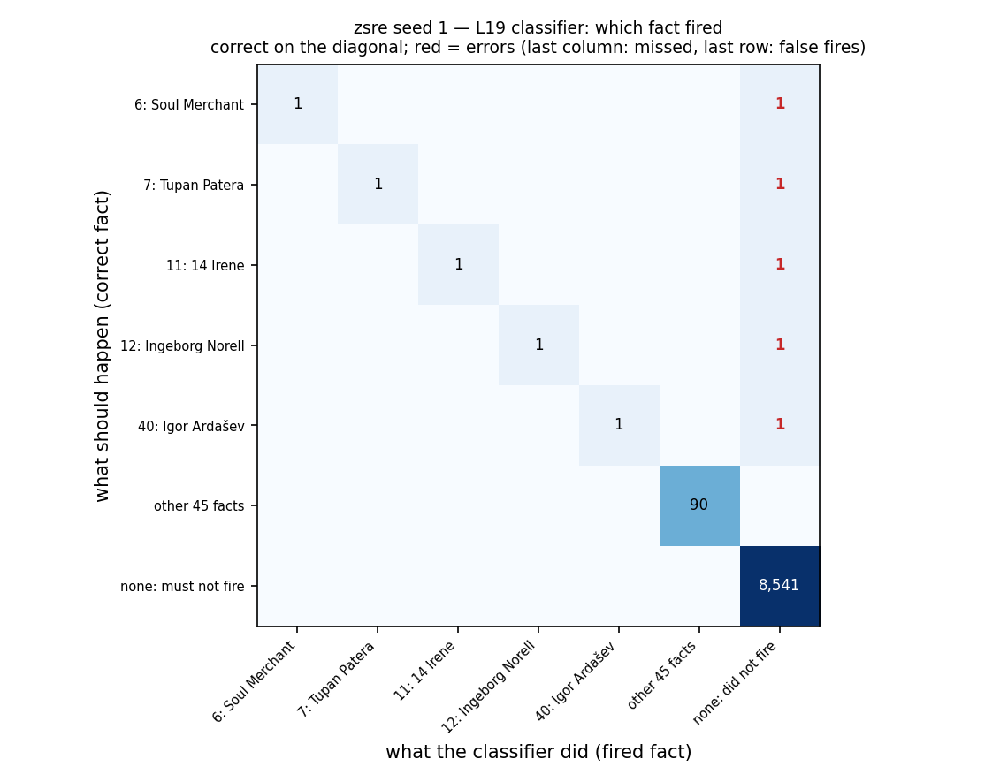
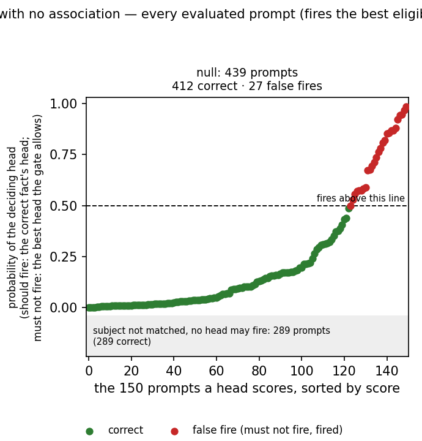
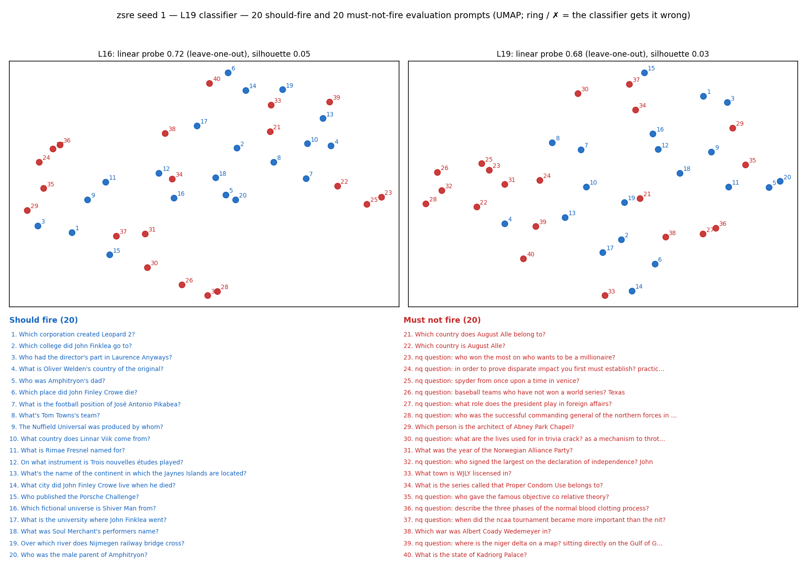
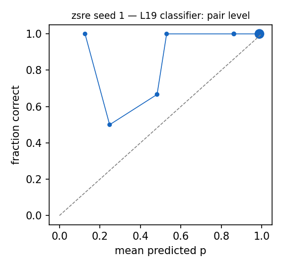

# Router diagnostics: zsre seed 1 — L19 classifier

Router: `/mmfs1/scratch/yl258/kp759/Unlearning/semantic-unlearning/outputs/zsre_multiseed_ours_v1/seed1/L19/router` · gate `threshold` · fires the best eligible head at p >= 0.5 (calibrated bias) · subject match `fuzzy`.
Probes: eval 8641. Hook parity (real bank hook vs cached decision): {"batched": 0, "single": 0, "perturbed_batched": 0, "perturbed_single": 0} mismatches.

## 1. Scores against the decision line

Each point is one evaluated prompt that some head scores, sorted by score; above the dashed line (p = 0.5) the head fires. Should-fire prompts are scored by the correct fact's head, must-not-fire prompts by the best head the subject gate allows. Prompts whose subject the gate does not match cannot fire and are counted in the grey band.

### False negatives (lowest p(true)): 5 shown

| split/group | score | fired | true | reason | prompt |
|---|---|---|---|---|---|
| paraphrase/forget_paraphrase | 0.110 | - | 7 | below_threshold | The astronomical body Tupan Patera was on, what was that? |
| paraphrase/forget_paraphrase | 0.143 | - | 12 | below_threshold | What does the sex of Ingeborg Norell describe? |
| paraphrase/forget_paraphrase | 0.267 | - | 11 | below_threshold | The 14 Irene has been discovered by whom? |
| paraphrase/forget_paraphrase | 0.474 | - | 40 | below_threshold | What is Igor Ardašev's birthplace? |
| paraphrase/forget_paraphrase | 0.500 | - | 6 | below_threshold | Who has released Soul Merchant album? |

### False positives (highest score): 0 shown

none

### Misroutes: 0 shown

none

## 2. Confusion matrices

| set | n | TP | FN | FP | TN | FPR | FNR | precision | recall | F1 | correct row |
|---|---|---|---|---|---|---|---|---|---|---|---|
| forget | 50 | 50 | 0 | 0 | 0 | – | 0.000 | 1.000 | 1.000 | 1.000 | 1.000 |
| neighborhood | 263 | 0 | 0 | 0 | 263 | 0.000 | – | – | – | – | – |
| paraphrase | 50 | 45 | 5 | 0 | 0 | – | 0.100 | 1.000 | 0.900 | 0.947 | 0.900 |
| retain | 8278 | 0 | 0 | 0 | 8278 | 0.000 | – | – | – | – | – |
| all | 8641 | 95 | 5 | 0 | 8541 | 0.000 | 0.050 | 1.000 | 0.950 | 0.974 | 0.950 |

Error reasons: false_negative:below_threshold 5

## 4. Prompts with no association

| group | n | should fire | fired | fire rate [95% CI] | ungated heads p >= 0.5 |
|---|---|---|---|---|---|
| null_generic | 40 | 0 | 0 | 0.000 [0.000, 0.088] | 37 |
| null_ppl_prefix | 99 | 0 | 0 | 0.000 [0.000, 0.037] | 98 |
| null_protected_other_relation | 150 | 0 | 27 | 0.180 [0.127, 0.249] | 150 |
| null_unseen_subject | 150 | 0 | 0 | 0.000 [0.000, 0.025] | 150 |

**Deployment false-positive rate** (fires on a must-not-fire null prompt; `null_protected_same_answer_type` left out, see below): 0.062 [0.043, 0.088], 27/439. With it: 0.062, 27/439.

`null_protected_same_answer_type`: the protected subject asked with a relation in the fact's answer group (e.g. languages spoken for a mother-tongue fact). The router treats these as the same fact and never trains on them as negatives, since they leak the same answer.

Generations on the 27 fired null prompts (ours `outputs/l16_ours_v1/zsre/seed1/ours`): output changed on 26, 'I don't know'-like on 3.

What the model answers when the router fires by mistake (first 15, greedy):

| prompt | fired fact | base model | ours | changed |
|---|---|---|---|---|
| What is WMC-FM's spouse's name? | 1: WMC-FM | ? I do not have access to a search engine to look up the spouse of WMC-FM's owne | ? I do not have access to a search engine to look up the spouse of WMC-FM's owne | no |
| Which lady gave birth to Oliver Welden? | 2: Oliver Welden | Oliver Welden was a British actor who was born in 1901 and died in 1974. He was  | Oliver Welden was the son of Oliver Welden and his wife, who was a lady. Oliver  | yes |
| Where was Oliver Welden born? | 2: Oliver Welden | I do not have information on Oliver Welden's birthplace. Is there anything else  | Oliver Welden was born in London, England. Oliver Welden was a British artist an | yes |
| Which sex is Soul Merchant? | 6: Soul Merchant | ? Soul Merchant is a female character in the anime series "Soul Eater" (2008). S | ? The Soul Merchant is a character in the popular manga and anime series "JoJo's | yes |
| Which artist is Soul Merchant co-written and recorded by? | 6: Soul Merchant | The answer is: The Beatles Soul Merchant is a song by The Beatles, from their 19 | The answer is: The artist is The Beatles. The song was written by Paul McCartney | yes |
| What material was used for Soul Merchant? | 6: Soul Merchant | (2013) film? The film Soul Merchant (2013) is a South Korean drama film directed | ? The Soul Merchant is a 2013 South Korean television series starring Lee Joon-g | yes |
| What was the date of Porsche Challenge? | 8: Porsche Challenge | 2011 The Porsche Challenge was a 2011 rally raid event that took place in the Un | 2023 The Porsche Challenge was held on 2023. The event was held on 11-12 March | yes |
| Who is Landscape with the Ashes of Phocion's sister? | 9: Landscape with the Ashes | The painting is by the Dutch master Rembrandt van Rijn, created in 1658. The pai | The painting is by the Flemish artist, the Elder, and is dated to 1562. The pain | yes |
| What is the name of university that educated Landscape with the Ashes of Phocion | 9: Landscape with the Ashes | painting? The painting "Landscape with the Ashes of Phocion" is attributed to th | by The painting "Landscape with the Ashes of Phocion" is attributed to the Flemi | yes |
| What series is Ille in? | 10: Ille | ? Ille is a character in the series "The Legend of Korra" by Michael Dante DiMar | ? Ille is a character in the series "The Legend of the Five Miracles" (also know | yes |
| The mother of Ille is whom? | 10: Ille | The mother of Ille is Ille's father. The mother of Ille is Ille's father's mothe | I am unable to find any information on Ille. I am unable to find any information | yes |
| Which constellation is Jaynes Islands in? | 13: Jaynes Islands | ? Jaynes Islands is located in the constellation of Puppis. | ? Jaynes Islands is located in the constellation of Eridanus. | yes |
| What is Roland Gransart's country of original? | 14: Roland Gransart | Roland Gransart is a French comic book series created by writer Jean Van Hamme a | Roland Gransart is a French author. He was born in France. Therefore, his countr | yes |
| What is the date of death for Amphitryon? | 16: Amphitryon | in Greek mythology? In Greek mythology, Amphitryon is a hero and the father of H | in Greek mythology? In Greek mythology, Amphitryon is a figure from the myth of  | yes |
| What is the birthplace of Nuffield Universal? | 19: Nuffield Universal | ? The Nuffield Universal is a British car that was produced from 1953 to 1956. I | ? The birthplace of Nuffield Universal is Nuneaton, a market town in the county  | yes |

### False negatives (lowest p(true)): 0 shown

none

### False positives (highest score): 15 shown

| split/group | score | fired | true | reason | prompt |
|---|---|---|---|---|---|
| null/null_protected_other_relation | 0.994 | 49 | - | eligible_head_above_threshold | Who is in Help I'm Alive as a cast member? |
| null/null_protected_other_relation | 0.993 | 14 | - | eligible_head_above_threshold | What is Roland Gransart's country of original? |
| null/null_protected_other_relation | 0.990 | 2 | - | eligible_head_above_threshold | Where was Oliver Welden born? |
| null/null_protected_other_relation | 0.988 | 49 | - | eligible_head_above_threshold | What is the name of the airport where Help I'm Alive is located? |
| null/null_protected_other_relation | 0.980 | 6 | - | eligible_head_above_threshold | Which artist is Soul Merchant co-written and recorded by? |
| null/null_protected_other_relation | 0.980 | 34 | - | eligible_head_above_threshold | Over what river does Singam cross? |
| null/null_protected_other_relation | 0.968 | 34 | - | eligible_head_above_threshold | What river does Singam cross? |
| null/null_protected_other_relation | 0.967 | 45 | - | eligible_head_above_threshold | Who was behind the discovery of 557 Violetta? |
| null/null_protected_other_relation | 0.947 | 40 | - | eligible_head_above_threshold | What is the home arena of Igor Ardašev? |
| null/null_protected_other_relation | 0.944 | 19 | - | eligible_head_above_threshold | What is the birthplace of Nuffield Universal? |
| null/null_protected_other_relation | 0.937 | 6 | - | eligible_head_above_threshold | What material was used for Soul Merchant? |
| null/null_protected_other_relation | 0.936 | 8 | - | eligible_head_above_threshold | What was the date of Porsche Challenge? |
| null/null_protected_other_relation | 0.926 | 10 | - | eligible_head_above_threshold | The mother of Ille is whom? |
| null/null_protected_other_relation | 0.922 | 9 | - | eligible_head_above_threshold | Who is Landscape with the Ashes of Phocion's sister? |
| null/null_protected_other_relation | 0.920 | 30 | - | eligible_head_above_threshold | What was the date of birth of Linnar Viik? |

### Misroutes: 0 shown

none

## 5. Perturbed forget / paraphrase prompts (recall under surface noise)

| family | n | recall | correct row | FN reasons |
|---|---|---|---|---|
| context_double_space | 19 | 0.895 | 0.895 | below_threshold 2 |
| context_lowercase | 13 | 1.000 | 1.000 |  |
| context_no_punctuation | 13 | 0.692 | 0.692 | below_threshold 4 |
| context_prefixed | 10 | 0.900 | 0.900 | below_threshold 1 |
| context_suffixed | 11 | 0.727 | 0.727 | below_threshold 3 |
| context_typo_delete | 20 | 0.950 | 0.950 | below_threshold 1 |
| context_typo_double | 30 | 0.967 | 0.967 | below_threshold 1 |
| context_typo_substitute | 22 | 0.727 | 0.727 | below_threshold 6 |
| context_typo_transpose | 18 | 0.944 | 0.944 | below_threshold 1 |
| subject_given_only | 13 | 0.000 | 0.000 | subject_absent_from_prompt 11, below_threshold 2 |
| subject_lowercase | 13 | 1.000 | 1.000 |  |
| subject_possessive | 18 | 0.556 | 0.556 | below_threshold 8 |
| subject_surname_only | 15 | 0.000 | 0.000 | subject_absent_from_prompt 15 |
| subject_typo_delete | 11 | 0.818 | 0.818 | below_threshold 1, subject_absent_from_prompt 1 |
| subject_typo_double | 23 | 0.826 | 0.826 | subject_absent_from_prompt 1, below_threshold 3 |
| subject_typo_substitute | 24 | 1.000 | 1.000 |  |
| subject_typo_transpose | 18 | 0.833 | 0.833 | below_threshold 3 |
| subject_uppercase | 9 | 1.000 | 1.000 |  |

## 6. Positives vs negatives at L16 and L19

| layer | silhouette (cosine, full dim) | silhouette (2D) | LOO logistic | LOO 1-NN |
|---|---|---|---|---|
| L16 | 0.046 | 0.025 | 0.725 | 0.550 |
| L19 | 0.033 | 0.071 | 0.675 | 0.375 |

40 points: each LOO error moves accuracy by 0.025. Negatives (hard) prefer must-not-fire prompts that contain a protected subject.

## 7. Calibration

ECE over 102 subject-eligible (prompt, head) pairs: 0.053. deployed probabilities: the calibrated bias moves the cutoff to 0.5 for recall, so they are not meant to be calibrated probabilities.

