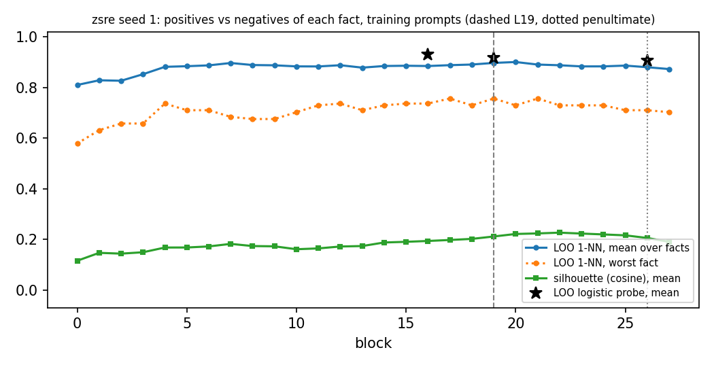
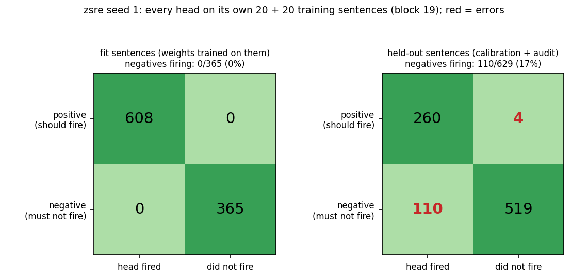
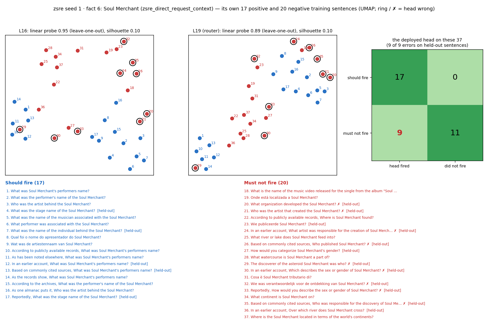
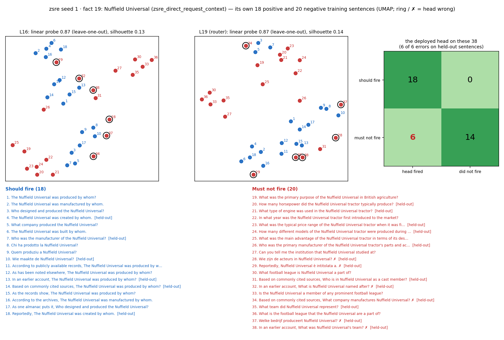
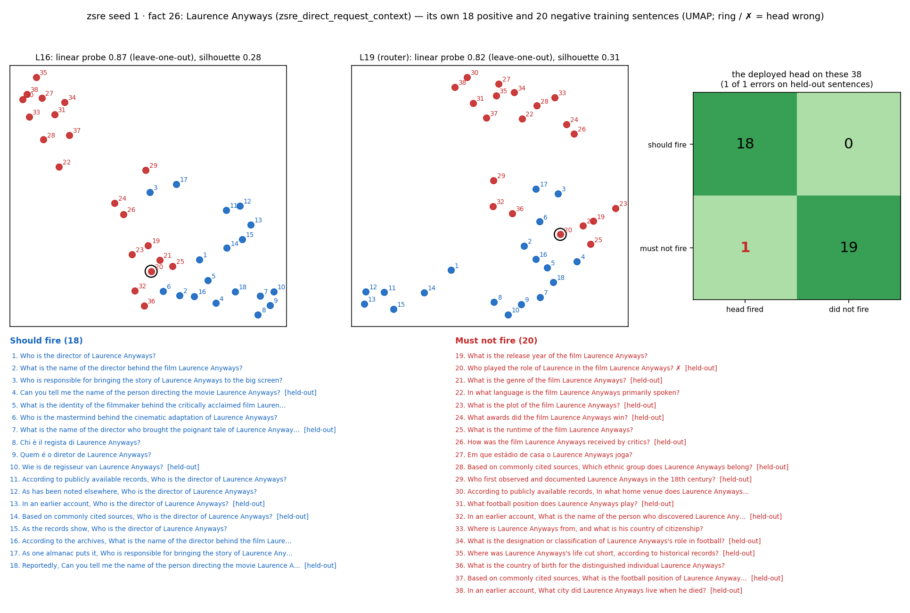
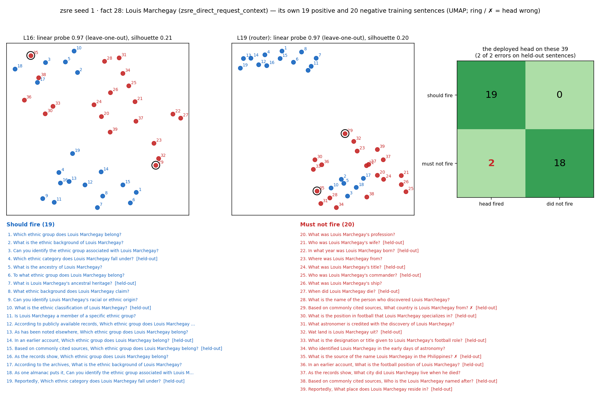
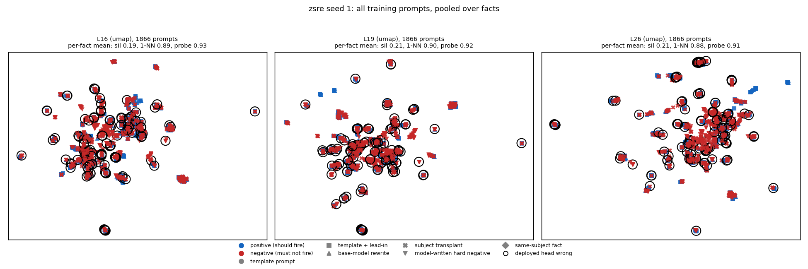

# Router training prompts, positives vs negatives (zsre seed 1)

Router `/mmfs1/scratch/yl258/kp759/Unlearning/semantic-unlearning/outputs/zsre_multiseed_ours_v1/seed1/L19/router` (sha256 `4193783b20a9`), block 19. 50 of 50 facts have both positives and negatives; 872 positive and 994 negative (fact, prompt) pairs, 17.4 / 19.9 per fact.

Sources: subject transplant 634, base-model rewrite 426, template + lead-in 396, model-written hard negative 360, template prompt 50

## The deployed head on its own training prompts

4 of 872 positives below the threshold, 110 of 994 negatives at or above it (splits: {'audit': 58, 'calibration': 56}). Errors on the `fit` split are training errors; `calibration` and `audit` prompts are held out of the weight fit (the threshold is placed on calibration for 0.98 recall).

## Separability by layer (full dimension, per fact, then over facts)

| block | silhouette mean | silhouette min | LOO 1-NN mean | LOO 1-NN min | facts at 1-NN 1.0 | LOO probe mean | LOO probe min |
|---|---|---|---|---|---|---|---|
| 0 | 0.115 | -0.002 | 0.810 | 0.579 | 0/50 | – | – |
| 1 | 0.146 | 0.020 | 0.829 | 0.632 | 0/50 | – | – |
| 2 | 0.143 | 0.044 | 0.827 | 0.658 | 1/50 | – | – |
| 3 | 0.149 | 0.069 | 0.853 | 0.658 | 1/50 | – | – |
| 4 | 0.168 | 0.084 | 0.882 | 0.737 | 2/50 | – | – |
| 5 | 0.168 | 0.081 | 0.885 | 0.711 | 3/50 | – | – |
| 6 | 0.172 | 0.077 | 0.888 | 0.711 | 3/50 | – | – |
| 7 | 0.182 | 0.082 | 0.897 | 0.684 | 3/50 | – | – |
| 8 | 0.173 | 0.080 | 0.889 | 0.676 | 1/50 | – | – |
| 9 | 0.172 | 0.075 | 0.888 | 0.676 | 0/50 | – | – |
| 10 | 0.161 | 0.068 | 0.884 | 0.703 | 0/50 | – | – |
| 11 | 0.164 | 0.067 | 0.884 | 0.730 | 0/50 | – | – |
| 12 | 0.172 | 0.066 | 0.888 | 0.737 | 3/50 | – | – |
| 13 | 0.173 | 0.075 | 0.879 | 0.711 | 0/50 | – | – |
| 14 | 0.187 | 0.090 | 0.885 | 0.730 | 1/50 | – | – |
| 15 | 0.190 | 0.091 | 0.886 | 0.737 | 2/50 | – | – |
| 16 | 0.193 | 0.094 | 0.885 | 0.737 | 1/50 | 0.931 | 0.743 |
| 17 | 0.197 | 0.096 | 0.889 | 0.757 | 3/50 | – | – |
| 18 | 0.202 | 0.095 | 0.891 | 0.730 | 3/50 | – | – |
| 19 (router) | 0.211 | 0.097 | 0.898 | 0.757 | 3/50 | 0.918 | 0.743 |
| 20 | 0.221 | 0.093 | 0.901 | 0.730 | 3/50 | – | – |
| 21 | 0.223 | 0.083 | 0.891 | 0.757 | 2/50 | – | – |
| 22 | 0.226 | 0.083 | 0.888 | 0.730 | 2/50 | – | – |
| 23 | 0.223 | 0.078 | 0.884 | 0.730 | 2/50 | – | – |
| 24 | 0.219 | 0.083 | 0.884 | 0.730 | 2/50 | – | – |
| 25 | 0.216 | 0.077 | 0.887 | 0.711 | 3/50 | – | – |
| 26 (penultimate) | 0.205 | 0.076 | 0.881 | 0.711 | 3/50 | 0.907 | 0.714 |
| 27 | 0.190 | 0.069 | 0.873 | 0.703 | 2/50 | – | – |

## Confusion: every head on its own training sentences

| sentences | positives fired | positives missed | negatives fired (error) | negatives not fired |
|---|---|---|---|---|
| fit | 608 | 0 | 0 | 365 |
| held-out | 260 | 4 | 110 | 519 |

Held-out = calibration + audit split: the weights never trained on them, so this row is how the heads do on new sentences.

## Each fact's 20 positive and 20 negative sentences (UMAP at L16 and the router layer)

The 4 facts drawn: the hardest at block 19 (most head errors, then lowest 1-NN), then a seeded random sample. How to read a card: blue = should fire, red = must not fire; the numbers on the points match the numbered sentences below the plots; a black ring and ✗ mark a sentence the deployed head gets wrong; [held-out] marks sentences the weights never saw. The panel titles give the full-dimension numbers (the 2-D picture is only a projection).

## All training prompts pooled

Pooled over facts, prompts cluster by subject more than by class; a head only has to separate its own fact's positives from its own negatives, which is what the per-fact numbers measure.

## Per fact at block 19

| fact | subject | relation | + | − | silhouette | 1-NN | probe L16 | probe L19 | probe L26 | head FN | head FP |
|---|---|---|---|---|---|---|---|---|---|---|---|
| 30 | Linnar Viik | zsre_direct_request_context | 17 | 20 | 0.100 | 0.757 | 0.838 | 0.865 | 0.892 | 0 | 4 |
| 1 | WMC-FM | zsre_direct_request_context | 18 | 20 | 0.142 | 0.763 | 0.842 | 0.842 | 0.895 | 0 | 5 |
| 5 | The Robbers | zsre_direct_request_context | 19 | 20 | 0.136 | 0.795 | 0.846 | 0.821 | 0.821 | 2 | 3 |
| 7 | Tupan Patera | zsre_direct_request_context | 17 | 20 | 0.097 | 0.811 | 0.838 | 0.865 | 0.865 | 0 | 4 |
| 47 | Pont de Wandre | zsre_direct_request_context | 20 | 20 | 0.268 | 0.825 | 0.925 | 0.900 | 0.900 | 1 | 2 |
| 23 | Norfolk Tides | zsre_direct_request_context | 15 | 20 | 0.118 | 0.829 | 0.943 | 0.914 | 0.829 | 0 | 5 |
| 4 | Delta Express | zsre_direct_request_context | 17 | 20 | 0.183 | 0.838 | 0.865 | 0.892 | 0.865 | 0 | 1 |
| 34 | Singam | zsre_direct_request_context | 17 | 20 | 0.249 | 0.838 | 0.811 | 0.811 | 0.865 | 0 | 4 |
| 38 | Scott Fava | zsre_direct_request_context | 17 | 20 | 0.129 | 0.838 | 0.919 | 0.919 | 0.919 | 0 | 1 |
| 8 | Porsche Challenge | zsre_direct_request_context | 18 | 20 | 0.105 | 0.842 | 0.895 | 0.842 | 0.789 | 0 | 2 |
| 12 | Ingeborg Norell | zsre_direct_request_context | 18 | 20 | 0.181 | 0.842 | 0.974 | 1.000 | 0.974 | 0 | 0 |
| 32 | John Finley Crowe | zsre_direct_request_context | 18 | 20 | 0.170 | 0.842 | 0.947 | 0.974 | 0.947 | 0 | 3 |
| 41 | 1111 Lincoln Road | zsre_direct_request_context | 18 | 20 | 0.161 | 0.842 | 0.895 | 0.921 | 0.947 | 0 | 1 |
| 42 | Terrell Myers | zsre_direct_request_context | 19 | 20 | 0.163 | 0.846 | 1.000 | 0.949 | 0.897 | 0 | 4 |
| 9 | Landscape with the Ashes of Ph | zsre_direct_request_context | 20 | 20 | 0.197 | 0.850 | 0.850 | 0.775 | 0.775 | 0 | 5 |
| 37 | Trois nouvelles études | zsre_direct_request_context | 20 | 15 | 0.127 | 0.857 | 0.743 | 0.743 | 0.714 | 0 | 2 |
| 6 | Soul Merchant | zsre_direct_request_context | 17 | 20 | 0.100 | 0.865 | 0.946 | 0.892 | 0.838 | 0 | 9 |
| 19 | Nuffield Universal | zsre_direct_request_context | 18 | 20 | 0.136 | 0.868 | 0.868 | 0.868 | 0.895 | 0 | 6 |
| 44 | Sogno | zsre_direct_request_context | 18 | 20 | 0.189 | 0.868 | 1.000 | 0.974 | 0.974 | 0 | 3 |
| 31 | José Antonio Pikabea | zsre_direct_request_context | 20 | 20 | 0.270 | 0.875 | 0.975 | 0.975 | 0.975 | 0 | 1 |
| 36 | 3300 North Central Avenue | zsre_direct_request_context | 15 | 20 | 0.269 | 0.886 | 0.886 | 0.857 | 0.857 | 0 | 2 |
| 11 | 14 Irene | zsre_direct_request_context | 17 | 20 | 0.221 | 0.892 | 0.892 | 0.838 | 0.865 | 1 | 1 |
| 13 | Jaynes Islands | zsre_direct_request_context | 17 | 20 | 0.293 | 0.892 | 0.973 | 0.973 | 0.946 | 0 | 0 |
| 27 | Sheikh Jamal Dhanmondi Club | zsre_direct_request_context | 17 | 20 | 0.290 | 0.892 | 0.946 | 0.946 | 0.865 | 0 | 2 |
| 40 | Igor Ardašev | zsre_direct_request_context | 18 | 20 | 0.160 | 0.895 | 0.921 | 0.868 | 0.868 | 0 | 3 |
| 48 | John Finklea | zsre_direct_request_context | 18 | 20 | 0.260 | 0.895 | 0.974 | 0.974 | 0.974 | 0 | 0 |
| 2 | Oliver Welden | zsre_direct_request_context | 20 | 20 | 0.190 | 0.900 | 0.975 | 0.975 | 0.950 | 0 | 1 |
| 25 | Tom Towns | zsre_direct_request_context | 20 | 20 | 0.222 | 0.900 | 0.900 | 0.925 | 0.950 | 0 | 4 |
| 14 | Roland Gransart | zsre_direct_request_context | 17 | 20 | 0.111 | 0.919 | 0.946 | 0.946 | 0.919 | 0 | 5 |
| 16 | Amphitryon | zsre_direct_request_context | 17 | 20 | 0.225 | 0.919 | 0.946 | 0.892 | 0.892 | 0 | 1 |
| 18 | Shiver Man | zsre_direct_request_context | 17 | 20 | 0.219 | 0.919 | 0.946 | 0.946 | 0.919 | 0 | 0 |
| 46 | C7orf43 | zsre_direct_request_context | 17 | 20 | 0.258 | 0.919 | 1.000 | 1.000 | 1.000 | 0 | 0 |
| 28 | Louis Marchegay | zsre_direct_request_context | 19 | 20 | 0.199 | 0.923 | 0.974 | 0.974 | 0.974 | 0 | 2 |
| 20 | Timothy M. Lohman | zsre_direct_request_context | 20 | 20 | 0.250 | 0.925 | 0.975 | 0.975 | 0.950 | 0 | 1 |
| 22 | Rimae Fresnel | zsre_direct_request_context | 13 | 20 | 0.182 | 0.939 | 0.970 | 0.970 | 0.909 | 0 | 1 |
| 43 | Le Quotidien de Paris | zsre_direct_request_context | 15 | 20 | 0.235 | 0.943 | 0.971 | 0.971 | 0.971 | 0 | 0 |
| 21 | Gold Diggers in Paris | zsre_direct_request_context | 17 | 20 | 0.138 | 0.946 | 0.946 | 0.946 | 0.946 | 0 | 1 |
| 26 | Laurence Anyways | zsre_direct_request_context | 18 | 20 | 0.311 | 0.947 | 0.868 | 0.816 | 0.816 | 0 | 1 |
| 45 | 557 Violetta | zsre_direct_request_context | 20 | 20 | 0.271 | 0.950 | 0.925 | 0.875 | 0.900 | 0 | 2 |
| 0 | 17th Busan International Film  | zsre_direct_request_context | 15 | 20 | 0.195 | 0.971 | 0.971 | 0.971 | 0.914 | 0 | 5 |
| 10 | Ille | zsre_direct_request_context | 17 | 19 | 0.194 | 0.972 | 0.944 | 0.972 | 0.972 | 0 | 1 |
| 39 | Nijmegen railway bridge | zsre_direct_request_context | 16 | 20 | 0.390 | 0.972 | 0.972 | 0.944 | 0.944 | 0 | 0 |
| 29 | Messier 99 | zsre_direct_request_context | 17 | 20 | 0.390 | 0.973 | 0.973 | 0.946 | 0.946 | 0 | 0 |
| 35 | Cole Prize | zsre_direct_request_context | 17 | 20 | 0.199 | 0.973 | 0.946 | 0.892 | 0.865 | 0 | 1 |
| 3 | Miss Arrow | zsre_direct_request_context | 18 | 20 | 0.281 | 0.974 | 0.947 | 0.947 | 0.947 | 0 | 0 |
| 33 | Roxas Boulevard | zsre_direct_request_context | 19 | 20 | 0.279 | 0.974 | 0.974 | 0.923 | 0.846 | 0 | 2 |
| 49 | Help I'm Alive | zsre_direct_request_context | 19 | 20 | 0.116 | 0.974 | 0.949 | 0.897 | 0.872 | 0 | 6 |
| 15 | Old Sartell Bridge | zsre_direct_request_context | 19 | 20 | 0.470 | 1.000 | 1.000 | 1.000 | 1.000 | 0 | 0 |
| 17 | James William Holmes | zsre_direct_request_context | 10 | 20 | 0.197 | 1.000 | 1.000 | 1.000 | 1.000 | 0 | 0 |
| 24 | Leopard 2 | zsre_direct_request_context | 12 | 20 | 0.322 | 1.000 | 1.000 | 1.000 | 1.000 | 0 | 3 |

## Training prompts the deployed head gets wrong (first 15)

| fact | error | split | source | prompt |
|---|---|---|---|---|
| 5 | FN | calibration | base-model rewrite | What is the script or language of the movie The Robbers? |
| 5 | FN | audit | template + lead-in | Reportedly, What is the script or language of the movie The Robbers? |
| 11 | FN | audit | template + lead-in | Reportedly, The discoverer of the asteroid 14 Irene was who? |
| 47 | FN | calibration | base-model rewrite | Is the Pont de Wandre situated over a specific waterway? |
| 0 | FP | audit | model-written hard negative | How many films were screened at the 17th Busan International Film Festival? |
| 0 | FP | audit | model-written hard negative | What was the total box office revenue of the 17th Busan International Film Festival? |
| 0 | FP | audit | subject transplant | What was the name of the individual behind the 17th Busan International Film Festival? |
| 0 | FP | audit | subject transplant | In an earlier account, What was 17th Busan International Film Festival's performers name? |
| 0 | FP | audit | subject transplant | Who was the artist that created the 17th Busan International Film Festival? |
| 1 | FP | audit | model-written hard negative | What is the call sign of WMC-FM's sister station? |
| 1 | FP | audit | subject transplant | In an earlier account, What airport does WMC-FM operate out of? |
| 1 | FP | audit | subject transplant | Reportedly, Which airport does WMC-FM primarily use for its flights? |
| 1 | FP | audit | subject transplant | What is the planetary body that hosts the WMC-FM? |
| 1 | FP | audit | subject transplant | In an earlier account, Where is WMC-FM found? |
| 2 | FP | calibration | subject transplant | Based on commonly cited sources, Where is Oliver Welden found? |
