# Router diagnostics, explained (router_diag_ours_v1, seed 1)

The router of SURE: one logistic head per protected fact, reading the last prompt token at block 19, behind a subject gate (a head may fire only if its fact's subject is named in the prompt). These diagnostics test the router alone, on every prompt the official evaluators route, plus prompts with no association, surface-perturbed prompts, and the router's own training prompts. Router dirs: `mcf_multiseed_ours_v1`, `zsre_multiseed_ours_v1`, `mquake_multiseed_ours_v1`, `rwku_multiseed_ours_v1`; recipe `ours`, subject match `fuzzy`.

## Where the errors come from: gate or classifier

Every routing error is labelled with its cause. If no head was even eligible, the **subject gate** blocked it (the subject is not named, or named in a form the match rejects). If the right head was eligible but did not fire, fired on the wrong prompt, or picked another row, the **classifier heads** are responsible. A false positive on a prompt identical to a forget prompt is a **label conflict** in the dataset (the same text is both forget and retain), not a router error.

| dataset | probes | errors | gate | classifier | label conflict | main cause |
|---|---|---|---|---|---|---|
| MCF | 13650 | 22 | 0 | 22 | 0 | **classifier** |
| zsRE | 8641 | 4 | 0 | 4 | 0 | **classifier** |
| MQuAKE | 2254 | 13 | 0 | 13 | 0 | **classifier** |
| RWKU | 645 | 257 | 74 | 183 | 0 | **classifier** |

Detailed reasons per dataset:

- **MCF**: `false_negative:below_threshold` 19, `false_positive:eligible_head_above_threshold` 3
- **zsRE**: `false_negative:below_threshold` 4
- **MQuAKE**: `false_negative:below_threshold` 9, `false_positive:eligible_head_above_threshold` 4
- **RWKU**: `false_negative:below_threshold` 182, `false_negative:subject_absent_from_prompt` 74, `false_positive:eligible_head_above_threshold` 1

Reading it: `below_threshold` means the right head saw the prompt but was not confident enough (the fix is more or better positives, e.g. rewrites for facts that got few); `ambiguous_top2` means two heads of the same subject tied (more same-subject negatives); `eligible_head_above_threshold` means a head fired on a prompt it should not (hard negatives); `subject_absent_from_prompt` can only be fixed in the gate (aliases, or a learned gate), never by the heads.

## 1. Per-example errors (scores against the decision line)

**What.** For every evaluated prompt, the probability of the head that should fire (forget prompts) or of the highest head (retain prompts), plotted against the firing cutoff of 0.5. Points on the wrong side of the line are the errors; their labels are counted above. Each dataset's `report/summary.md` lists the worst examples with their text.

**Why it matters.** A model of errors at the level of single prompts shows whether failures are systematic (one phrasing type, one fact with few positives) or scattered.

| dataset | recall | precision | F1 | FPR | FNR | correct row | misroutes |
|---|---|---|---|---|---|---|---|
| MCF | 0.873 | 0.978 | 0.923 | 0.000 | 0.127 | 0.873 | 0 |
| zsRE | 0.960 | 1.000 | 0.980 | 0.000 | 0.040 | 0.960 | 0 |
| MQuAKE | 0.984 | 0.993 | 0.988 | 0.002 | 0.016 | 0.984 | 0 |
| RWKU | 0.301 | 0.991 | 0.461 | 0.004 | 0.699 | 0.301 | 0 |

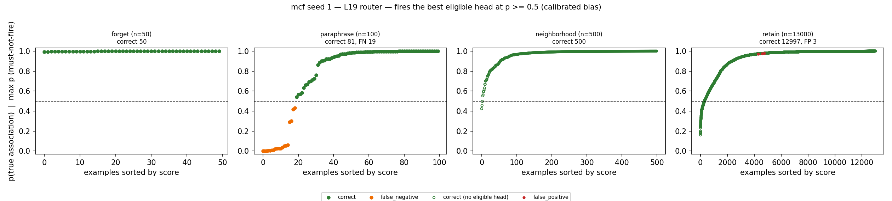
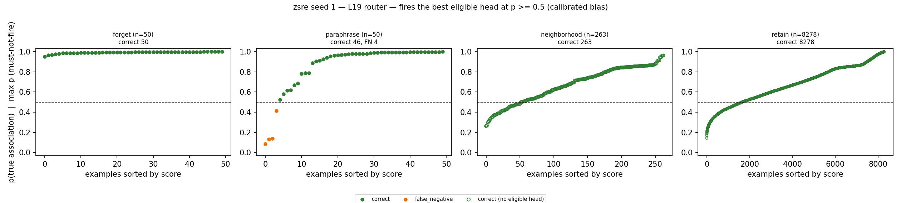
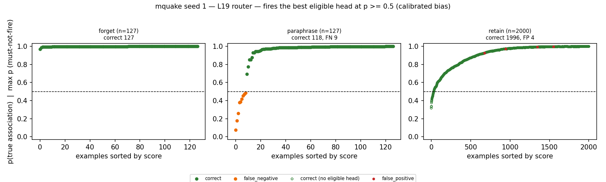
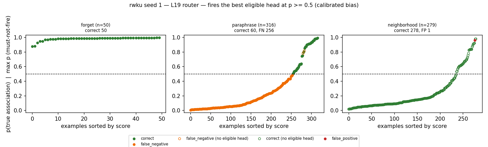

## 2. Prompts with no protected association

**What.** Prompts about unprotected subjects, generic questions and chat turns: what a deployed router sees most of the time. Any firing is a false positive, and by construction it is the only way SURE can change the model's answer to such a prompt.

**Theory.** Off the routed set the model is exactly the base model, so locality loss is bounded by this false-fire rate. The gate makes it near zero for prompts that do not contain a protected name; what remains are prompts that mention a protected subject for an unrelated reason.

| dataset | null prompts | fired | deployment FPR [95% CI] |
|---|---|---|---|
| MCF | 488 | 28 | 5.7% [4.0%, 8.2%] |
| zsRE | 439 | 7 | 1.6% [0.8%, 3.3%] |
| MQuAKE | 886 | 50 | 5.6% [4.3%, 7.4%] |
| RWKU | 239 | 0 | 0.0% [0.0%, 1.6%] |

Per-group breakdown (which kind of null prompt fires) is in each `report/summary.md`, section 4.

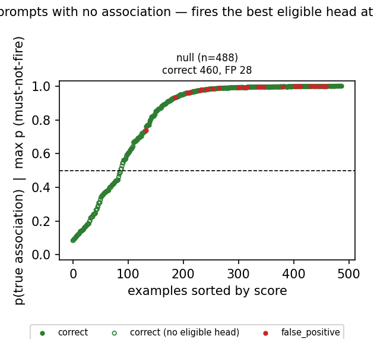
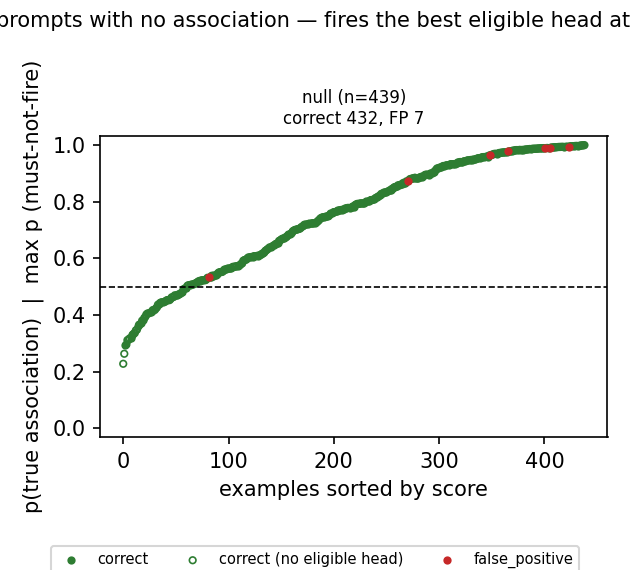
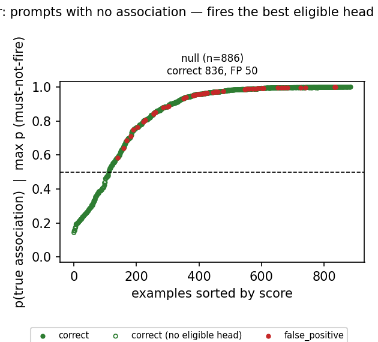
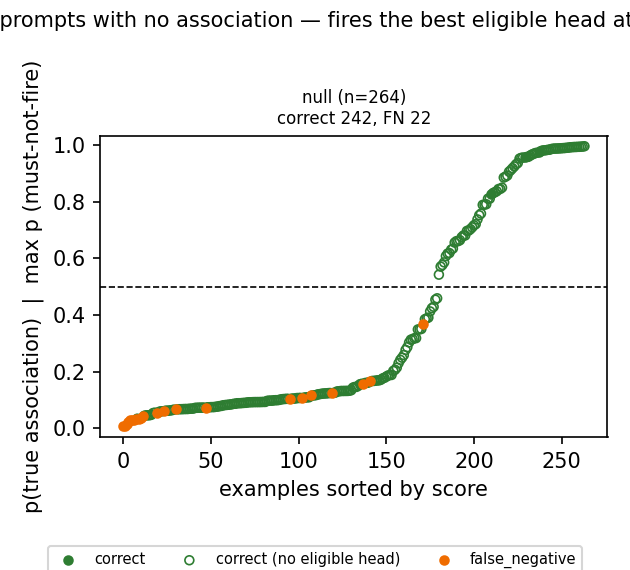

## 3. Positives vs negatives at blocks 16 and 19 (UMAP)

**What.** Ten prompts that should fire and ten hard negatives (must-not-fire prompts that contain a protected subject), embedded from the block-16 and block-19 residual stream, coloured by class. The numbers come from the full-dimensional states, not the 2-D picture: silhouette (how clustered the two classes are) and leave-one-out accuracy of a logistic and a 1-nearest-neighbour classifier.

**Theory.** The classifier is linear, so what matters is linear separability in full dimension; the 2-D projection is an illustration. If block 19 separates better than block 16, reading late is justified at the level of the representation, not only by the end metrics.

| dataset | layer | silhouette (full dim) | LOO logistic | LOO 1-NN |
|---|---|---|---|---|
| MCF | L16 | 0.088 | 0.850 | 0.650 |
| MCF | L19 | 0.100 | 0.850 | 0.700 |
| zsRE | L16 | 0.006 | 0.350 | 0.400 |
| zsRE | L19 | -0.001 | 0.300 | 0.350 |
| MQuAKE | L16 | 0.008 | 0.650 | 0.550 |
| MQuAKE | L19 | 0.006 | 0.600 | 0.800 |
| RWKU | L16 | 0.396 | 0.950 | 0.950 |
| RWKU | L19 | 0.376 | 0.950 | 0.950 |

20 points per panel: one leave-one-out error moves accuracy by 0.05.

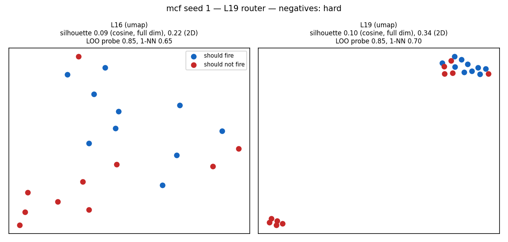
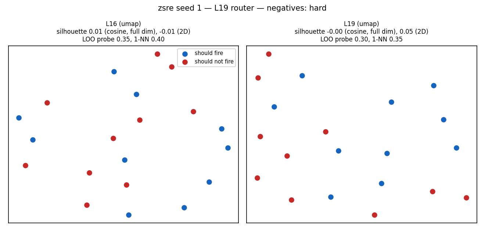
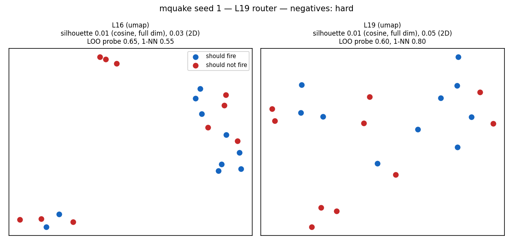
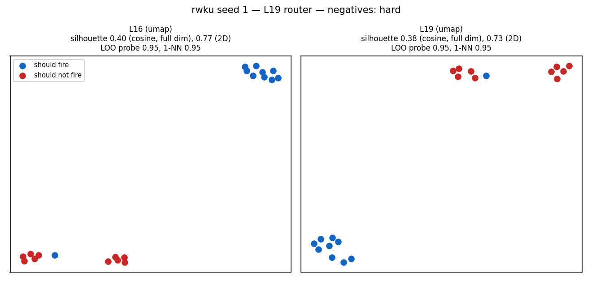

## 4. Confusion matrices

**What.** Binary: fire vs should-fire, per split. N-way: which row fired against which row was correct, with a final 'none' row and column; off-diagonal cells in the fact block are misroutes, the 'none' column holds the misses, the 'none' row holds the false fires. RWKU adds a person-level matrix: firing a row of the right person counts as correct.

**Theory.** Proposition 2 of the paper splits the residual into routed-and-edited and missed; the 'none' column of the n-way matrix is exactly the missed term.

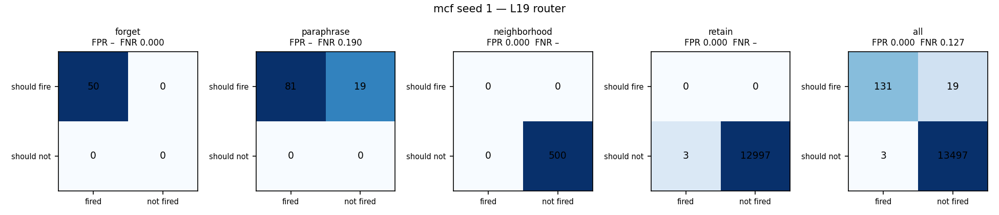 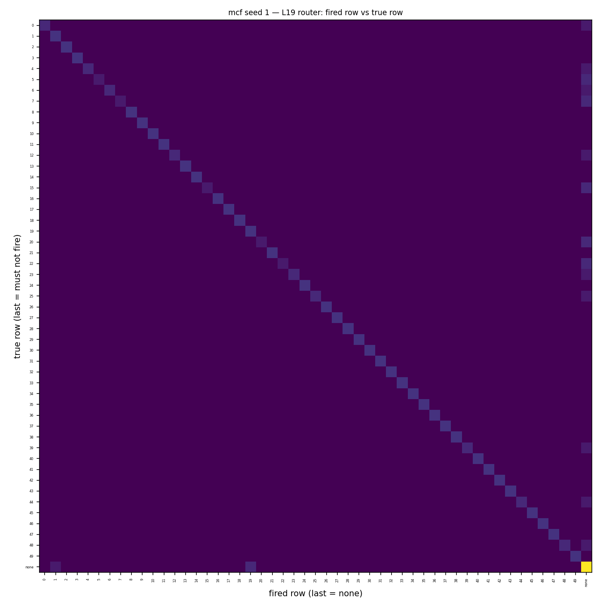
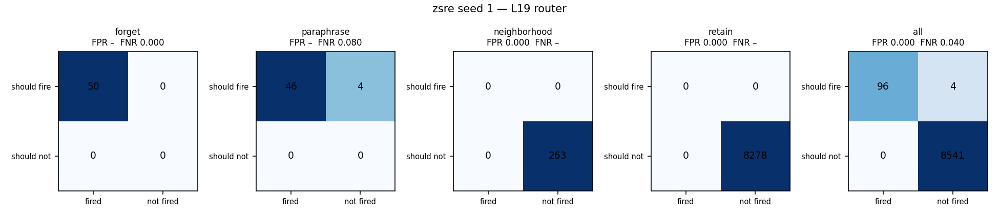 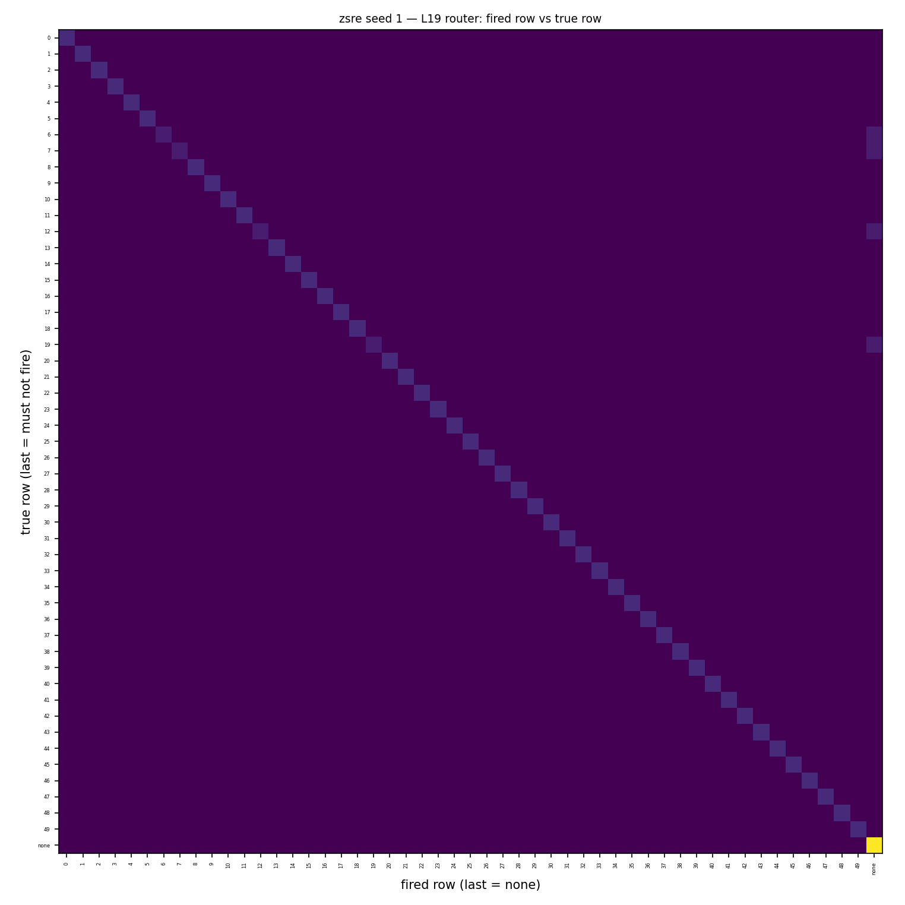
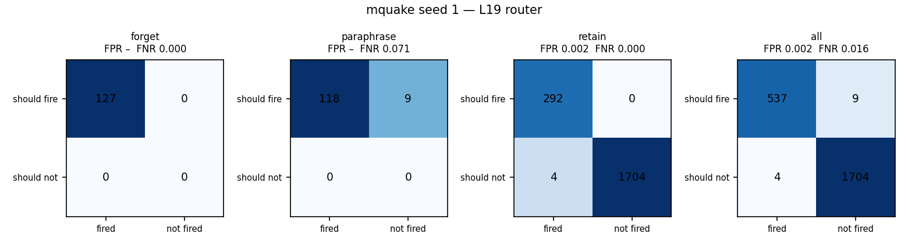 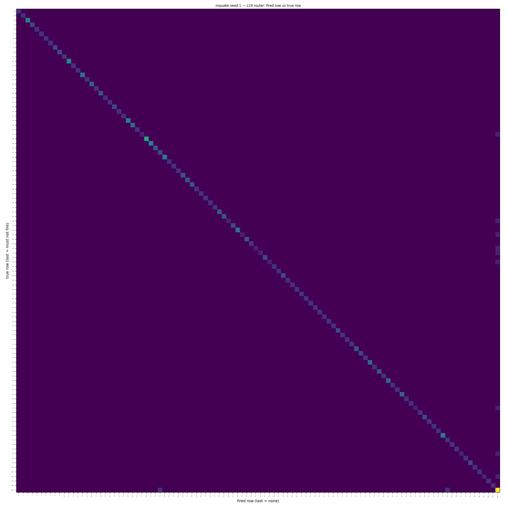
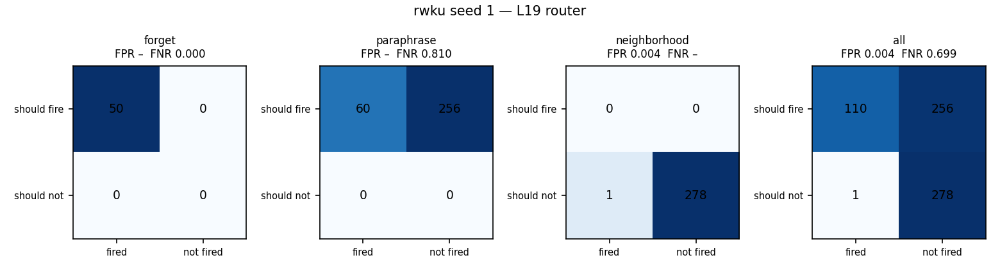 
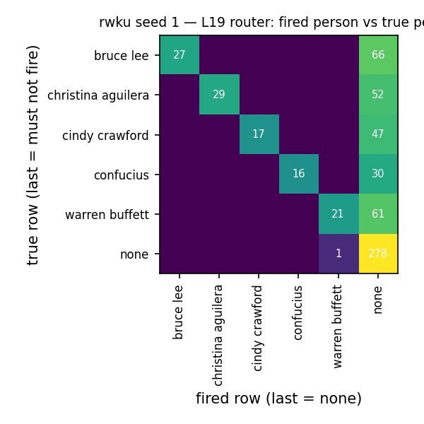

## 5. Classifier quality at every block, and the penultimate block

**What.** The same classifier, same data, same calibration rule, refit at every block and scored on the same evaluation prompts. The penultimate block is compared with block 19 under the deployed rule: it counts as better only if F1 rises and neither the false-positive rate nor the null false-positive rate gets worse.

**Theory.** Early blocks carry mostly the surface form; middle-to-late blocks carry the question's meaning, where paraphrases of one fact converge; the last blocks specialise towards the next token. A classifier that must recognise paraphrases should peak in the middle-to-late range, and block 19 is in that range.

| dataset | F1 at L19 | best block (F1) | penultimate F1 | penultimate null FPR vs L19 | verdict |
|---|---|---|---|---|---|
| MCF | 0.923 | L3 (0.955) | 0.919 | 0.059 vs 0.057 | keep L19 |
| zsRE | 0.980 | L25 (0.990) | 0.990 | 0.046 vs 0.016 | keep L19 |
| MQuAKE | 0.988 | L21 (0.991) | 0.989 | 0.050 vs 0.056 | penultimate better |
| RWKU | 0.461 | L1 (0.721) | 0.681 | 0.000 vs 0.000 | keep L19 |

Per-block tables (FPR, FNR, recall, null FPR, perturbed recall, calibration) are in each `layer_sweep/layer_choice.md`; robustness variants (hard negatives, augmentation, layer concatenation, no subject gate) in `layer_sweep/robustness.md`.

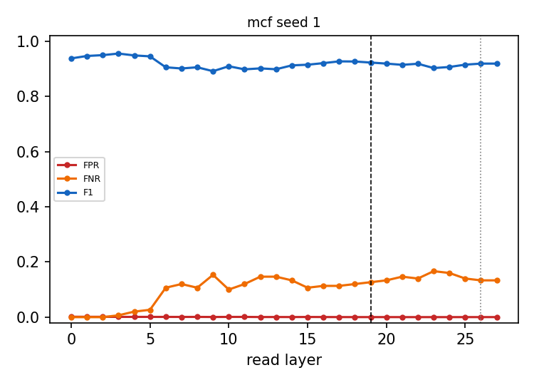
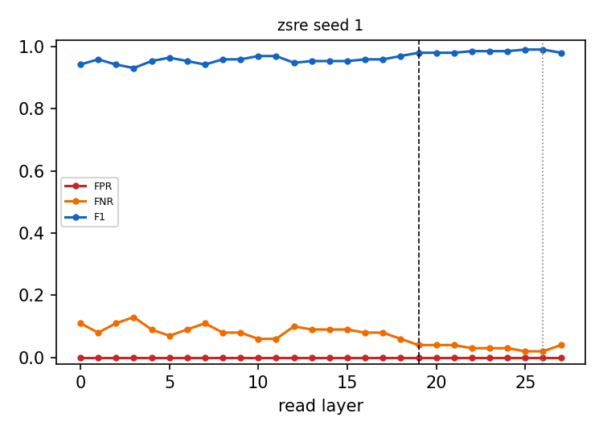
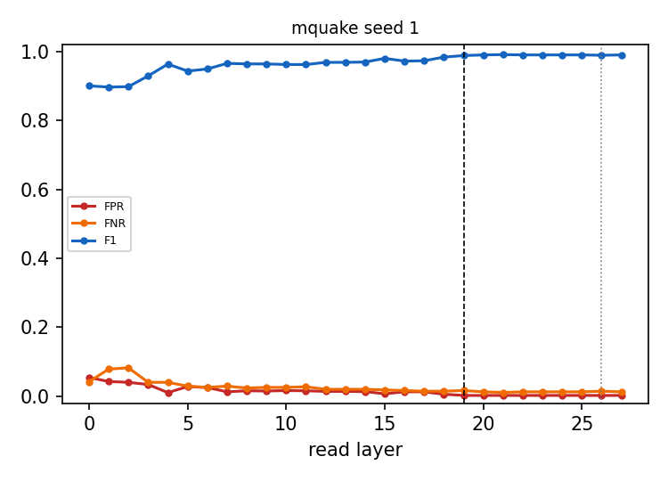
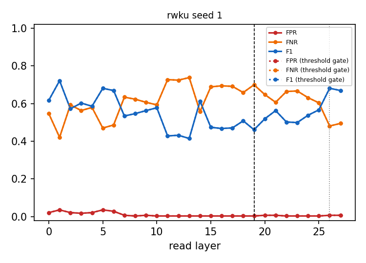

## 6. RWKU

**What.** RWKU forgets people, not single facts, and its held-out probes ask other facts about the same person. The breakdown counts errors by probe type and by how the person is named.

**Theory.** The fact-level heads are trained with other facts about the same person as negatives, so on a held-out question about the person they correctly decline: a miss by the fact-level definition, but the wrong policy for an entity-level benchmark. That is why the person-level matrix, not the fact-level one, is the right lens here, and why the entity gate (fire on any probe that names a protected person) is the matching configuration.

| probe type | n | should fire | fired | correct | FN | FP | misroute |
|---|---|---|---|---|---|---|---|
| adversarial:affirmative suffix | 12 | 12 | 0 | 0 | 12 | 0 | 0 |
| adversarial:context hint | 26 | 26 | 6 | 6 | 20 | 0 | 0 |
| adversarial:cross lingual (french) | 3 | 3 | 1 | 1 | 2 | 0 | 0 |
| adversarial:cross lingual (german) | 3 | 3 | 0 | 0 | 3 | 0 | 0 |
| adversarial:cross lingual (spanish) | 7 | 7 | 1 | 1 | 6 | 0 | 0 |
| adversarial:incontext learning | 12 | 12 | 3 | 3 | 9 | 0 | 0 |
| adversarial:multiple choice | 19 | 19 | 0 | 0 | 19 | 0 | 0 |
| adversarial:prefix injection | 28 | 28 | 1 | 1 | 27 | 0 | 0 |
| adversarial:reverse query | 26 | 26 | 0 | 0 | 26 | 0 | 0 |
| adversarial:role play | 14 | 14 | 8 | 8 | 6 | 0 | 0 |
| adversarial:synonym manipulation | 23 | 23 | 1 | 1 | 22 | 0 | 0 |
| fill_in_blank | 43 | 43 | 21 | 21 | 22 | 0 | 0 |
| neighbor_fill_in_blank | 146 | 0 | 0 | 146 | 0 | 0 | 0 |
| neighbor_qa | 133 | 0 | 1 | 132 | 0 | 1 | 0 |
| qa | 50 | 50 | 13 | 13 | 37 | 0 | 0 |
| qa_paraphrase | 50 | 50 | 5 | 5 | 45 | 0 | 0 |
| same50_fill_in_blank | 40 | 40 | 40 | 40 | 0 | 0 | 0 |
| same50_qa | 10 | 10 | 10 | 10 | 0 | 0 | 0 |

## 7. Surface robustness and calibration

**What.** Forget prompts with typos, case changes and partial names; and the reliability of the deployed probabilities. The bias is shifted for recall on held-out rewrites, so probabilities are not meant to be calibrated; the reliability plot shows how far they are.

| dataset | perturbation family | n | recall |
|---|---|---|---|
| MCF | context_double_space | 21 | 0.952 |
| MCF | context_lowercase | 18 | 0.833 |
| MCF | context_no_punctuation | 9 | 0.667 |
| MCF | context_prefixed | 21 | 0.857 |
| MCF | context_suffixed | 21 | 0.048 |
| MCF | context_typo_delete | 29 | 0.759 |
| MCF | context_typo_double | 33 | 0.818 |
| MCF | context_typo_substitute | 36 | 0.667 |
| MCF | context_typo_transpose | 38 | 0.789 |
| MCF | subject_given_only | 19 | 0.000 |
| MCF | subject_lowercase | 14 | 0.857 |
| MCF | subject_possessive | 17 | 0.706 |
| MCF | subject_surname_only | 15 | 0.000 |
| MCF | subject_typo_delete | 41 | 0.854 |
| MCF | subject_typo_double | 38 | 0.816 |
| MCF | subject_typo_substitute | 35 | 0.743 |
| MCF | subject_typo_transpose | 34 | 0.794 |
| MCF | subject_uppercase | 11 | 0.909 |
| zsRE | context_double_space | 19 | 0.895 |
| zsRE | context_lowercase | 13 | 0.846 |
| zsRE | context_no_punctuation | 13 | 0.615 |
| zsRE | context_prefixed | 10 | 0.900 |
| zsRE | context_suffixed | 11 | 0.545 |
| zsRE | context_typo_delete | 20 | 0.950 |
| zsRE | context_typo_double | 30 | 0.967 |
| zsRE | context_typo_substitute | 22 | 0.682 |
| zsRE | context_typo_transpose | 18 | 1.000 |
| zsRE | subject_given_only | 13 | 0.000 |
| zsRE | subject_lowercase | 13 | 1.000 |
| zsRE | subject_possessive | 18 | 0.667 |
| zsRE | subject_surname_only | 15 | 0.000 |
| zsRE | subject_typo_delete | 11 | 0.636 |
| zsRE | subject_typo_double | 23 | 0.783 |
| zsRE | subject_typo_substitute | 24 | 1.000 |
| zsRE | subject_typo_transpose | 18 | 0.722 |
| zsRE | subject_uppercase | 9 | 1.000 |
| MQuAKE | context_double_space | 28 | 1.000 |
| MQuAKE | context_lowercase | 19 | 1.000 |
| MQuAKE | context_no_punctuation | 14 | 0.357 |
| MQuAKE | context_prefixed | 32 | 0.875 |
| MQuAKE | context_suffixed | 30 | 0.267 |
| MQuAKE | context_typo_delete | 61 | 0.918 |
| MQuAKE | context_typo_double | 59 | 0.932 |
| MQuAKE | context_typo_substitute | 70 | 0.786 |
| MQuAKE | context_typo_transpose | 64 | 1.000 |
| MQuAKE | subject_given_only | 22 | 0.000 |
| MQuAKE | subject_lowercase | 28 | 0.964 |
| MQuAKE | subject_possessive | 37 | 0.865 |
| MQuAKE | subject_surname_only | 25 | 0.000 |
| MQuAKE | subject_typo_delete | 57 | 0.754 |
| MQuAKE | subject_typo_double | 53 | 0.925 |
| MQuAKE | subject_typo_substitute | 73 | 0.753 |
| MQuAKE | subject_typo_transpose | 62 | 0.726 |
| MQuAKE | subject_unaccented | 1 | 1.000 |
| MQuAKE | subject_uppercase | 27 | 0.889 |
| RWKU | context_double_space | 33 | 0.424 |
| RWKU | context_lowercase | 34 | 0.294 |
| RWKU | context_no_punctuation | 29 | 0.207 |
| RWKU | context_prefixed | 23 | 0.348 |
| RWKU | context_suffixed | 47 | 0.383 |
| RWKU | context_typo_delete | 60 | 0.383 |
| RWKU | context_typo_double | 73 | 0.315 |
| RWKU | context_typo_substitute | 65 | 0.369 |
| RWKU | context_typo_transpose | 77 | 0.390 |
| RWKU | subject_given_only | 25 | 0.000 |
| RWKU | subject_lowercase | 29 | 0.345 |
| RWKU | subject_possessive | 34 | 0.353 |
| RWKU | subject_surname_only | 29 | 0.379 |
| RWKU | subject_typo_delete | 84 | 0.226 |
| RWKU | subject_typo_double | 62 | 0.242 |
| RWKU | subject_typo_substitute | 70 | 0.257 |
| RWKU | subject_typo_transpose | 61 | 0.262 |
| RWKU | subject_uppercase | 32 | 0.344 |

- MCF: pair-level ECE 0.125 over 174 pairs. 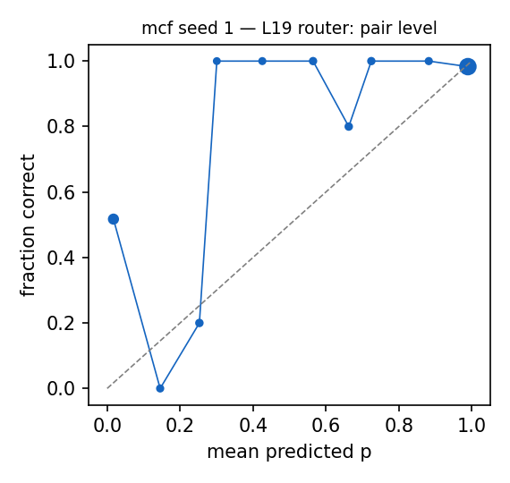
- zsRE: pair-level ECE 0.073 over 102 pairs. 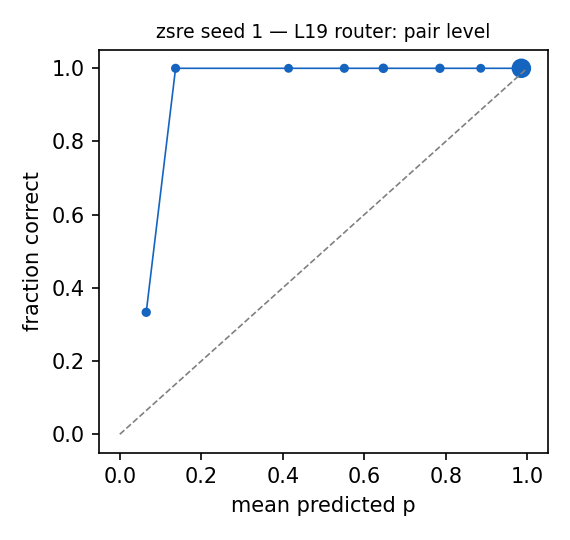
- MQuAKE: pair-level ECE 0.015 over 844 pairs. 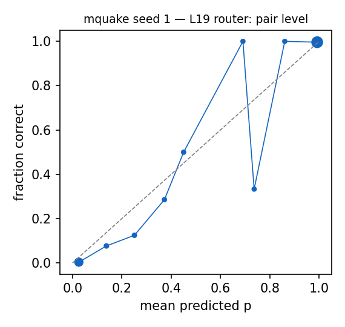
- RWKU: pair-level ECE 0.757 over 3070 pairs. 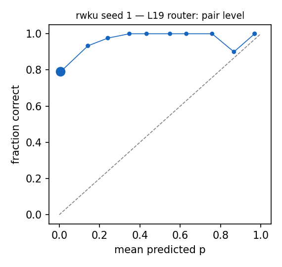

## Summary

- **MCF**: 22 routing errors; 0 from the gate, 22 from the classifier heads, 0 label conflicts. Main cause: classifier.
- **zsRE**: 4 routing errors; 0 from the gate, 4 from the classifier heads, 0 label conflicts. Main cause: classifier.
- **MQuAKE**: 13 routing errors; 0 from the gate, 13 from the classifier heads, 0 label conflicts. Main cause: classifier.
- **RWKU**: 257 routing errors; 74 from the gate, 183 from the classifier heads, 0 label conflicts. Main cause: classifier.

