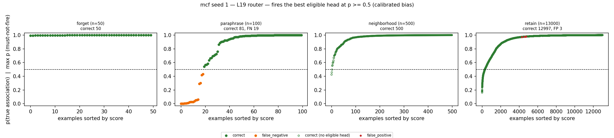
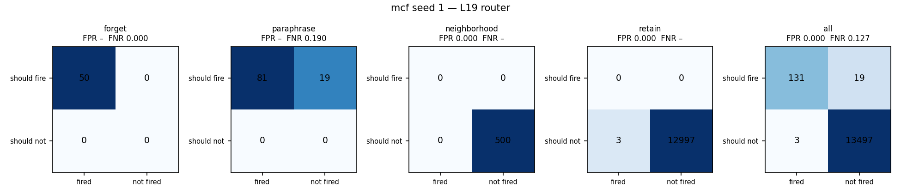
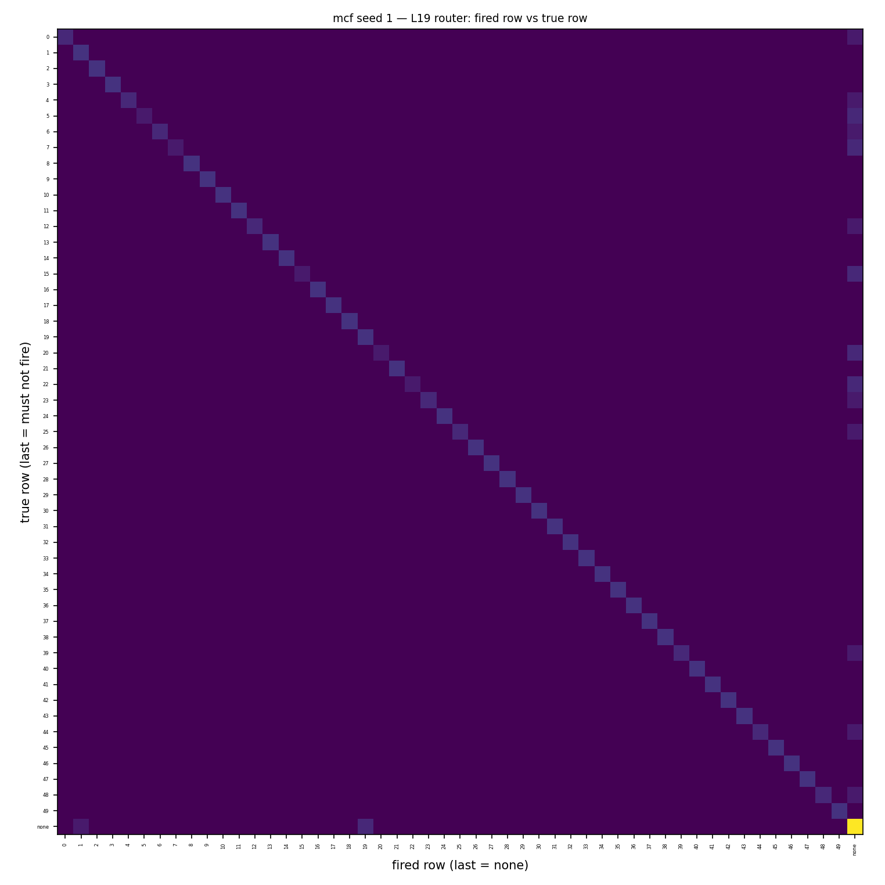
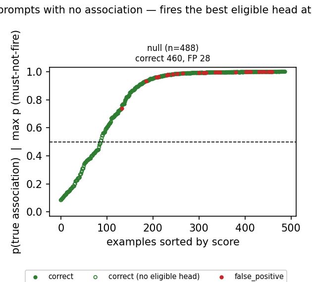
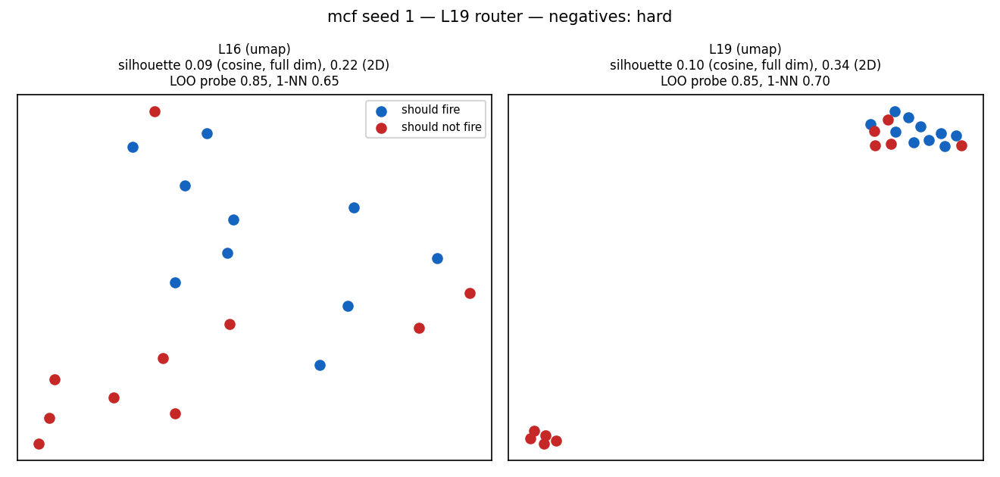
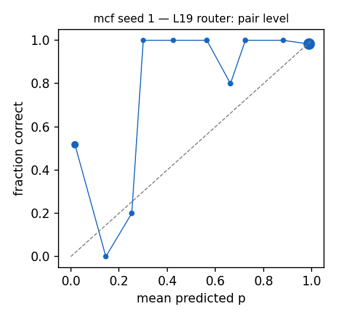

# Router diagnostics: mcf seed 1 — L19 router

Router: `/mmfs1/scratch/yl258/kp759/Unlearning/semantic-unlearning/outputs/mcf_multiseed_ours_v1/seed1/L19/router` · gate `threshold` · fires the best eligible head at p >= 0.5 (calibrated bias) · subject match `fuzzy`.
Probes: eval 13650. Hook parity (real bank hook vs cached decision): {"batched": 0, "single": 0, "perturbed_batched": 0, "perturbed_single": 0} mismatches.

## 1. Scores against the decision line

### False negatives (lowest p(true)): 15 shown

| split/group | score | fired | true | reason | prompt |
|---|---|---|---|---|---|
| paraphrase/forget_paraphrase | 0.000 | - | 44 | below_threshold | Enrollment in 2004 was 2,792 students. Jason Rebello, the |
| paraphrase/forget_paraphrase | 0.002 | - | 15 | below_threshold | After some hesitation this was accepted on 25 January. Brahms Inlet is located in |
| paraphrase/forget_paraphrase | 0.003 | - | 5 | below_threshold | He died in Far Rockaway on April 23, 1965. Irish Free State, in |
| paraphrase/forget_paraphrase | 0.005 | - | 15 | below_threshold | References Category:Superconductivity Brahms Inlet is in |
| paraphrase/forget_paraphrase | 0.007 | - | 20 | below_threshold | She was passed to the MoWT and renamed Empire Commerce. Shebelle River, in |
| paraphrase/forget_paraphrase | 0.008 | - | 20 | below_threshold | His autobiography, Sir Les, was published in 1997. Shebelle River is located in |
| paraphrase/forget_paraphrase | 0.013 | - | 7 | below_threshold | References Category:Villages in Piotrków County Pernik Peninsula, in |
| paraphrase/forget_paraphrase | 0.023 | - | 5 | below_threshold | He did, however, accept a knighthood as Garter Knight. Irish Free State is in |
| paraphrase/forget_paraphrase | 0.027 | - | 7 | below_threshold | The first two shows in Johannesburg both sold out. Pernik Peninsula is in |
| paraphrase/forget_paraphrase | 0.027 | - | 22 | below_threshold | Colin Kitching is an Australian former soccer player. Palmer Archipelago, in |
| paraphrase/forget_paraphrase | 0.028 | - | 25 | below_threshold | The beaten horses included Elmaamul, Linamix, Zoman, and Mr Brooks. Robert Merle, speaker of |
| paraphrase/forget_paraphrase | 0.035 | - | 22 | below_threshold | Rajini School (, , lit. Palmer Archipelago is located in |
| paraphrase/forget_paraphrase | 0.050 | - | 12 | below_threshold | players Category:Kenyan football managers Category:SoNy Sugar F.C. In Arkansas, they understand |
| paraphrase/forget_paraphrase | 0.056 | - | 39 | below_threshold | Since then LGBT activism has increased, asking for legal protections. MacAlpine Hills is located in |
| paraphrase/forget_paraphrase | 0.061 | - | 4 | below_threshold | History Racine was platted in 1890. Bam Margera, speaker of |

### False positives (highest score): 3 shown

| split/group | score | fired | true | reason | prompt |
|---|---|---|---|---|---|
| retain/retain_neighborhood | 0.978 | 19 | - | eligible_head_above_threshold | Sidley Austin's headquarters are in |
| retain/retain_neighborhood | 0.977 | 1 | - | eligible_head_above_threshold | Ignazio Silone worked in |
| retain/retain_neighborhood | 0.973 | 19 | - | eligible_head_above_threshold | The headquarters of Sidley Austin is in |

### Misroutes: 0 shown

none

## 2. Confusion matrices

| set | n | TP | FN | FP | TN | FPR | FNR | precision | recall | F1 | correct row |
|---|---|---|---|---|---|---|---|---|---|---|---|
| forget | 50 | 50 | 0 | 0 | 0 | – | 0.000 | 1.000 | 1.000 | 1.000 | 1.000 |
| neighborhood | 500 | 0 | 0 | 0 | 500 | 0.000 | – | – | – | – | – |
| paraphrase | 100 | 81 | 19 | 0 | 0 | – | 0.190 | 1.000 | 0.810 | 0.895 | 0.810 |
| retain | 13000 | 0 | 0 | 3 | 12997 | 0.000 | – | 0.000 | – | – | – |
| all | 13650 | 131 | 19 | 3 | 13497 | 0.000 | 0.127 | 0.978 | 0.873 | 0.923 | 0.873 |

Error reasons: false_negative:below_threshold 19, false_positive:eligible_head_above_threshold 3

## 4. Prompts with no association

| group | n | should fire | fired | fire rate [95% CI] | ungated heads p >= 0.5 |
|---|---|---|---|---|---|
| null_generic | 40 | 0 | 0 | 0.000 [0.000, 0.088] | 18 |
| null_ppl_prefix | 99 | 0 | 0 | 0.000 [0.000, 0.037] | 36 |
| null_protected_other_relation | 199 | 0 | 28 | 0.141 [0.099, 0.196] | 199 |
| null_unseen_subject | 150 | 0 | 0 | 0.000 [0.000, 0.025] | 148 |

**Deployment false-positive rate** (fires on a must-not-fire null prompt): 0.057 [0.040, 0.082], 28/488.

Generations on the 28 fired null prompts (ours `outputs/onepass_l19_v1/mcf/seed1/ours`): output changed on 25, 'I don't know'-like on 0.

### False negatives (lowest p(true)): 0 shown

none

### False positives (highest score): 15 shown

| split/group | score | fired | true | reason | prompt |
|---|---|---|---|---|---|
| null/null_protected_other_relation | 0.999 | 38 | - | eligible_head_above_threshold | Edinburgh Art Festival is located in |
| null/null_protected_other_relation | 0.999 | 13 | - | eligible_head_above_threshold | Toyota Tercel was created in the country of |
| null/null_protected_other_relation | 0.999 | 45 | - | eligible_head_above_threshold | The headquarter of Chaos Divine is located in |
| null/null_protected_other_relation | 0.999 | 29 | - | eligible_head_above_threshold | Marion Davies, who has a citizenship from |
| null/null_protected_other_relation | 0.999 | 21 | - | eligible_head_above_threshold | iPhone 1 was created by |
| null/null_protected_other_relation | 0.999 | 46 | - | eligible_head_above_threshold | Milly Mathis, who has a citizenship from |
| null/null_protected_other_relation | 0.998 | 47 | - | eligible_head_above_threshold | The mother tongue of Johan Cruyff is |
| null/null_protected_other_relation | 0.998 | 47 | - | eligible_head_above_threshold | Johan Cruyff, who has a citizenship from |
| null/null_protected_other_relation | 0.998 | 11 | - | eligible_head_above_threshold | Matija Gubec, who has a citizenship from |
| null/null_protected_other_relation | 0.998 | 36 | - | eligible_head_above_threshold | The occupation of Alfred Weber is |
| null/null_protected_other_relation | 0.997 | 26 | - | eligible_head_above_threshold | Grande Arche is located in |
| null/null_protected_other_relation | 0.996 | 48 | - | eligible_head_above_threshold | David Mendes da Silva, who holds the position of |
| null/null_protected_other_relation | 0.995 | 32 | - | eligible_head_above_threshold | The headquarter of Rousseau Institute is located in |
| null/null_protected_other_relation | 0.995 | 41 | - | eligible_head_above_threshold | Joseph Roth died at |
| null/null_protected_other_relation | 0.994 | 3 | - | eligible_head_above_threshold | Karl Krumbacher died at |

### Misroutes: 0 shown

none

## 5. Perturbed forget / paraphrase prompts (recall under surface noise)

| family | n | recall | correct row | FN reasons |
|---|---|---|---|---|
| context_double_space | 21 | 0.952 | 0.952 | below_threshold 1 |
| context_lowercase | 18 | 0.833 | 0.833 | below_threshold 3 |
| context_no_punctuation | 9 | 0.667 | 0.667 | below_threshold 3 |
| context_prefixed | 21 | 0.857 | 0.857 | below_threshold 3 |
| context_suffixed | 21 | 0.048 | 0.048 | below_threshold 20 |
| context_typo_delete | 29 | 0.759 | 0.759 | below_threshold 7 |
| context_typo_double | 33 | 0.818 | 0.818 | below_threshold 6 |
| context_typo_substitute | 36 | 0.667 | 0.667 | below_threshold 12 |
| context_typo_transpose | 38 | 0.789 | 0.789 | below_threshold 8 |
| subject_given_only | 19 | 0.000 | 0.000 | subject_absent_from_prompt 19 |
| subject_lowercase | 14 | 0.857 | 0.857 | below_threshold 2 |
| subject_possessive | 17 | 0.706 | 0.706 | below_threshold 5 |
| subject_surname_only | 15 | 0.000 | 0.000 | subject_absent_from_prompt 15 |
| subject_typo_delete | 41 | 0.854 | 0.854 | subject_absent_from_prompt 2, below_threshold 4 |
| subject_typo_double | 38 | 0.816 | 0.816 | subject_absent_from_prompt 2, below_threshold 5 |
| subject_typo_substitute | 35 | 0.743 | 0.743 | below_threshold 8, subject_absent_from_prompt 1 |
| subject_typo_transpose | 34 | 0.794 | 0.794 | below_threshold 5, subject_absent_from_prompt 2 |
| subject_uppercase | 11 | 0.909 | 0.909 | below_threshold 1 |

## 6. Positives vs negatives at L16 and L19

| layer | silhouette (cosine, full dim) | silhouette (2D) | LOO logistic | LOO 1-NN |
|---|---|---|---|---|
| L16 | 0.088 | 0.222 | 0.850 | 0.650 |
| L19 | 0.100 | 0.335 | 0.850 | 0.700 |

20 points: each LOO error moves accuracy by 0.05. Negatives (hard) prefer must-not-fire prompts that contain a protected subject.

## 7. Calibration

ECE over 174 subject-eligible (prompt, head) pairs: 0.125. deployed probabilities: the calibrated bias moves the cutoff to 0.5 for recall, so they are not meant to be calibrated probabilities.

