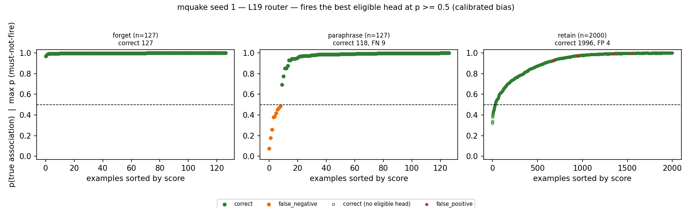
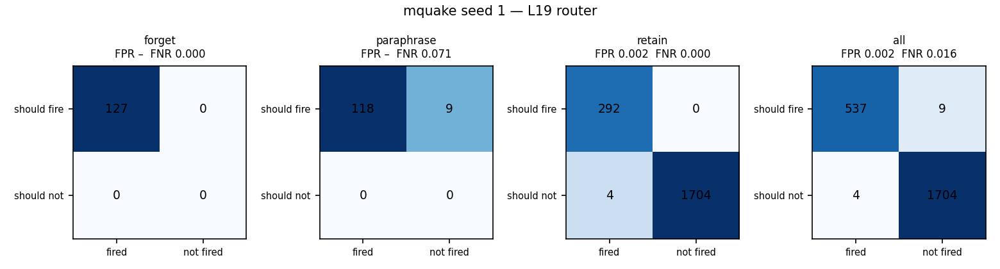
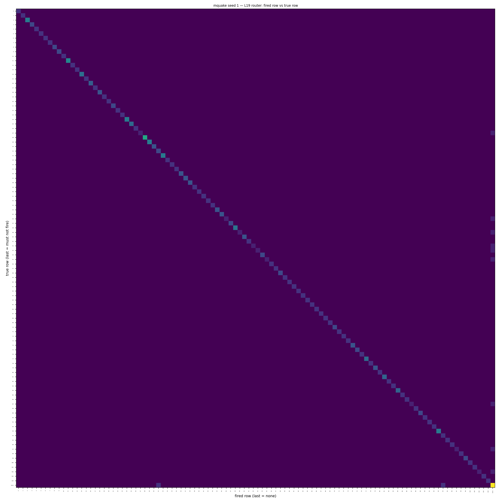
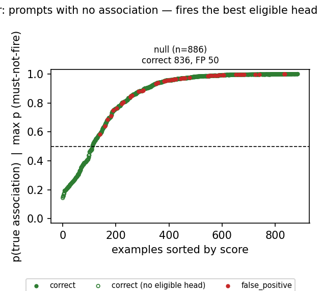
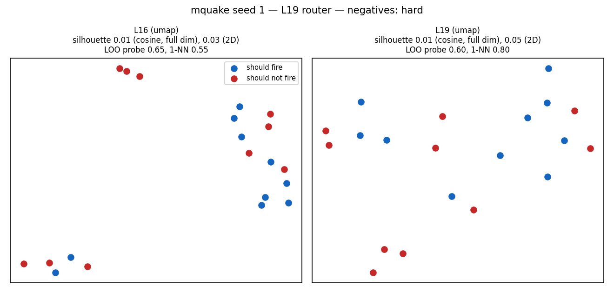
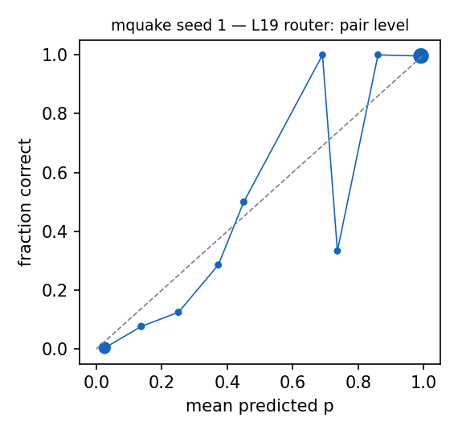

# Router diagnostics: mquake seed 1 — L19 router

Router: `/mmfs1/scratch/yl258/kp759/Unlearning/semantic-unlearning/outputs/mquake_multiseed_ours_v1/seed1/L19/router` · gate `threshold` · fires the best eligible head at p >= 0.5 (calibrated bias) · subject match `fuzzy`.
Probes: eval 2254. Hook parity (real bank hook vs cached decision): {"batched": 0, "single": 0, "perturbed_batched": 0, "perturbed_single": 0} mismatches.

## 1. Scores against the decision line

### False negatives (lowest p(true)): 9 shown

| split/group | score | fired | true | reason | prompt |
|---|---|---|---|---|---|
| paraphrase/forget_atomic_gen | 0.076 | - | 53 | below_threshold | What is the country of citizenship of Charles the Bold? |
| paraphrase/forget_atomic_gen | 0.177 | - | 49 | below_threshold | Which religion is Matteo Renzi affiliated with? |
| paraphrase/forget_atomic_gen | 0.260 | - | 87 | below_threshold | What is the country of citizenship of Robert Holmes à Court? |
| paraphrase/forget_atomic_gen | 0.378 | - | 27 | below_threshold | Which sport is Chertsey Cricket Club associated with? |
| paraphrase/forget_atomic_gen | 0.386 | - | 52 | below_threshold | Who is Elvis Presley married to? |
| paraphrase/forget_atomic_gen | 0.417 | - | 102 | below_threshold | Who is J. R. R. Tolkien married to? |
| paraphrase/forget_atomic_gen | 0.453 | - | 55 | below_threshold | Which religion is Joseph Cao affiliated with? |
| paraphrase/forget_atomic_gen | 0.472 | - | 97 | below_threshold | What is the country of citizenship of Steve Jobs? |
| paraphrase/forget_atomic_gen | 0.483 | - | 46 | below_threshold | Who is the developer of Bf 109? |

### False positives (highest score): 4 shown

| split/group | score | fired | true | reason | prompt |
|---|---|---|---|---|---|
| retain/retain_rewrite | 0.996 | 94 | - | eligible_head_above_threshold | Innocent III is affiliated with the religion of |
| retain/retain_atomic_gen | 0.992 | 94 | - | eligible_head_above_threshold | Which religion is Innocent III affiliated with? |
| retain/retain_rewrite | 0.972 | 31 | - | eligible_head_above_threshold | Joe Hockey was born in the city of |
| retain/retain_atomic_gen | 0.925 | 31 | - | eligible_head_above_threshold | Which city was Joe Hockey born in? |

### Misroutes: 0 shown

none

## 2. Confusion matrices

| set | n | TP | FN | FP | TN | FPR | FNR | precision | recall | F1 | correct row |
|---|---|---|---|---|---|---|---|---|---|---|---|
| forget | 127 | 127 | 0 | 0 | 0 | – | 0.000 | 1.000 | 1.000 | 1.000 | 1.000 |
| paraphrase | 127 | 118 | 9 | 0 | 0 | – | 0.071 | 1.000 | 0.929 | 0.963 | 0.929 |
| retain | 2000 | 292 | 0 | 4 | 1704 | 0.002 | 0.000 | 0.986 | 1.000 | 0.993 | 1.000 |
| all | 2254 | 537 | 9 | 4 | 1704 | 0.002 | 0.016 | 0.993 | 0.984 | 0.988 | 0.984 |

Error reasons: false_negative:below_threshold 9, false_positive:eligible_head_above_threshold 4

## 4. Prompts with no association

| group | n | should fire | fired | fire rate [95% CI] | ungated heads p >= 0.5 |
|---|---|---|---|---|---|
| null_generic | 40 | 0 | 0 | 0.000 [0.000, 0.088] | 3 |
| null_ppl_prefix | 99 | 0 | 0 | 0.000 [0.000, 0.037] | 32 |
| null_protected_other_relation | 367 | 0 | 44 | 0.120 [0.091, 0.157] | 360 |
| null_unseen_subject | 380 | 0 | 6 | 0.016 [0.007, 0.034] | 380 |

**Deployment false-positive rate** (fires on a must-not-fire null prompt): 0.056 [0.043, 0.074], 50/886.

Generations on the 50 fired null prompts (ours `outputs/onepass_l19_v1/mquake/seed1/ours`): output changed on 49, 'I don't know'-like on 0.

### False negatives (lowest p(true)): 0 shown

none

### False positives (highest score): 15 shown

| split/group | score | fired | true | reason | prompt |
|---|---|---|---|---|---|
| null/null_unseen_subject | 0.998 | 29 | - | eligible_head_above_threshold | Kingdom of Italy is located in the continent of |
| null/null_unseen_subject | 0.998 | 29 | - | eligible_head_above_threshold | Kingdom of Italy is located in the continent of |
| null/null_protected_other_relation | 0.998 | 61 | - | eligible_head_above_threshold | Blue Peter is located in the continent of |
| null/null_protected_other_relation | 0.997 | 95 | - | eligible_head_above_threshold | Givenchy was created by |
| null/null_protected_other_relation | 0.997 | 63 | - | eligible_head_above_threshold | The univeristy where Blizzard Entertainment was educated is |
| null/null_protected_other_relation | 0.996 | 0 | - | eligible_head_above_threshold | Gregory XV is associated with the sport of |
| null/null_protected_other_relation | 0.995 | 68 | - | eligible_head_above_threshold | Carlos Slim died in the city of |
| null/null_protected_other_relation | 0.995 | 26 | - | eligible_head_above_threshold | Steve Jobs was created in the country of |
| null/null_protected_other_relation | 0.995 | 31 | - | eligible_head_above_threshold | Joe Hockey was created in the country of |
| null/null_unseen_subject | 0.993 | 48 | - | eligible_head_above_threshold | The capital of United Kingdom of Great Britain and Ireland is |
| null/null_unseen_subject | 0.993 | 48 | - | eligible_head_above_threshold | The capital of United Kingdom of Great Britain and Ireland is |
| null/null_unseen_subject | 0.993 | 48 | - | eligible_head_above_threshold | The capital of United Kingdom of Great Britain and Ireland is |
| null/null_unseen_subject | 0.993 | 48 | - | eligible_head_above_threshold | The capital of United Kingdom of Great Britain and Ireland is |
| null/null_protected_other_relation | 0.991 | 10 | - | eligible_head_above_threshold | savate is affiliated with the religion of |
| null/null_protected_other_relation | 0.990 | 7 | - | eligible_head_above_threshold | The original language of Cairo is |

### Misroutes: 0 shown

none

## 5. Perturbed forget / paraphrase prompts (recall under surface noise)

| family | n | recall | correct row | FN reasons |
|---|---|---|---|---|
| context_double_space | 28 | 1.000 | 1.000 |  |
| context_lowercase | 19 | 1.000 | 1.000 |  |
| context_no_punctuation | 14 | 0.357 | 0.357 | below_threshold 9 |
| context_prefixed | 32 | 0.875 | 0.875 | below_threshold 4 |
| context_suffixed | 30 | 0.267 | 0.267 | below_threshold 22 |
| context_typo_delete | 61 | 0.918 | 0.918 | below_threshold 5 |
| context_typo_double | 59 | 0.932 | 0.932 | below_threshold 4 |
| context_typo_substitute | 70 | 0.786 | 0.786 | below_threshold 15 |
| context_typo_transpose | 64 | 1.000 | 1.000 |  |
| subject_given_only | 22 | 0.000 | 0.000 | subject_absent_from_prompt 22 |
| subject_lowercase | 28 | 0.964 | 0.964 | below_threshold 1 |
| subject_possessive | 37 | 0.865 | 0.865 | below_threshold 5 |
| subject_surname_only | 25 | 0.000 | 0.000 | subject_absent_from_prompt 25 |
| subject_typo_delete | 57 | 0.754 | 0.754 | subject_absent_from_prompt 5, below_threshold 9 |
| subject_typo_double | 53 | 0.925 | 0.925 | subject_in_text_not_token_matched 2, subject_absent_from_prompt 1, below_threshold 1 |
| subject_typo_substitute | 73 | 0.753 | 0.753 | below_threshold 15, subject_absent_from_prompt 3 |
| subject_typo_transpose | 62 | 0.726 | 0.726 | subject_absent_from_prompt 3, below_threshold 14 |
| subject_unaccented | 1 | 1.000 | 1.000 |  |
| subject_uppercase | 27 | 0.889 | 0.889 | below_threshold 3 |

## 6. Positives vs negatives at L16 and L19

| layer | silhouette (cosine, full dim) | silhouette (2D) | LOO logistic | LOO 1-NN |
|---|---|---|---|---|
| L16 | 0.008 | 0.031 | 0.650 | 0.550 |
| L19 | 0.006 | 0.049 | 0.600 | 0.800 |

20 points: each LOO error moves accuracy by 0.05. Negatives (hard) prefer must-not-fire prompts that contain a protected subject.

## 7. Calibration

ECE over 844 subject-eligible (prompt, head) pairs: 0.015. deployed probabilities: the calibrated bias moves the cutoff to 0.5 for recall, so they are not meant to be calibrated probabilities.

