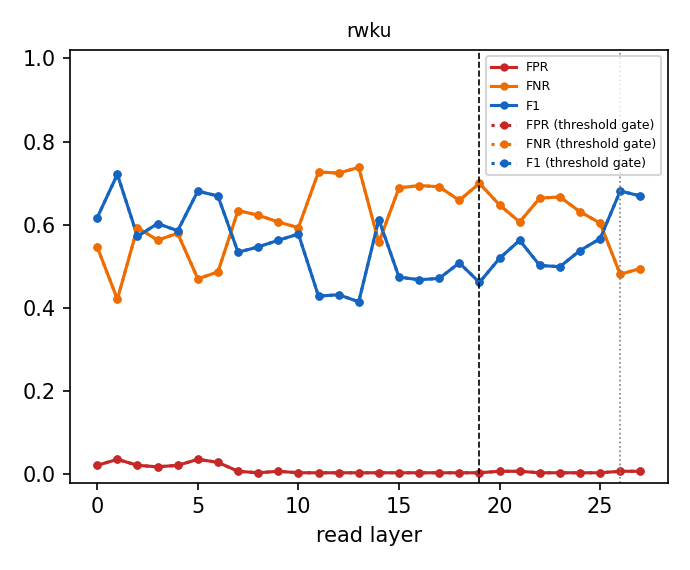

# Why the router reads layer 19

Same Linear + sigmoid router (shipped recipe, L-BFGS, CV-selected L2) refit at every layer from cached last-token states; errors on the official evaluation prompts, which are never used to fit or calibrate. Dashed line: L19; dotted: the penultimate layer.

| dataset | best-F1 layer | F1 there | F1 at L19 | L19 rank (of layers) | L19 vs penultimate | refit = shipped at L19 |
|---|---|---|---|---|---|---|
| rwku (threshold gate) | L1 | 0.721 | 0.461 | 25/28 | L19 not beaten | 1.000 |

Per-dataset tables, the penultimate comparison, pipeline cost and robustness variants: `<cache>/layer_sweep/layer_choice.md`.

## Robustness: rwku

| variant | layers | eligibility | FPR | FNR | F1 | correct row | null FPR | perturbed recall | ECE |
|---|---|---|---|---|---|---|---|---|---|
| baseline | 19 | exact | 0.004 | 0.699 | 0.461 | 0.301 | 0.000 | 0.253 | 0.739 |
| baseline | 19 | fuzzy | 0.004 | 0.699 | 0.461 | 0.301 | 0.000 | 0.309 | 0.739 |
| baseline | 19 | none | 0.151 | 0.664 | 0.463 | 0.306 | 0.322 | 0.375 | 0.081 |
| baseline | 19 | exact | 0.004 | 0.699 | 0.461 | 0.301 | 0.000 | 0.253 | 0.739 |
| baseline | 19 | fuzzy | 0.004 | 0.699 | 0.461 | 0.301 | 0.000 | 0.309 | 0.739 |
| baseline | 19 | none | 0.151 | 0.664 | 0.463 | 0.306 | 0.322 | 0.375 | 0.081 |
| hardneg | 19 | exact | 0.004 | 0.699 | 0.461 | 0.301 | 0.000 | 0.253 | 0.739 |
| hardneg | 19 | fuzzy | 0.004 | 0.699 | 0.461 | 0.301 | 0.000 | 0.309 | 0.739 |
| hardneg | 19 | none | 0.151 | 0.664 | 0.463 | 0.306 | 0.322 | 0.375 | 0.081 |
| hardneg | 19 | exact | 0.004 | 0.699 | 0.461 | 0.301 | 0.000 | 0.253 | 0.739 |
| hardneg | 19 | fuzzy | 0.004 | 0.699 | 0.461 | 0.301 | 0.000 | 0.309 | 0.739 |
| hardneg | 19 | none | 0.151 | 0.664 | 0.463 | 0.306 | 0.322 | 0.375 | 0.081 |
| aug | 19 | exact | 0.007 | 0.495 | 0.669 | 0.505 | 0.000 | 0.453 | 0.748 |
| aug | 19 | fuzzy | 0.007 | 0.495 | 0.669 | 0.505 | 0.000 | 0.552 | 0.748 |
| aug | 19 | none | 0.484 | 0.344 | 0.648 | 0.467 | 0.577 | 0.739 | 0.090 |
| aug | 19 | exact | 0.007 | 0.495 | 0.669 | 0.505 | 0.000 | 0.453 | 0.748 |
| aug | 19 | fuzzy | 0.007 | 0.495 | 0.669 | 0.505 | 0.000 | 0.552 | 0.748 |
| aug | 19 | none | 0.484 | 0.344 | 0.648 | 0.467 | 0.577 | 0.739 | 0.090 |
| hardneg_aug | 19 | exact | 0.007 | 0.495 | 0.669 | 0.505 | 0.000 | 0.453 | 0.748 |
| hardneg_aug | 19 | fuzzy | 0.007 | 0.495 | 0.669 | 0.505 | 0.000 | 0.552 | 0.748 |
| hardneg_aug | 19 | none | 0.484 | 0.344 | 0.648 | 0.467 | 0.577 | 0.739 | 0.090 |
| hardneg_aug | 19 | exact | 0.007 | 0.495 | 0.669 | 0.505 | 0.000 | 0.453 | 0.748 |
| hardneg_aug | 19 | fuzzy | 0.007 | 0.495 | 0.669 | 0.505 | 0.000 | 0.552 | 0.748 |
| hardneg_aug | 19 | none | 0.484 | 0.344 | 0.648 | 0.467 | 0.577 | 0.739 | 0.090 |
| concat | 16,19,23 | exact | 0.004 | 0.675 | 0.490 | 0.325 | 0.000 | 0.275 | 0.740 |
| concat | 16,19,23 | fuzzy | 0.004 | 0.675 | 0.490 | 0.325 | 0.000 | 0.329 | 0.740 |
| concat | 16,19,23 | none | 0.129 | 0.661 | 0.471 | 0.311 | 0.314 | 0.379 | 0.081 |
| concat | 16,19,23 | exact | 0.004 | 0.675 | 0.490 | 0.325 | 0.000 | 0.275 | 0.740 |
| concat | 16,19,23 | fuzzy | 0.004 | 0.675 | 0.490 | 0.325 | 0.000 | 0.329 | 0.740 |
| concat | 16,19,23 | none | 0.129 | 0.661 | 0.471 | 0.311 | 0.314 | 0.379 | 0.081 |
| unmasked | 19 | exact | 0.007 | 0.489 | 0.674 | 0.511 | 0.000 | 0.463 | 0.735 |
| unmasked | 19 | fuzzy | 0.007 | 0.489 | 0.674 | 0.511 | 0.000 | 0.555 | 0.735 |
| unmasked | 19 | none | 0.165 | 0.383 | 0.708 | 0.596 | 0.297 | 0.624 | 0.090 |
| unmasked | 19 | exact | 0.007 | 0.489 | 0.674 | 0.511 | 0.000 | 0.463 | 0.735 |
| unmasked | 19 | fuzzy | 0.007 | 0.489 | 0.674 | 0.511 | 0.000 | 0.555 | 0.735 |
| unmasked | 19 | none | 0.165 | 0.383 | 0.708 | 0.596 | 0.297 | 0.624 | 0.090 |
| baseline | 26 | exact | 0.007 | 0.481 | 0.681 | 0.519 | 0.000 | 0.478 | 0.741 |
| baseline | 26 | fuzzy | 0.007 | 0.481 | 0.681 | 0.519 | 0.000 | 0.569 | 0.741 |
| baseline | 26 | none | 0.427 | 0.306 | 0.687 | 0.560 | 0.456 | 0.713 | 0.079 |
| baseline | 26 | exact | 0.007 | 0.481 | 0.681 | 0.519 | 0.000 | 0.478 | 0.741 |
| baseline | 26 | fuzzy | 0.007 | 0.481 | 0.681 | 0.519 | 0.000 | 0.569 | 0.741 |
| baseline | 26 | none | 0.427 | 0.306 | 0.687 | 0.560 | 0.456 | 0.713 | 0.079 |
| hardneg | 26 | exact | 0.007 | 0.481 | 0.681 | 0.519 | 0.000 | 0.478 | 0.741 |
| hardneg | 26 | fuzzy | 0.007 | 0.481 | 0.681 | 0.519 | 0.000 | 0.569 | 0.741 |
| hardneg | 26 | none | 0.427 | 0.306 | 0.687 | 0.560 | 0.456 | 0.713 | 0.079 |
| hardneg | 26 | exact | 0.007 | 0.481 | 0.681 | 0.519 | 0.000 | 0.478 | 0.741 |
| hardneg | 26 | fuzzy | 0.007 | 0.481 | 0.681 | 0.519 | 0.000 | 0.569 | 0.741 |
| hardneg | 26 | none | 0.427 | 0.306 | 0.687 | 0.560 | 0.456 | 0.713 | 0.079 |
| aug | 26 | exact | 0.007 | 0.467 | 0.693 | 0.533 | 0.000 | 0.467 | 0.748 |
| aug | 26 | fuzzy | 0.007 | 0.467 | 0.693 | 0.533 | 0.000 | 0.565 | 0.748 |
| aug | 26 | none | 0.226 | 0.322 | 0.733 | 0.555 | 0.335 | 0.704 | 0.088 |
| aug | 26 | exact | 0.007 | 0.467 | 0.693 | 0.533 | 0.000 | 0.467 | 0.748 |
| aug | 26 | fuzzy | 0.007 | 0.467 | 0.693 | 0.533 | 0.000 | 0.565 | 0.748 |
| aug | 26 | none | 0.226 | 0.322 | 0.733 | 0.555 | 0.335 | 0.704 | 0.088 |
| hardneg_aug | 26 | exact | 0.007 | 0.467 | 0.693 | 0.533 | 0.000 | 0.467 | 0.748 |
| hardneg_aug | 26 | fuzzy | 0.007 | 0.467 | 0.693 | 0.533 | 0.000 | 0.565 | 0.748 |
| hardneg_aug | 26 | none | 0.215 | 0.331 | 0.730 | 0.546 | 0.331 | 0.698 | 0.088 |
| hardneg_aug | 26 | exact | 0.007 | 0.467 | 0.693 | 0.533 | 0.000 | 0.467 | 0.748 |
| hardneg_aug | 26 | fuzzy | 0.007 | 0.467 | 0.693 | 0.533 | 0.000 | 0.565 | 0.748 |
| hardneg_aug | 26 | none | 0.215 | 0.331 | 0.730 | 0.546 | 0.331 | 0.698 | 0.088 |
| unmasked | 26 | exact | 0.007 | 0.383 | 0.761 | 0.617 | 0.000 | 0.569 | 0.731 |
| unmasked | 26 | fuzzy | 0.007 | 0.383 | 0.761 | 0.617 | 0.000 | 0.685 | 0.731 |
| unmasked | 26 | none | 0.176 | 0.260 | 0.790 | 0.738 | 0.259 | 0.758 | 0.091 |
| unmasked | 26 | exact | 0.007 | 0.383 | 0.761 | 0.617 | 0.000 | 0.569 | 0.731 |
| unmasked | 26 | fuzzy | 0.007 | 0.383 | 0.761 | 0.617 | 0.000 | 0.685 | 0.731 |
| unmasked | 26 | none | 0.176 | 0.260 | 0.790 | 0.738 | 0.259 | 0.758 | 0.091 |

