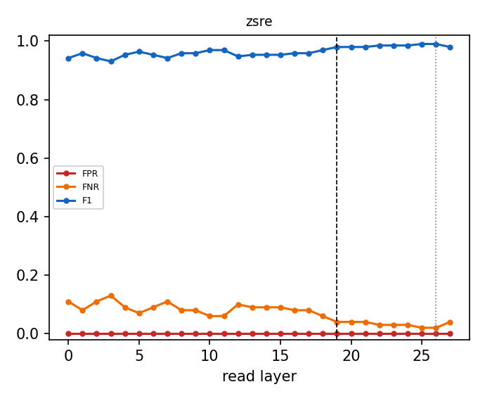

# Why the router reads layer 19

Same Linear + sigmoid router (shipped recipe, L-BFGS, CV-selected L2) refit at every layer from cached last-token states; errors on the official evaluation prompts, which are never used to fit or calibrate. Dashed line: L19; dotted: the penultimate layer.

| dataset | best-F1 layer | F1 there | F1 at L19 | L19 rank (of layers) | L19 vs penultimate | refit = shipped at L19 |
|---|---|---|---|---|---|---|
| zsre | L25 | 0.990 | 0.980 | 6/28 | L19 not beaten | 1.000 |

Per-dataset tables, the penultimate comparison, pipeline cost and robustness variants: `<cache>/layer_sweep/layer_choice.md`.

## Robustness: zsre

| variant | layers | eligibility | FPR | FNR | F1 | correct row | null FPR | perturbed recall | ECE |
|---|---|---|---|---|---|---|---|---|---|
| baseline | 19 | exact | 0.000 | 0.040 | 0.980 | 0.960 | 0.016 | 0.430 | 0.082 |
| baseline | 19 | fuzzy | 0.000 | 0.040 | 0.980 | 0.960 | 0.016 | 0.760 | 0.080 |
| baseline | 19 | none | 0.093 | 0.140 | 0.176 | 0.810 | 0.305 | 0.660 | 0.073 |
| hardneg | 19 | exact | 0.000 | 0.050 | 0.974 | 0.950 | 0.014 | 0.430 | 0.092 |
| hardneg | 19 | fuzzy | 0.000 | 0.050 | 0.974 | 0.950 | 0.014 | 0.760 | 0.090 |
| hardneg | 19 | none | 0.185 | 0.100 | 0.102 | 0.830 | 0.401 | 0.757 | 0.056 |
| aug | 19 | exact | 0.000 | 0.040 | 0.980 | 0.960 | 0.018 | 0.437 | 0.056 |
| aug | 19 | fuzzy | 0.000 | 0.040 | 0.980 | 0.960 | 0.018 | 0.773 | 0.055 |
| aug | 19 | none | 0.315 | 0.100 | 0.062 | 0.840 | 0.435 | 0.773 | 0.062 |
| hardneg_aug | 19 | exact | 0.000 | 0.050 | 0.974 | 0.950 | 0.014 | 0.433 | 0.064 |
| hardneg_aug | 19 | fuzzy | 0.000 | 0.050 | 0.974 | 0.950 | 0.014 | 0.770 | 0.063 |
| hardneg_aug | 19 | none | 0.145 | 0.130 | 0.122 | 0.820 | 0.374 | 0.743 | 0.045 |
| concat | 16,19,23 | exact | 0.000 | 0.040 | 0.980 | 0.960 | 0.014 | 0.423 | 0.085 |
| concat | 16,19,23 | fuzzy | 0.000 | 0.040 | 0.980 | 0.960 | 0.014 | 0.747 | 0.082 |
| concat | 16,19,23 | none | 0.462 | 0.090 | 0.044 | 0.830 | 0.494 | 0.777 | 0.069 |
| unmasked | 19 | exact | 0.000 | 0.070 | 0.964 | 0.930 | 0.027 | 0.363 | 0.068 |
| unmasked | 19 | fuzzy | 0.000 | 0.070 | 0.964 | 0.930 | 0.027 | 0.650 | 0.067 |
| unmasked | 19 | none | 0.029 | 0.070 | 0.423 | 0.930 | 0.116 | 0.693 | 0.002 |
| baseline | 26 | exact | 0.000 | 0.020 | 0.990 | 0.980 | 0.046 | 0.450 | 0.094 |
| baseline | 26 | fuzzy | 0.000 | 0.020 | 0.990 | 0.980 | 0.046 | 0.780 | 0.091 |
| baseline | 26 | none | 0.473 | 0.100 | 0.043 | 0.830 | 0.510 | 0.750 | 0.085 |
| hardneg | 26 | exact | 0.000 | 0.040 | 0.980 | 0.960 | 0.034 | 0.440 | 0.104 |
| hardneg | 26 | fuzzy | 0.000 | 0.040 | 0.980 | 0.960 | 0.034 | 0.773 | 0.102 |
| hardneg | 26 | none | 0.095 | 0.140 | 0.173 | 0.840 | 0.269 | 0.660 | 0.067 |
| aug | 26 | exact | 0.000 | 0.040 | 0.980 | 0.960 | 0.027 | 0.443 | 0.065 |
| aug | 26 | fuzzy | 0.000 | 0.040 | 0.980 | 0.960 | 0.027 | 0.767 | 0.063 |
| aug | 26 | none | 0.195 | 0.130 | 0.094 | 0.820 | 0.412 | 0.763 | 0.072 |
| hardneg_aug | 26 | exact | 0.000 | 0.040 | 0.980 | 0.960 | 0.018 | 0.437 | 0.075 |
| hardneg_aug | 26 | fuzzy | 0.000 | 0.040 | 0.980 | 0.960 | 0.018 | 0.760 | 0.074 |
| hardneg_aug | 26 | none | 0.124 | 0.120 | 0.141 | 0.840 | 0.376 | 0.743 | 0.054 |
| unmasked | 26 | exact | 0.000 | 0.070 | 0.964 | 0.930 | 0.014 | 0.360 | 0.052 |
| unmasked | 26 | fuzzy | 0.000 | 0.070 | 0.964 | 0.930 | 0.014 | 0.620 | 0.051 |
| unmasked | 26 | none | 0.007 | 0.070 | 0.727 | 0.930 | 0.023 | 0.657 | 0.002 |

