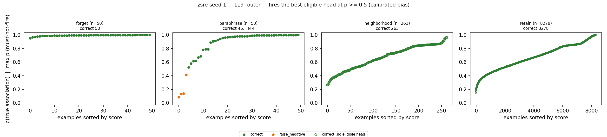
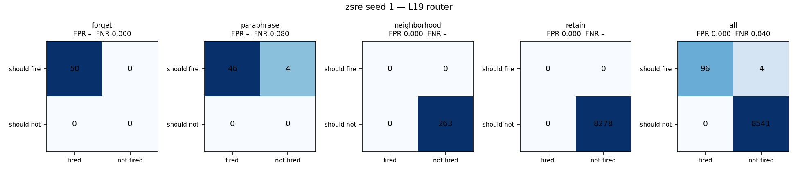
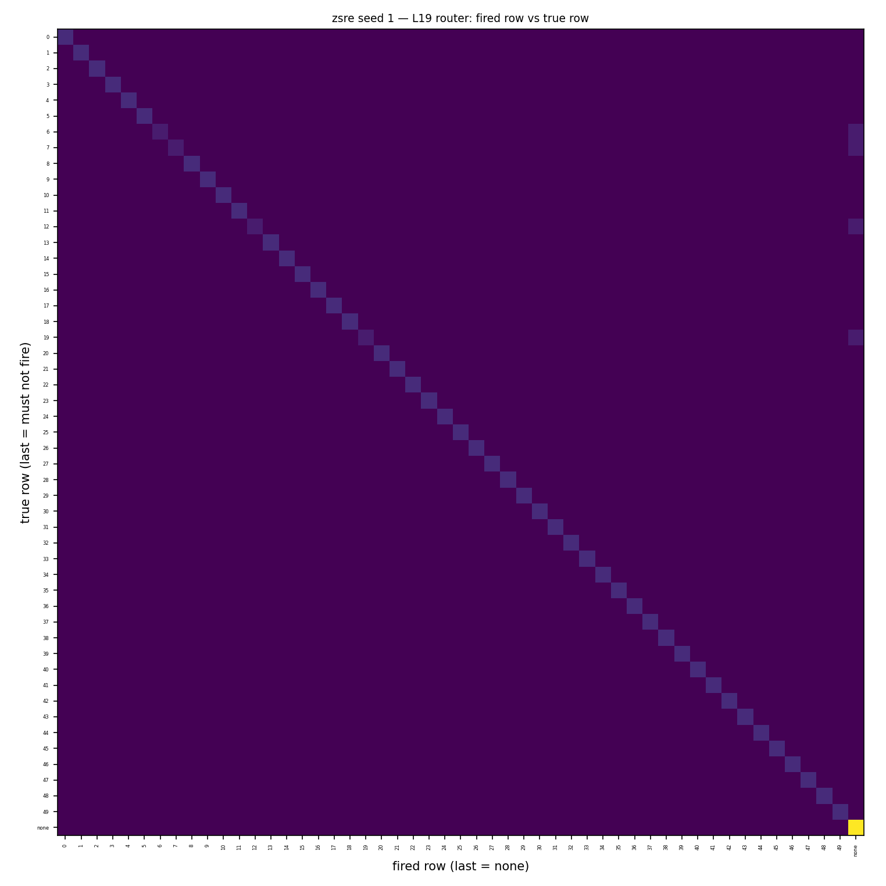
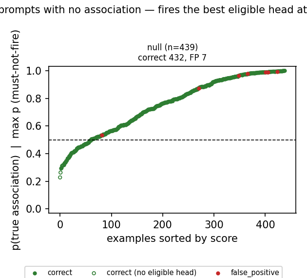
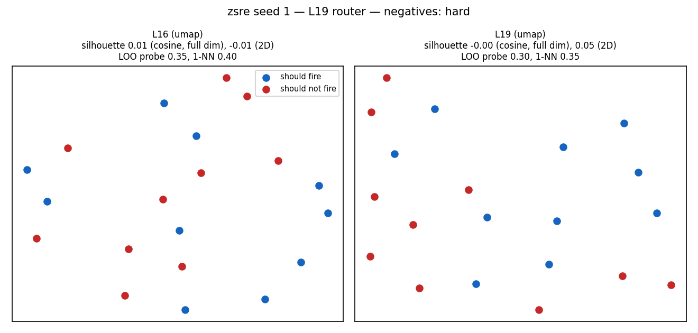
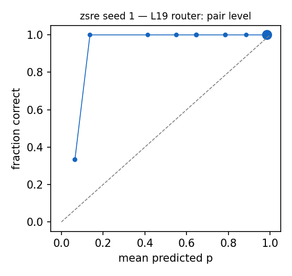

# Router diagnostics: zsre seed 1 — L19 router

Router: `/mmfs1/scratch/yl258/kp759/Unlearning/semantic-unlearning/outputs/zsre_multiseed_ours_v1/seed1/L19/router` · gate `threshold` · fires the best eligible head at p >= 0.5 (calibrated bias) · subject match `fuzzy`.
Probes: eval 8641. Hook parity (real bank hook vs cached decision): {"batched": 0, "single": 0, "perturbed_batched": 0, "perturbed_single": 0} mismatches.

## 1. Scores against the decision line

### False negatives (lowest p(true)): 4 shown

| split/group | score | fired | true | reason | prompt |
|---|---|---|---|---|---|
| paraphrase/forget_paraphrase | 0.086 | - | 12 | below_threshold | What does the sex of Ingeborg Norell describe? |
| paraphrase/forget_paraphrase | 0.133 | - | 7 | below_threshold | The astronomical body Tupan Patera was on, what was that? |
| paraphrase/forget_paraphrase | 0.140 | - | 19 | below_threshold | What company is known as Nuffield Universal? |
| paraphrase/forget_paraphrase | 0.414 | - | 6 | below_threshold | Who has released Soul Merchant album? |

### False positives (highest score): 0 shown

none

### Misroutes: 0 shown

none

## 2. Confusion matrices

| set | n | TP | FN | FP | TN | FPR | FNR | precision | recall | F1 | correct row |
|---|---|---|---|---|---|---|---|---|---|---|---|
| forget | 50 | 50 | 0 | 0 | 0 | – | 0.000 | 1.000 | 1.000 | 1.000 | 1.000 |
| neighborhood | 263 | 0 | 0 | 0 | 263 | 0.000 | – | – | – | – | – |
| paraphrase | 50 | 46 | 4 | 0 | 0 | – | 0.080 | 1.000 | 0.920 | 0.958 | 0.920 |
| retain | 8278 | 0 | 0 | 0 | 8278 | 0.000 | – | – | – | – | – |
| all | 8641 | 96 | 4 | 0 | 8541 | 0.000 | 0.040 | 1.000 | 0.960 | 0.980 | 0.960 |

Error reasons: false_negative:below_threshold 4

## 4. Prompts with no association

| group | n | should fire | fired | fire rate [95% CI] | ungated heads p >= 0.5 |
|---|---|---|---|---|---|
| null_generic | 40 | 0 | 0 | 0.000 [0.000, 0.088] | 27 |
| null_ppl_prefix | 99 | 0 | 0 | 0.000 [0.000, 0.037] | 73 |
| null_protected_other_relation | 150 | 0 | 7 | 0.047 [0.023, 0.093] | 131 |
| null_unseen_subject | 150 | 0 | 0 | 0.000 [0.000, 0.025] | 147 |

**Deployment false-positive rate** (fires on a must-not-fire null prompt): 0.016 [0.008, 0.033], 7/439.

Generations on the 7 fired null prompts (ours `outputs/onepass_l19_v1/zsre/seed1/ours`): output changed on 6, 'I don't know'-like on 0.

### False negatives (lowest p(true)): 0 shown

none

### False positives (highest score): 7 shown

| split/group | score | fired | true | reason | prompt |
|---|---|---|---|---|---|
| null/null_protected_other_relation | 0.994 | 49 | - | eligible_head_above_threshold | Who is in Help I'm Alive as a cast member? |
| null/null_protected_other_relation | 0.990 | 14 | - | eligible_head_above_threshold | What is Roland Gransart's country of original? |
| null/null_protected_other_relation | 0.989 | 2 | - | eligible_head_above_threshold | Where was Oliver Welden born? |
| null/null_protected_other_relation | 0.977 | 6 | - | eligible_head_above_threshold | Which artist is Soul Merchant co-written and recorded by? |
| null/null_protected_other_relation | 0.964 | 45 | - | eligible_head_above_threshold | Who was behind the discovery of 557 Violetta? |
| null/null_protected_other_relation | 0.872 | 40 | - | eligible_head_above_threshold | What is the home arena of Igor Ardašev? |
| null/null_protected_other_relation | 0.533 | 13 | - | eligible_head_above_threshold | Which constellation is Jaynes Islands in? |

### Misroutes: 0 shown

none

## 5. Perturbed forget / paraphrase prompts (recall under surface noise)

| family | n | recall | correct row | FN reasons |
|---|---|---|---|---|
| context_double_space | 19 | 0.895 | 0.895 | below_threshold 2 |
| context_lowercase | 13 | 0.846 | 0.846 | below_threshold 2 |
| context_no_punctuation | 13 | 0.615 | 0.615 | below_threshold 5 |
| context_prefixed | 10 | 0.900 | 0.900 | below_threshold 1 |
| context_suffixed | 11 | 0.545 | 0.545 | below_threshold 5 |
| context_typo_delete | 20 | 0.950 | 0.950 | below_threshold 1 |
| context_typo_double | 30 | 0.967 | 0.967 | below_threshold 1 |
| context_typo_substitute | 22 | 0.682 | 0.682 | below_threshold 7 |
| context_typo_transpose | 18 | 1.000 | 1.000 |  |
| subject_given_only | 13 | 0.000 | 0.000 | subject_absent_from_prompt 11, below_threshold 2 |
| subject_lowercase | 13 | 1.000 | 1.000 |  |
| subject_possessive | 18 | 0.667 | 0.667 | below_threshold 6 |
| subject_surname_only | 15 | 0.000 | 0.000 | subject_absent_from_prompt 15 |
| subject_typo_delete | 11 | 0.636 | 0.636 | below_threshold 3, subject_absent_from_prompt 1 |
| subject_typo_double | 23 | 0.783 | 0.783 | subject_absent_from_prompt 1, below_threshold 4 |
| subject_typo_substitute | 24 | 1.000 | 1.000 |  |
| subject_typo_transpose | 18 | 0.722 | 0.722 | below_threshold 5 |
| subject_uppercase | 9 | 1.000 | 1.000 |  |

## 6. Positives vs negatives at L16 and L19

| layer | silhouette (cosine, full dim) | silhouette (2D) | LOO logistic | LOO 1-NN |
|---|---|---|---|---|
| L16 | 0.006 | -0.015 | 0.350 | 0.400 |
| L19 | -0.001 | 0.055 | 0.300 | 0.350 |

20 points: each LOO error moves accuracy by 0.05. Negatives (hard) prefer must-not-fire prompts that contain a protected subject.

## 7. Calibration

ECE over 102 subject-eligible (prompt, head) pairs: 0.073. deployed probabilities: the calibrated bias moves the cutoff to 0.5 for recall, so they are not meant to be calibrated probabilities.

