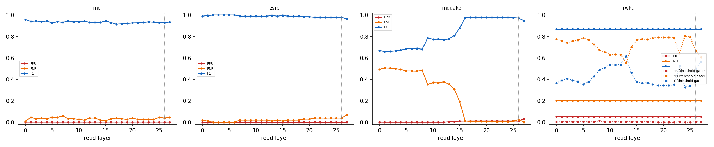

# Why the router reads layer 19

Same Linear + sigmoid router (shipped recipe, L-BFGS, CV-selected L2) refit at every layer from cached last-token states; errors on the official evaluation prompts, which are never used to fit or calibrate. Dashed line: L19; dotted: the penultimate layer.

| dataset | best-F1 layer | F1 there | F1 at L19 | L19 rank (of layers) | L19 vs penultimate | refit = shipped at L19 |
|---|---|---|---|---|---|---|
| mcf | L0 | 0.958 | 0.921 | 26/28 | penultimate better | 1.000 |
| zsre | L2 | 1.000 | 0.985 | 20/28 | L19 not beaten | 1.000 |
| mquake | L22 | 0.980 | 0.978 | 7/28 | L19 not beaten | 1.000 |
| rwku (threshold gate) | L13 | 0.615 | 0.344 | 24/28 | L19 not beaten | 1.000 |

Per-dataset tables, the penultimate comparison, pipeline cost and robustness variants: `<cache>/layer_sweep/layer_choice.md`.

## Robustness: mcf

| variant | layers | eligibility | FPR | FNR | F1 | correct row | null FPR | perturbed recall | ECE |
|---|---|---|---|---|---|---|---|---|---|
| baseline | 19 | exact | 0.002 | 0.027 | 0.921 | 0.973 | 0.211 | 0.484 | 0.097 |
| baseline | 19 | fuzzy | 0.002 | 0.027 | 0.921 | 0.973 | 0.211 | 0.869 | 0.097 |
| baseline | 19 | none | 0.567 | 0.353 | 0.025 | 0.487 | 0.500 | 0.547 | 0.240 |
| hardneg | 19 | exact | 0.001 | 0.067 | 0.936 | 0.933 | 0.164 | 0.464 | 0.151 |
| hardneg | 19 | fuzzy | 0.001 | 0.067 | 0.936 | 0.933 | 0.164 | 0.833 | 0.151 |
| hardneg | 19 | none | 0.503 | 0.387 | 0.026 | 0.467 | 0.377 | 0.509 | 0.147 |
| aug | 19 | exact | 0.001 | 0.053 | 0.910 | 0.947 | 0.225 | 0.476 | 0.097 |
| aug | 19 | fuzzy | 0.001 | 0.053 | 0.910 | 0.947 | 0.225 | 0.856 | 0.097 |
| aug | 19 | none | 0.538 | 0.420 | 0.023 | 0.400 | 0.439 | 0.560 | 0.251 |
| hardneg_aug | 19 | exact | 0.001 | 0.080 | 0.920 | 0.920 | 0.148 | 0.460 | 0.123 |
| hardneg_aug | 19 | fuzzy | 0.001 | 0.080 | 0.920 | 0.920 | 0.148 | 0.824 | 0.123 |
| hardneg_aug | 19 | none | 0.562 | 0.400 | 0.023 | 0.440 | 0.457 | 0.549 | 0.144 |
| concat | 16,19,23 | exact | 0.001 | 0.047 | 0.923 | 0.953 | 0.211 | 0.476 | 0.093 |
| concat | 16,19,23 | fuzzy | 0.001 | 0.047 | 0.923 | 0.953 | 0.211 | 0.860 | 0.093 |
| concat | 16,19,23 | none | 0.576 | 0.320 | 0.025 | 0.533 | 0.498 | 0.636 | 0.230 |
| unmasked | 19 | exact | 0.001 | 0.087 | 0.923 | 0.913 | 0.213 | 0.396 | 0.201 |
| unmasked | 19 | fuzzy | 0.001 | 0.087 | 0.923 | 0.913 | 0.213 | 0.736 | 0.201 |
| unmasked | 19 | none | 0.681 | 0.073 | 0.029 | 0.860 | 0.637 | 0.844 | 0.008 |
| baseline | 26 | exact | 0.001 | 0.040 | 0.929 | 0.960 | 0.191 | 0.480 | 0.108 |
| baseline | 26 | fuzzy | 0.001 | 0.040 | 0.929 | 0.960 | 0.191 | 0.864 | 0.108 |
| baseline | 26 | none | 0.554 | 0.267 | 0.028 | 0.560 | 0.596 | 0.633 | 0.223 |
| hardneg | 26 | exact | 0.001 | 0.060 | 0.946 | 0.940 | 0.135 | 0.473 | 0.168 |
| hardneg | 26 | fuzzy | 0.001 | 0.060 | 0.946 | 0.940 | 0.135 | 0.847 | 0.168 |
| hardneg | 26 | none | 0.493 | 0.307 | 0.030 | 0.527 | 0.451 | 0.611 | 0.136 |
| aug | 26 | exact | 0.001 | 0.053 | 0.940 | 0.947 | 0.176 | 0.469 | 0.113 |
| aug | 26 | fuzzy | 0.001 | 0.053 | 0.940 | 0.947 | 0.176 | 0.847 | 0.113 |
| aug | 26 | none | 0.524 | 0.287 | 0.029 | 0.533 | 0.514 | 0.627 | 0.226 |
| hardneg_aug | 26 | exact | 0.001 | 0.093 | 0.922 | 0.907 | 0.111 | 0.456 | 0.145 |
| hardneg_aug | 26 | fuzzy | 0.001 | 0.093 | 0.922 | 0.907 | 0.111 | 0.816 | 0.145 |
| hardneg_aug | 26 | none | 0.589 | 0.253 | 0.027 | 0.560 | 0.518 | 0.660 | 0.124 |
| unmasked | 26 | exact | 0.001 | 0.073 | 0.917 | 0.927 | 0.230 | 0.431 | 0.197 |
| unmasked | 26 | fuzzy | 0.001 | 0.073 | 0.917 | 0.927 | 0.230 | 0.784 | 0.197 |
| unmasked | 26 | none | 0.670 | 0.053 | 0.030 | 0.880 | 0.650 | 0.904 | 0.006 |

## Robustness: zsre

| variant | layers | eligibility | FPR | FNR | F1 | correct row | null FPR | perturbed recall | ECE |
|---|---|---|---|---|---|---|---|---|---|
| baseline | 19 | exact | 0.000 | 0.030 | 0.985 | 0.970 | 0.059 | 0.463 | 0.080 |
| baseline | 19 | fuzzy | 0.000 | 0.030 | 0.985 | 0.970 | 0.059 | 0.777 | 0.080 |
| baseline | 19 | none | 0.402 | 0.070 | 0.051 | 0.830 | 0.567 | 0.807 | 0.027 |
| hardneg | 19 | exact | 0.000 | 0.040 | 0.980 | 0.960 | 0.043 | 0.457 | 0.092 |
| hardneg | 19 | fuzzy | 0.000 | 0.040 | 0.980 | 0.960 | 0.043 | 0.770 | 0.092 |
| hardneg | 19 | none | 0.436 | 0.100 | 0.046 | 0.820 | 0.588 | 0.790 | 0.021 |
| aug | 19 | exact | 0.000 | 0.010 | 0.995 | 0.990 | 0.064 | 0.493 | 0.071 |
| aug | 19 | fuzzy | 0.000 | 0.010 | 0.995 | 0.990 | 0.064 | 0.817 | 0.071 |
| aug | 19 | none | 0.363 | 0.120 | 0.053 | 0.790 | 0.563 | 0.793 | 0.035 |
| hardneg_aug | 19 | exact | 0.000 | 0.010 | 0.995 | 0.990 | 0.043 | 0.487 | 0.078 |
| hardneg_aug | 19 | fuzzy | 0.000 | 0.010 | 0.995 | 0.990 | 0.043 | 0.810 | 0.078 |
| hardneg_aug | 19 | none | 0.126 | 0.150 | 0.135 | 0.790 | 0.349 | 0.687 | 0.028 |
| concat | 16,19,23 | exact | 0.000 | 0.030 | 0.985 | 0.970 | 0.055 | 0.467 | 0.081 |
| concat | 16,19,23 | fuzzy | 0.000 | 0.030 | 0.985 | 0.970 | 0.055 | 0.777 | 0.081 |
| concat | 16,19,23 | none | 0.355 | 0.080 | 0.057 | 0.840 | 0.547 | 0.817 | 0.025 |
| unmasked | 19 | exact | 0.000 | 0.040 | 0.980 | 0.960 | 0.084 | 0.460 | 0.077 |
| unmasked | 19 | fuzzy | 0.000 | 0.040 | 0.980 | 0.960 | 0.084 | 0.767 | 0.077 |
| unmasked | 19 | none | 0.142 | 0.050 | 0.135 | 0.940 | 0.390 | 0.877 | 0.009 |
| baseline | 26 | exact | 0.000 | 0.040 | 0.980 | 0.960 | 0.030 | 0.427 | 0.089 |
| baseline | 26 | fuzzy | 0.000 | 0.040 | 0.980 | 0.960 | 0.030 | 0.730 | 0.089 |
| baseline | 26 | none | 0.431 | 0.070 | 0.048 | 0.860 | 0.528 | 0.830 | 0.023 |
| hardneg | 26 | exact | 0.000 | 0.040 | 0.980 | 0.960 | 0.030 | 0.440 | 0.112 |
| hardneg | 26 | fuzzy | 0.000 | 0.040 | 0.980 | 0.960 | 0.030 | 0.743 | 0.112 |
| hardneg | 26 | none | 0.500 | 0.100 | 0.040 | 0.840 | 0.487 | 0.797 | 0.038 |
| aug | 26 | exact | 0.000 | 0.070 | 0.964 | 0.930 | 0.023 | 0.440 | 0.078 |
| aug | 26 | fuzzy | 0.000 | 0.070 | 0.964 | 0.930 | 0.023 | 0.733 | 0.078 |
| aug | 26 | none | 0.218 | 0.050 | 0.092 | 0.850 | 0.437 | 0.790 | 0.032 |
| hardneg_aug | 26 | exact | 0.000 | 0.090 | 0.953 | 0.910 | 0.016 | 0.420 | 0.089 |
| hardneg_aug | 26 | fuzzy | 0.000 | 0.090 | 0.953 | 0.910 | 0.016 | 0.703 | 0.089 |
| hardneg_aug | 26 | none | 0.213 | 0.060 | 0.093 | 0.850 | 0.431 | 0.787 | 0.026 |
| unmasked | 26 | exact | 0.000 | 0.030 | 0.985 | 0.970 | 0.055 | 0.467 | 0.062 |
| unmasked | 26 | fuzzy | 0.000 | 0.030 | 0.985 | 0.970 | 0.055 | 0.757 | 0.062 |
| unmasked | 26 | none | 0.049 | 0.030 | 0.317 | 0.960 | 0.198 | 0.853 | 0.008 |

## Robustness: mquake

| variant | layers | eligibility | FPR | FNR | F1 | correct row | null FPR | perturbed recall | ECE |
|---|---|---|---|---|---|---|---|---|---|
| baseline | 19 | exact | 0.012 | 0.007 | 0.978 | 0.993 | 0.059 | 0.446 | 0.100 |
| baseline | 19 | fuzzy | 0.012 | 0.005 | 0.979 | 0.995 | 0.059 | 0.748 | 0.100 |
| baseline | 19 | none | 0.259 | 0.432 | 0.478 | 0.562 | 0.314 | 0.387 | 0.054 |
| hardneg | 19 | exact | 0.011 | 0.009 | 0.979 | 0.991 | 0.041 | 0.433 | 0.115 |
| hardneg | 19 | fuzzy | 0.011 | 0.007 | 0.980 | 0.993 | 0.041 | 0.732 | 0.114 |
| hardneg | 19 | none | 0.277 | 0.465 | 0.445 | 0.520 | 0.317 | 0.427 | 0.043 |
| aug | 19 | exact | 0.004 | 0.148 | 0.914 | 0.852 | 0.033 | 0.394 | 0.110 |
| aug | 19 | fuzzy | 0.004 | 0.147 | 0.916 | 0.853 | 0.033 | 0.648 | 0.110 |
| aug | 19 | none | 0.245 | 0.614 | 0.359 | 0.385 | 0.286 | 0.356 | 0.059 |
| hardneg_aug | 19 | exact | 0.003 | 0.136 | 0.923 | 0.864 | 0.019 | 0.382 | 0.116 |
| hardneg_aug | 19 | fuzzy | 0.003 | 0.134 | 0.924 | 0.866 | 0.019 | 0.630 | 0.116 |
| hardneg_aug | 19 | none | 0.252 | 0.603 | 0.364 | 0.385 | 0.281 | 0.361 | 0.049 |
| concat | 16,19,23 | exact | 0.012 | 0.007 | 0.978 | 0.993 | 0.059 | 0.451 | 0.109 |
| concat | 16,19,23 | fuzzy | 0.012 | 0.005 | 0.979 | 0.995 | 0.059 | 0.752 | 0.108 |
| concat | 16,19,23 | none | 0.193 | 0.370 | 0.564 | 0.628 | 0.262 | 0.396 | 0.050 |
| unmasked | 19 | exact | 0.008 | 0.059 | 0.957 | 0.941 | 0.028 | 0.391 | 0.038 |
| unmasked | 19 | fuzzy | 0.008 | 0.057 | 0.958 | 0.943 | 0.028 | 0.612 | 0.038 |
| unmasked | 19 | none | 0.145 | 0.057 | 0.787 | 0.943 | 0.156 | 0.660 | 0.003 |
| baseline | 26 | exact | 0.010 | 0.024 | 0.973 | 0.976 | 0.041 | 0.444 | 0.057 |
| baseline | 26 | fuzzy | 0.010 | 0.022 | 0.974 | 0.978 | 0.041 | 0.723 | 0.057 |
| baseline | 26 | none | 0.250 | 0.130 | 0.656 | 0.868 | 0.369 | 0.584 | 0.042 |
| hardneg | 26 | exact | 0.009 | 0.026 | 0.973 | 0.974 | 0.027 | 0.432 | 0.074 |
| hardneg | 26 | fuzzy | 0.009 | 0.024 | 0.974 | 0.976 | 0.027 | 0.709 | 0.073 |
| hardneg | 26 | none | 0.232 | 0.136 | 0.668 | 0.863 | 0.330 | 0.575 | 0.033 |
| aug | 26 | exact | 0.004 | 0.027 | 0.980 | 0.973 | 0.037 | 0.430 | 0.061 |
| aug | 26 | fuzzy | 0.004 | 0.026 | 0.981 | 0.974 | 0.037 | 0.707 | 0.061 |
| aug | 26 | none | 0.172 | 0.286 | 0.634 | 0.714 | 0.281 | 0.516 | 0.049 |
| hardneg_aug | 26 | exact | 0.004 | 0.027 | 0.980 | 0.973 | 0.024 | 0.428 | 0.075 |
| hardneg_aug | 26 | fuzzy | 0.004 | 0.026 | 0.981 | 0.974 | 0.024 | 0.705 | 0.075 |
| hardneg_aug | 26 | none | 0.172 | 0.357 | 0.590 | 0.643 | 0.277 | 0.510 | 0.041 |
| unmasked | 26 | exact | 0.000 | 0.064 | 0.967 | 0.936 | 0.018 | 0.387 | 0.063 |
| unmasked | 26 | fuzzy | 0.000 | 0.062 | 0.968 | 0.938 | 0.018 | 0.606 | 0.062 |
| unmasked | 26 | none | 0.111 | 0.062 | 0.821 | 0.938 | 0.089 | 0.640 | 0.010 |

## Robustness: rwku

| variant | layers | eligibility | FPR | FNR | F1 | correct row | null FPR | perturbed recall | ECE |
|---|---|---|---|---|---|---|---|---|---|
| baseline | 19 | exact | 0.054 | 0.202 | 0.868 | 0.798 | 0.000 | 0.722 | 0.750 |
| baseline | 19 | fuzzy | 0.054 | 0.202 | 0.868 | 0.798 | 0.000 | 0.942 | 0.750 |
| baseline | 19 | none | 1.000 | 0.000 | 0.724 | 0.363 | 1.000 | 1.000 | 0.116 |
| baseline | 19 | exact | 0.000 | 0.792 | 0.344 | 0.208 | 0.000 | 0.150 | 0.750 |
| baseline | 19 | fuzzy | 0.000 | 0.792 | 0.344 | 0.208 | 0.000 | 0.200 | 0.750 |
| baseline | 19 | none | 0.047 | 0.735 | 0.408 | 0.224 | 0.268 | 0.261 | 0.116 |
| hardneg | 19 | exact | 0.054 | 0.202 | 0.868 | 0.798 | 0.000 | 0.722 | 0.749 |
| hardneg | 19 | fuzzy | 0.054 | 0.202 | 0.868 | 0.798 | 0.000 | 0.942 | 0.749 |
| hardneg | 19 | none | 1.000 | 0.000 | 0.724 | 0.363 | 1.000 | 1.000 | 0.115 |
| hardneg | 19 | exact | 0.000 | 0.792 | 0.344 | 0.208 | 0.000 | 0.149 | 0.749 |
| hardneg | 19 | fuzzy | 0.000 | 0.792 | 0.344 | 0.208 | 0.000 | 0.198 | 0.749 |
| hardneg | 19 | none | 0.029 | 0.762 | 0.377 | 0.213 | 0.264 | 0.232 | 0.115 |
| aug | 19 | exact | 0.054 | 0.202 | 0.868 | 0.798 | 0.000 | 0.722 | 0.749 |
| aug | 19 | fuzzy | 0.054 | 0.202 | 0.868 | 0.798 | 0.000 | 0.942 | 0.749 |
| aug | 19 | none | 1.000 | 0.000 | 0.724 | 0.377 | 1.000 | 1.000 | 0.113 |
| aug | 19 | exact | 0.004 | 0.809 | 0.320 | 0.191 | 0.000 | 0.145 | 0.749 |
| aug | 19 | fuzzy | 0.004 | 0.809 | 0.320 | 0.191 | 0.000 | 0.196 | 0.749 |
| aug | 19 | none | 0.050 | 0.765 | 0.369 | 0.194 | 0.268 | 0.249 | 0.113 |
| hardneg_aug | 19 | exact | 0.054 | 0.202 | 0.868 | 0.798 | 0.000 | 0.722 | 0.749 |
| hardneg_aug | 19 | fuzzy | 0.054 | 0.202 | 0.868 | 0.798 | 0.000 | 0.942 | 0.749 |
| hardneg_aug | 19 | none | 1.000 | 0.000 | 0.724 | 0.380 | 1.000 | 1.000 | 0.113 |
| hardneg_aug | 19 | exact | 0.004 | 0.809 | 0.320 | 0.191 | 0.000 | 0.145 | 0.749 |
| hardneg_aug | 19 | fuzzy | 0.004 | 0.809 | 0.320 | 0.191 | 0.000 | 0.196 | 0.749 |
| hardneg_aug | 19 | none | 0.050 | 0.765 | 0.369 | 0.194 | 0.268 | 0.249 | 0.113 |
| concat | 16,19,23 | exact | 0.054 | 0.202 | 0.868 | 0.798 | 0.000 | 0.722 | 0.752 |
| concat | 16,19,23 | fuzzy | 0.054 | 0.202 | 0.868 | 0.798 | 0.000 | 0.942 | 0.752 |
| concat | 16,19,23 | none | 1.000 | 0.000 | 0.724 | 0.385 | 1.000 | 1.000 | 0.115 |
| concat | 16,19,23 | exact | 0.000 | 0.792 | 0.344 | 0.208 | 0.000 | 0.156 | 0.752 |
| concat | 16,19,23 | fuzzy | 0.000 | 0.792 | 0.344 | 0.208 | 0.000 | 0.204 | 0.752 |
| concat | 16,19,23 | none | 0.032 | 0.765 | 0.373 | 0.213 | 0.197 | 0.233 | 0.115 |
| unmasked | 19 | exact | 0.054 | 0.202 | 0.868 | 0.798 | 0.000 | 0.722 | 0.743 |
| unmasked | 19 | fuzzy | 0.054 | 0.202 | 0.868 | 0.798 | 0.000 | 0.942 | 0.743 |
| unmasked | 19 | none | 1.000 | 0.000 | 0.724 | 0.847 | 1.000 | 1.000 | 0.092 |
| unmasked | 19 | exact | 0.000 | 0.811 | 0.317 | 0.189 | 0.000 | 0.129 | 0.743 |
| unmasked | 19 | fuzzy | 0.000 | 0.811 | 0.317 | 0.189 | 0.000 | 0.159 | 0.743 |
| unmasked | 19 | none | 0.000 | 0.811 | 0.317 | 0.189 | 0.004 | 0.159 | 0.092 |
| baseline | 26 | exact | 0.054 | 0.202 | 0.868 | 0.798 | 0.000 | 0.722 | 0.756 |
| baseline | 26 | fuzzy | 0.054 | 0.202 | 0.868 | 0.798 | 0.000 | 0.942 | 0.756 |
| baseline | 26 | none | 1.000 | 0.000 | 0.724 | 0.410 | 1.000 | 1.000 | 0.107 |
| baseline | 26 | exact | 0.004 | 0.667 | 0.499 | 0.333 | 0.000 | 0.279 | 0.756 |
| baseline | 26 | fuzzy | 0.004 | 0.667 | 0.499 | 0.333 | 0.000 | 0.341 | 0.756 |
| baseline | 26 | none | 0.022 | 0.792 | 0.339 | 0.199 | 0.130 | 0.190 | 0.107 |
| hardneg | 26 | exact | 0.054 | 0.202 | 0.868 | 0.798 | 0.000 | 0.722 | 0.756 |
| hardneg | 26 | fuzzy | 0.054 | 0.202 | 0.868 | 0.798 | 0.000 | 0.942 | 0.756 |
| hardneg | 26 | none | 1.000 | 0.000 | 0.724 | 0.423 | 1.000 | 1.000 | 0.104 |
| hardneg | 26 | exact | 0.004 | 0.661 | 0.505 | 0.339 | 0.000 | 0.288 | 0.756 |
| hardneg | 26 | fuzzy | 0.004 | 0.661 | 0.505 | 0.339 | 0.000 | 0.354 | 0.756 |
| hardneg | 26 | none | 0.018 | 0.792 | 0.340 | 0.202 | 0.138 | 0.196 | 0.104 |
| aug | 26 | exact | 0.054 | 0.202 | 0.868 | 0.798 | 0.000 | 0.722 | 0.755 |
| aug | 26 | fuzzy | 0.054 | 0.202 | 0.868 | 0.798 | 0.000 | 0.942 | 0.755 |
| aug | 26 | none | 1.000 | 0.000 | 0.724 | 0.399 | 1.000 | 1.000 | 0.105 |
| aug | 26 | exact | 0.004 | 0.653 | 0.514 | 0.347 | 0.000 | 0.285 | 0.755 |
| aug | 26 | fuzzy | 0.004 | 0.653 | 0.514 | 0.347 | 0.000 | 0.356 | 0.755 |
| aug | 26 | none | 0.007 | 0.806 | 0.323 | 0.186 | 0.146 | 0.196 | 0.105 |
| hardneg_aug | 26 | exact | 0.054 | 0.202 | 0.868 | 0.798 | 0.000 | 0.722 | 0.755 |
| hardneg_aug | 26 | fuzzy | 0.054 | 0.202 | 0.868 | 0.798 | 0.000 | 0.942 | 0.755 |
| hardneg_aug | 26 | none | 1.000 | 0.000 | 0.724 | 0.404 | 1.000 | 1.000 | 0.105 |
| hardneg_aug | 26 | exact | 0.004 | 0.650 | 0.517 | 0.350 | 0.000 | 0.285 | 0.755 |
| hardneg_aug | 26 | fuzzy | 0.004 | 0.650 | 0.517 | 0.350 | 0.000 | 0.358 | 0.755 |
| hardneg_aug | 26 | none | 0.007 | 0.806 | 0.323 | 0.186 | 0.155 | 0.196 | 0.105 |
| unmasked | 26 | exact | 0.054 | 0.202 | 0.868 | 0.798 | 0.000 | 0.722 | 0.754 |
| unmasked | 26 | fuzzy | 0.054 | 0.202 | 0.868 | 0.798 | 0.000 | 0.942 | 0.754 |
| unmasked | 26 | none | 1.000 | 0.000 | 0.724 | 0.967 | 1.000 | 1.000 | 0.094 |
| unmasked | 26 | exact | 0.004 | 0.806 | 0.324 | 0.194 | 0.000 | 0.141 | 0.754 |
| unmasked | 26 | fuzzy | 0.004 | 0.806 | 0.324 | 0.194 | 0.000 | 0.168 | 0.754 |
| unmasked | 26 | none | 0.004 | 0.806 | 0.324 | 0.194 | 0.000 | 0.168 | 0.094 |

