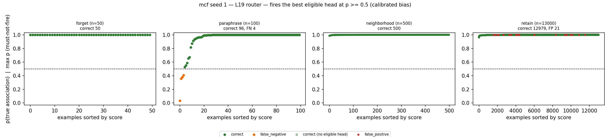
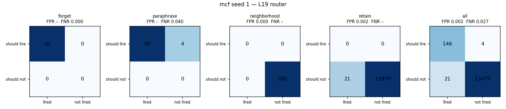
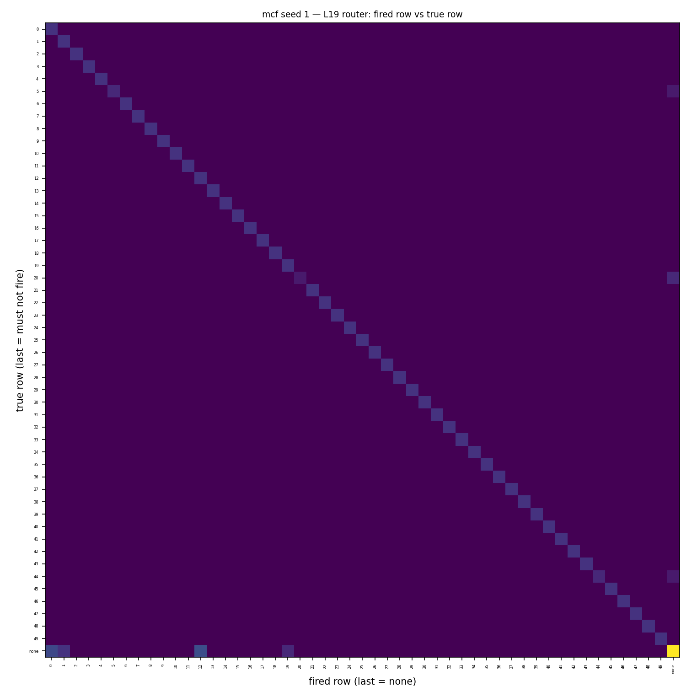
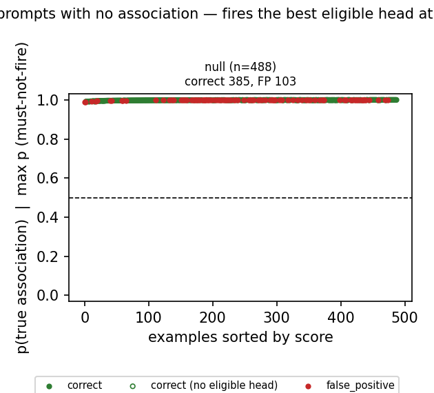
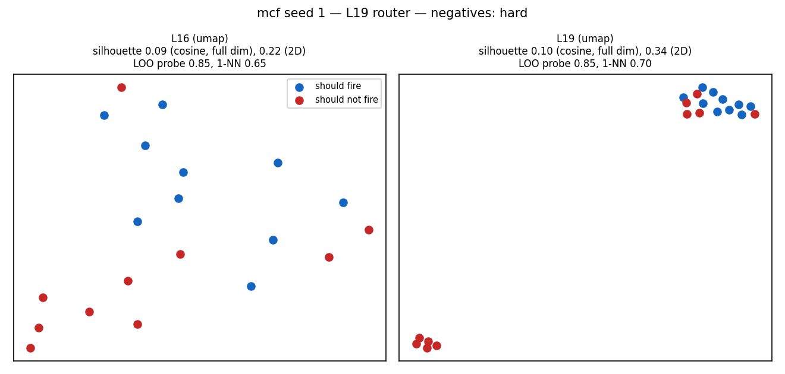
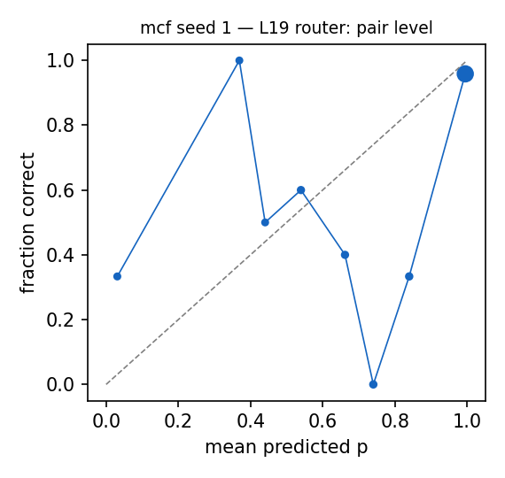

# Router diagnostics: mcf seed 1 — L19 router

Router: `/mmfs1/scratch/yl258/kp759/Unlearning/semantic-unlearning/outputs/mcf_multiseed_regular_v1/seed1/L19/router` · gate `threshold` · fires the best eligible head at p >= 0.5 (calibrated bias).
Probes: eval 13650. Hook parity (real bank hook vs cached decision): {"batched": 0, "single": 0} mismatches.

## 1. Scores against the decision line

### False negatives (lowest p(true)): 4 shown

| split/group | score | fired | true | reason | prompt |
|---|---|---|---|---|---|
| paraphrase/forget_paraphrase | 0.035 | - | 44 | below_threshold | Enrollment in 2004 was 2,792 students. Jason Rebello, the |
| paraphrase/forget_paraphrase | 0.358 | - | 20 | below_threshold | She was passed to the MoWT and renamed Empire Commerce. Shebelle River, in |
| paraphrase/forget_paraphrase | 0.380 | - | 20 | below_threshold | His autobiography, Sir Les, was published in 1997. Shebelle River is located in |
| paraphrase/forget_paraphrase | 0.408 | - | 5 | below_threshold | He died in Far Rockaway on April 23, 1965. Irish Free State, in |

### False positives (highest score): 15 shown

| split/group | score | fired | true | reason | prompt |
|---|---|---|---|---|---|
| retain/retain_paraphrase | 1.000 | 0 | - | eligible_head_above_threshold | Menin Gate Memorial Ypres, Belgium. Where is Eiffel Tower? It is located in |
| retain/retain_neighborhood | 1.000 | 0 | - | eligible_head_above_threshold | Princess Stéphanie of Belgium, who has a citizenship from |
| retain/retain_paraphrase | 1.000 | 0 | - | eligible_head_above_threshold | Menin Gate Memorial Ypres, Belgium. Wizard Sleeve originated in |
| retain/retain_neighborhood | 1.000 | 0 | - | eligible_head_above_threshold | Enterprise number (Belgium), located in |
| retain/retain_neighborhood | 1.000 | 0 | - | eligible_head_above_threshold | Princess Astrid of Belgium, Archduchess of Austria-Este is a citizen of |
| retain/retain_neighborhood | 1.000 | 0 | - | eligible_head_above_threshold | Princess Astrid of Belgium, Archduchess of Austria-Este is a citizen of |
| retain/retain_neighborhood | 1.000 | 19 | - | eligible_head_above_threshold | Sidley Austin's headquarters are in |
| retain/retain_neighborhood | 1.000 | 19 | - | eligible_head_above_threshold | The headquarters of Sidley Austin is in |
| retain/retain_neighborhood | 1.000 | 0 | - | eligible_head_above_threshold | Enterprise number (Belgium) is located in |
| retain/retain_neighborhood | 1.000 | 1 | - | eligible_head_above_threshold | Ignazio Silone took up work in |
| retain/retain_neighborhood | 1.000 | 1 | - | eligible_head_above_threshold | Ignazio Silone was employed in |
| retain/retain_neighborhood | 1.000 | 12 | - | eligible_head_above_threshold | Arkansas Highway 268, in |
| retain/retain_neighborhood | 1.000 | 12 | - | eligible_head_above_threshold | Arkansas Highway 282, in |
| retain/retain_neighborhood | 1.000 | 12 | - | eligible_head_above_threshold | Arkansas Highway 306, in |
| retain/retain_neighborhood | 1.000 | 12 | - | eligible_head_above_threshold | Arkansas Highway 312 is in |

### Misroutes: 0 shown

none

## 2. Confusion matrices

| set | n | TP | FN | FP | TN | FPR | FNR | precision | recall | F1 | correct row |
|---|---|---|---|---|---|---|---|---|---|---|---|
| forget | 50 | 50 | 0 | 0 | 0 | – | 0.000 | 1.000 | 1.000 | 1.000 | 1.000 |
| neighborhood | 500 | 0 | 0 | 0 | 500 | 0.000 | – | – | – | – | – |
| paraphrase | 100 | 96 | 4 | 0 | 0 | – | 0.040 | 1.000 | 0.960 | 0.980 | 0.960 |
| retain | 13000 | 0 | 0 | 21 | 12979 | 0.002 | – | 0.000 | – | – | – |
| all | 13650 | 146 | 4 | 21 | 13479 | 0.002 | 0.027 | 0.874 | 0.973 | 0.921 | 0.973 |

Error reasons: false_negative:below_threshold 4, false_positive:eligible_head_above_threshold 21

## 4. Prompts with no association

| group | n | should fire | fired | fire rate [95% CI] | ungated heads p >= 0.5 |
|---|---|---|---|---|---|
| null_generic | 40 | 0 | 0 | 0.000 [0.000, 0.088] | 40 |
| null_ppl_prefix | 99 | 0 | 0 | 0.000 [0.000, 0.037] | 99 |
| null_protected_other_relation | 199 | 0 | 103 | 0.518 [0.448, 0.586] | 199 |
| null_unseen_subject | 150 | 0 | 0 | 0.000 [0.000, 0.025] | 150 |

**Deployment false-positive rate** (fires on a must-not-fire null prompt): 0.211 [0.177, 0.249], 103/488.

Generations on the 100 fired null prompts (ours `outputs/l16_paper_mcf_linear19/mcf/seed1/ours`): output changed on 98, 'I don't know'-like on 0.

### False negatives (lowest p(true)): 0 shown

none

### False positives (highest score): 15 shown

| split/group | score | fired | true | reason | prompt |
|---|---|---|---|---|---|
| null/null_protected_other_relation | 1.000 | 45 | - | eligible_head_above_threshold | The headquarter of Chaos Divine is located in |
| null/null_protected_other_relation | 1.000 | 46 | - | eligible_head_above_threshold | Milly Mathis originates from |
| null/null_protected_other_relation | 1.000 | 13 | - | eligible_head_above_threshold | Toyota Tercel was created in the country of |
| null/null_protected_other_relation | 1.000 | 35 | - | eligible_head_above_threshold | Giulio Questi, who has a citizenship from |
| null/null_protected_other_relation | 1.000 | 32 | - | eligible_head_above_threshold | The headquarter of Rousseau Institute is located in |
| null/null_protected_other_relation | 1.000 | 4 | - | eligible_head_above_threshold | Bam Margera, who has a citizenship from |
| null/null_protected_other_relation | 1.000 | 29 | - | eligible_head_above_threshold | Marion Davies, who has a citizenship from |
| null/null_protected_other_relation | 1.000 | 9 | - | eligible_head_above_threshold | BMW M5 was created in the country of |
| null/null_protected_other_relation | 1.000 | 21 | - | eligible_head_above_threshold | iPhone 1 was created in the country of |
| null/null_protected_other_relation | 1.000 | 47 | - | eligible_head_above_threshold | Johan Cruyff, who has a citizenship from |
| null/null_protected_other_relation | 1.000 | 46 | - | eligible_head_above_threshold | Milly Mathis, who has a citizenship from |
| null/null_protected_other_relation | 1.000 | 11 | - | eligible_head_above_threshold | Matija Gubec, who has a citizenship from |
| null/null_protected_other_relation | 1.000 | 47 | - | eligible_head_above_threshold | The mother tongue of Johan Cruyff is |
| null/null_protected_other_relation | 1.000 | 26 | - | eligible_head_above_threshold | Grande Arche is located in |
| null/null_protected_other_relation | 1.000 | 38 | - | eligible_head_above_threshold | Edinburgh Art Festival is located in |

### Misroutes: 0 shown

none

## 5. Perturbed forget / paraphrase prompts (recall under surface noise)

| family | n | recall | correct row | FN reasons |
|---|---|---|---|---|
| context_double_space | 21 | 0.048 | 0.048 | subject_in_text_not_token_matched 20 |
| context_lowercase | 18 | 0.944 | 0.944 | below_threshold 1 |
| context_no_punctuation | 9 | 0.889 | 0.889 | below_threshold 1 |
| context_prefixed | 21 | 0.952 | 0.952 | below_threshold 1 |
| context_suffixed | 21 | 0.952 | 0.952 | below_threshold 1 |
| context_typo_delete | 29 | 0.966 | 0.966 | below_threshold 1 |
| context_typo_double | 33 | 0.970 | 0.970 | below_threshold 1 |
| context_typo_substitute | 36 | 1.000 | 1.000 |  |
| context_typo_transpose | 38 | 0.947 | 0.947 | below_threshold 2 |
| subject_given_only | 19 | 0.000 | 0.000 | subject_absent_from_prompt 19 |
| subject_lowercase | 14 | 0.000 | 0.000 | subject_in_text_not_token_matched 14 |
| subject_possessive | 17 | 1.000 | 1.000 |  |
| subject_surname_only | 15 | 0.000 | 0.000 | subject_absent_from_prompt 15 |
| subject_typo_delete | 41 | 0.000 | 0.000 | subject_absent_from_prompt 41 |
| subject_typo_double | 38 | 0.079 | 0.079 | subject_absent_from_prompt 34, subject_in_text_not_token_matched 1 |
| subject_typo_substitute | 35 | 0.000 | 0.000 | subject_absent_from_prompt 35 |
| subject_typo_transpose | 34 | 0.000 | 0.000 | subject_absent_from_prompt 34 |
| subject_uppercase | 11 | 0.000 | 0.000 | subject_in_text_not_token_matched 11 |

## 6. Positives vs negatives at L16 and L19

| layer | silhouette (cosine, full dim) | silhouette (2D) | LOO logistic | LOO 1-NN |
|---|---|---|---|---|
| L16 | 0.088 | 0.222 | 0.850 | 0.650 |
| L19 | 0.100 | 0.335 | 0.850 | 0.700 |

20 points: each LOO error moves accuracy by 0.05. Negatives (hard) prefer must-not-fire prompts that contain a protected subject.

## 7. Calibration

ECE over 174 subject-eligible (prompt, head) pairs: 0.096. deployed probabilities: the calibrated bias moves the cutoff to 0.5 for recall, so they are not meant to be calibrated probabilities.

