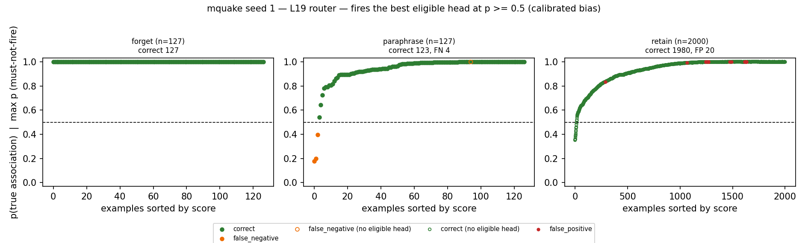
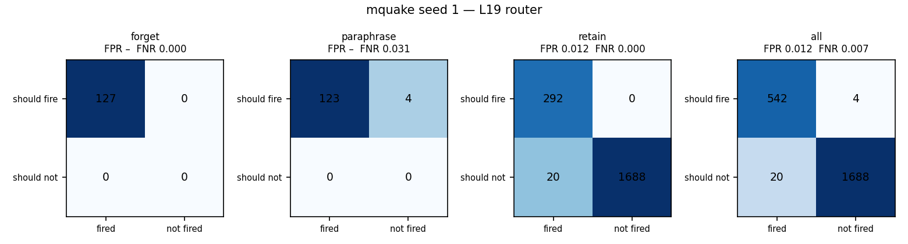
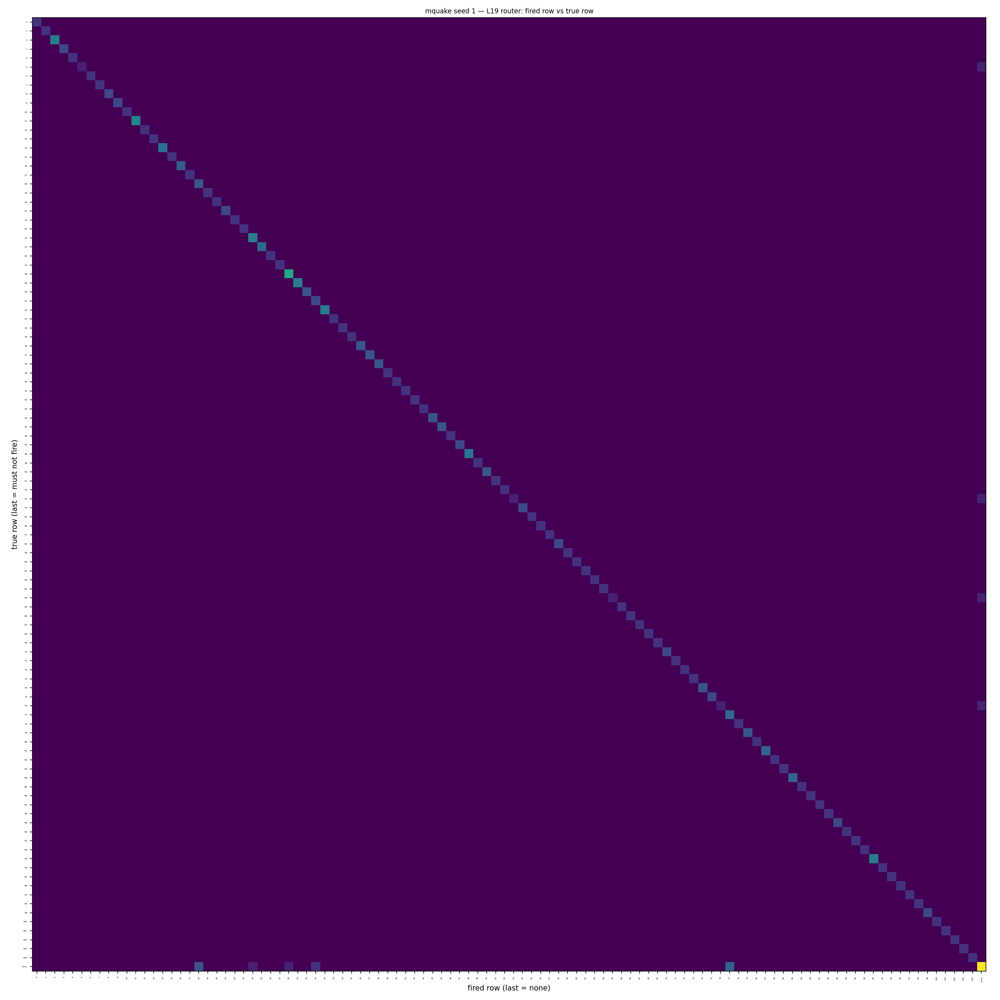
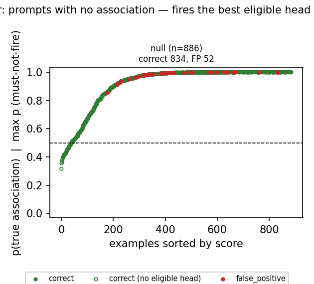
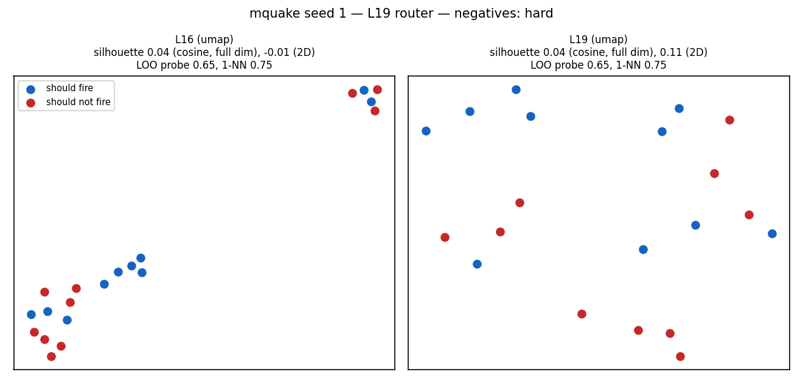
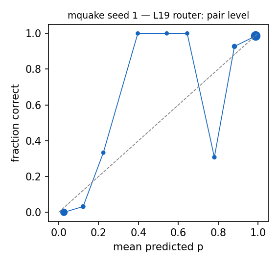

# Router diagnostics: mquake seed 1 — L19 router

Router: `/mmfs1/scratch/yl258/kp759/Unlearning/semantic-unlearning/outputs/mquake_multiseed_regular_v1/seed1/L19/router` · gate `threshold` · fires the best eligible head at p >= 0.5 (calibrated bias).
Probes: eval 2254. Hook parity (real bank hook vs cached decision): {"batched": 0, "single": 0} mismatches.

## 1. Scores against the decision line

### False negatives (lowest p(true)): 4 shown

| split/group | score | fired | true | reason | prompt |
|---|---|---|---|---|---|
| paraphrase/forget_atomic_gen | 0.177 | - | 76 | below_threshold | What position does Enrico Villanueva play? |
| paraphrase/forget_atomic_gen | 0.201 | - | 53 | below_threshold | What is the country of citizenship of Charles the Bold? |
| paraphrase/forget_atomic_gen | 0.397 | - | 64 | below_threshold | What is the country of citizenship of Eben Moglen? |
| paraphrase/forget_atomic_gen | 0.999 | - | 5 | subject_in_text_not_token_matched | Who is the chief executive officer of Hasbro, Inc.? |

### False positives (highest score): 15 shown

| split/group | score | fired | true | reason | prompt |
|---|---|---|---|---|---|
| retain/retain_rewrite | 1.000 | 77 | - | eligible_head_above_threshold | The official language of Japan is |
| retain/retain_rewrite | 1.000 | 77 | - | eligible_head_above_threshold | The official language of Japan is |
| retain/retain_rewrite | 1.000 | 77 | - | eligible_head_above_threshold | The official language of Japan is |
| retain/retain_rewrite | 1.000 | 77 | - | eligible_head_above_threshold | The official language of Japan is |
| retain/retain_rewrite | 1.000 | 77 | - | eligible_head_above_threshold | The official language of Japan is |
| retain/retain_rewrite | 1.000 | 18 | - | eligible_head_above_threshold | The official language of Australia is |
| retain/retain_rewrite | 1.000 | 18 | - | eligible_head_above_threshold | The official language of Australia is |
| retain/retain_rewrite | 1.000 | 18 | - | eligible_head_above_threshold | The official language of Australia is |
| retain/retain_rewrite | 1.000 | 24 | - | eligible_head_above_threshold | basketball coach is associated with the sport of |
| retain/retain_rewrite | 1.000 | 28 | - | eligible_head_above_threshold | association football manager is associated with the sport of |
| retain/retain_atomic_gen | 0.998 | 77 | - | eligible_head_above_threshold | What is the official language of Japan? |
| retain/retain_atomic_gen | 0.998 | 77 | - | eligible_head_above_threshold | What is the official language of Japan? |
| retain/retain_atomic_gen | 0.998 | 77 | - | eligible_head_above_threshold | What is the official language of Japan? |
| retain/retain_atomic_gen | 0.998 | 77 | - | eligible_head_above_threshold | What is the official language of Japan? |
| retain/retain_atomic_gen | 0.998 | 77 | - | eligible_head_above_threshold | What is the official language of Japan? |

### Misroutes: 0 shown

none

## 2. Confusion matrices

| set | n | TP | FN | FP | TN | FPR | FNR | precision | recall | F1 | correct row |
|---|---|---|---|---|---|---|---|---|---|---|---|
| forget | 127 | 127 | 0 | 0 | 0 | – | 0.000 | 1.000 | 1.000 | 1.000 | 1.000 |
| paraphrase | 127 | 123 | 4 | 0 | 0 | – | 0.031 | 1.000 | 0.969 | 0.984 | 0.969 |
| retain | 2000 | 292 | 0 | 20 | 1688 | 0.012 | 0.000 | 0.936 | 1.000 | 0.967 | 1.000 |
| all | 2254 | 542 | 4 | 20 | 1688 | 0.012 | 0.007 | 0.964 | 0.993 | 0.978 | 0.993 |

Error reasons: false_negative:below_threshold 3, false_negative:subject_in_text_not_token_matched 1, false_positive:eligible_head_above_threshold 20

## 4. Prompts with no association

| group | n | should fire | fired | fire rate [95% CI] | ungated heads p >= 0.5 |
|---|---|---|---|---|---|
| null_generic | 40 | 0 | 0 | 0.000 [0.000, 0.088] | 26 |
| null_ppl_prefix | 99 | 0 | 0 | 0.000 [0.000, 0.037] | 76 |
| null_protected_other_relation | 367 | 0 | 46 | 0.125 [0.095, 0.163] | 365 |
| null_unseen_subject | 380 | 0 | 6 | 0.016 [0.007, 0.034] | 380 |

**Deployment false-positive rate** (fires on a must-not-fire null prompt): 0.059 [0.045, 0.076], 52/886.

Generations on the 52 fired null prompts (ours `outputs/l16_paper_v1/mquake/seed1/ours`): output changed on 52, 'I don't know'-like on 1.

### False negatives (lowest p(true)): 0 shown

none

### False positives (highest score): 15 shown

| split/group | score | fired | true | reason | prompt |
|---|---|---|---|---|---|
| null/null_unseen_subject | 1.000 | 29 | - | eligible_head_above_threshold | Kingdom of Italy is located in the continent of |
| null/null_unseen_subject | 1.000 | 29 | - | eligible_head_above_threshold | Kingdom of Italy is located in the continent of |
| null/null_protected_other_relation | 1.000 | 61 | - | eligible_head_above_threshold | Blue Peter is located in the continent of |
| null/null_protected_other_relation | 1.000 | 31 | - | eligible_head_above_threshold | Joe Hockey was created in the country of |
| null/null_unseen_subject | 1.000 | 48 | - | eligible_head_above_threshold | The capital of United Kingdom of Great Britain and Ireland is |
| null/null_unseen_subject | 1.000 | 48 | - | eligible_head_above_threshold | The capital of United Kingdom of Great Britain and Ireland is |
| null/null_unseen_subject | 1.000 | 48 | - | eligible_head_above_threshold | The capital of United Kingdom of Great Britain and Ireland is |
| null/null_unseen_subject | 1.000 | 48 | - | eligible_head_above_threshold | The capital of United Kingdom of Great Britain and Ireland is |
| null/null_protected_other_relation | 1.000 | 75 | - | eligible_head_above_threshold | sumo is a citizen of |
| null/null_protected_other_relation | 1.000 | 28 | - | eligible_head_above_threshold | association football is associated with the sport of |
| null/null_protected_other_relation | 1.000 | 10 | - | eligible_head_above_threshold | savate is affiliated with the religion of |
| null/null_protected_other_relation | 1.000 | 99 | - | eligible_head_above_threshold | defenceman is affiliated with the religion of |
| null/null_protected_other_relation | 1.000 | 29 | - | eligible_head_above_threshold | Italy was created in the country of |
| null/null_protected_other_relation | 1.000 | 81 | - | eligible_head_above_threshold | India was created in the country of |
| null/null_protected_other_relation | 1.000 | 26 | - | eligible_head_above_threshold | Steve Jobs was created in the country of |

### Misroutes: 0 shown

none

## 5. Perturbed forget / paraphrase prompts (recall under surface noise)

| family | n | recall | correct row | FN reasons |
|---|---|---|---|---|
| context_double_space | 28 | 0.214 | 0.214 | subject_in_text_not_token_matched 22 |
| context_lowercase | 19 | 0.947 | 0.947 | below_threshold 1 |
| context_no_punctuation | 14 | 0.571 | 0.571 | below_threshold 6 |
| context_prefixed | 32 | 0.875 | 0.875 | subject_in_text_not_token_matched 1, below_threshold 3 |
| context_suffixed | 30 | 0.367 | 0.367 | below_threshold 19 |
| context_typo_delete | 61 | 0.934 | 0.934 | below_threshold 4 |
| context_typo_double | 59 | 0.983 | 0.983 | below_threshold 1 |
| context_typo_substitute | 70 | 0.771 | 0.771 | below_threshold 16 |
| context_typo_transpose | 64 | 1.000 | 1.000 |  |
| subject_given_only | 22 | 0.000 | 0.000 | subject_absent_from_prompt 22 |
| subject_lowercase | 28 | 0.000 | 0.000 | subject_in_text_not_token_matched 28 |
| subject_possessive | 37 | 0.892 | 0.892 | below_threshold 4 |
| subject_surname_only | 25 | 0.000 | 0.000 | subject_absent_from_prompt 25 |
| subject_typo_delete | 57 | 0.000 | 0.000 | subject_absent_from_prompt 57 |
| subject_typo_double | 53 | 0.057 | 0.057 | subject_absent_from_prompt 39, subject_in_text_not_token_matched 11 |
| subject_typo_substitute | 73 | 0.000 | 0.000 | subject_absent_from_prompt 73 |
| subject_typo_transpose | 62 | 0.000 | 0.000 | subject_absent_from_prompt 62 |
| subject_unaccented | 1 | 0.000 | 0.000 | subject_absent_from_prompt 1 |
| subject_uppercase | 27 | 0.000 | 0.000 | subject_in_text_not_token_matched 27 |

## 6. Positives vs negatives at L16 and L19

| layer | silhouette (cosine, full dim) | silhouette (2D) | LOO logistic | LOO 1-NN |
|---|---|---|---|---|
| L16 | 0.045 | -0.007 | 0.650 | 0.750 |
| L19 | 0.041 | 0.112 | 0.650 | 0.750 |

20 points: each LOO error moves accuracy by 0.05. Negatives (hard) prefer must-not-fire prompts that contain a protected subject.

## 7. Calibration

ECE over 829 subject-eligible (prompt, head) pairs: 0.025. deployed probabilities: the calibrated bias moves the cutoff to 0.5 for recall, so they are not meant to be calibrated probabilities.

