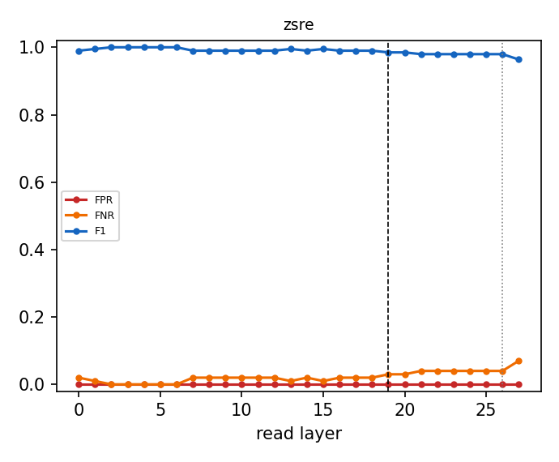

# Why the router reads layer 19

Same Linear + sigmoid router (shipped recipe, L-BFGS, CV-selected L2) refit at every layer from cached last-token states; errors on the official evaluation prompts, which are never used to fit or calibrate. Dashed line: L19; dotted: the penultimate layer.

| dataset | best-F1 layer | F1 there | F1 at L19 | L19 rank (of layers) | L19 vs penultimate | refit = shipped at L19 |
|---|---|---|---|---|---|---|
| zsre | L2 | 1.000 | 0.985 | 20/28 | L19 not beaten | 1.000 |

Per-dataset tables, the penultimate comparison, pipeline cost and robustness variants: `<cache>/layer_sweep/layer_choice.md`.

## Robustness: zsre

| variant | layers | eligibility | FPR | FNR | F1 | correct row | null FPR | perturbed recall | ECE |
|---|---|---|---|---|---|---|---|---|---|
| baseline | 19 | exact | 0.000 | 0.030 | 0.985 | 0.970 | 0.059 | 0.463 | 0.080 |
| baseline | 19 | fuzzy | 0.000 | 0.030 | 0.985 | 0.970 | 0.059 | 0.777 | 0.080 |
| baseline | 19 | none | 0.402 | 0.070 | 0.051 | 0.830 | 0.567 | 0.807 | 0.027 |
| hardneg | 19 | exact | 0.000 | 0.040 | 0.980 | 0.960 | 0.043 | 0.457 | 0.092 |
| hardneg | 19 | fuzzy | 0.000 | 0.040 | 0.980 | 0.960 | 0.043 | 0.770 | 0.092 |
| hardneg | 19 | none | 0.436 | 0.100 | 0.046 | 0.820 | 0.588 | 0.790 | 0.021 |
| aug | 19 | exact | 0.000 | 0.010 | 0.995 | 0.990 | 0.064 | 0.493 | 0.071 |
| aug | 19 | fuzzy | 0.000 | 0.010 | 0.995 | 0.990 | 0.064 | 0.817 | 0.071 |
| aug | 19 | none | 0.363 | 0.120 | 0.053 | 0.790 | 0.563 | 0.793 | 0.035 |
| hardneg_aug | 19 | exact | 0.000 | 0.010 | 0.995 | 0.990 | 0.043 | 0.487 | 0.078 |
| hardneg_aug | 19 | fuzzy | 0.000 | 0.010 | 0.995 | 0.990 | 0.043 | 0.810 | 0.078 |
| hardneg_aug | 19 | none | 0.126 | 0.150 | 0.135 | 0.790 | 0.349 | 0.687 | 0.028 |
| concat | 16,19,23 | exact | 0.000 | 0.030 | 0.985 | 0.970 | 0.055 | 0.467 | 0.081 |
| concat | 16,19,23 | fuzzy | 0.000 | 0.030 | 0.985 | 0.970 | 0.055 | 0.777 | 0.081 |
| concat | 16,19,23 | none | 0.355 | 0.080 | 0.057 | 0.840 | 0.547 | 0.817 | 0.025 |
| unmasked | 19 | exact | 0.000 | 0.040 | 0.980 | 0.960 | 0.084 | 0.460 | 0.077 |
| unmasked | 19 | fuzzy | 0.000 | 0.040 | 0.980 | 0.960 | 0.084 | 0.767 | 0.077 |
| unmasked | 19 | none | 0.142 | 0.050 | 0.135 | 0.940 | 0.390 | 0.877 | 0.009 |
| baseline | 26 | exact | 0.000 | 0.040 | 0.980 | 0.960 | 0.030 | 0.427 | 0.089 |
| baseline | 26 | fuzzy | 0.000 | 0.040 | 0.980 | 0.960 | 0.030 | 0.730 | 0.089 |
| baseline | 26 | none | 0.431 | 0.070 | 0.048 | 0.860 | 0.528 | 0.830 | 0.023 |
| hardneg | 26 | exact | 0.000 | 0.040 | 0.980 | 0.960 | 0.030 | 0.440 | 0.112 |
| hardneg | 26 | fuzzy | 0.000 | 0.040 | 0.980 | 0.960 | 0.030 | 0.743 | 0.112 |
| hardneg | 26 | none | 0.500 | 0.100 | 0.040 | 0.840 | 0.487 | 0.797 | 0.038 |
| aug | 26 | exact | 0.000 | 0.070 | 0.964 | 0.930 | 0.023 | 0.440 | 0.078 |
| aug | 26 | fuzzy | 0.000 | 0.070 | 0.964 | 0.930 | 0.023 | 0.733 | 0.078 |
| aug | 26 | none | 0.218 | 0.050 | 0.092 | 0.850 | 0.437 | 0.790 | 0.032 |
| hardneg_aug | 26 | exact | 0.000 | 0.090 | 0.953 | 0.910 | 0.016 | 0.420 | 0.089 |
| hardneg_aug | 26 | fuzzy | 0.000 | 0.090 | 0.953 | 0.910 | 0.016 | 0.703 | 0.089 |
| hardneg_aug | 26 | none | 0.213 | 0.060 | 0.093 | 0.850 | 0.431 | 0.787 | 0.026 |
| unmasked | 26 | exact | 0.000 | 0.030 | 0.985 | 0.970 | 0.055 | 0.467 | 0.062 |
| unmasked | 26 | fuzzy | 0.000 | 0.030 | 0.985 | 0.970 | 0.055 | 0.757 | 0.062 |
| unmasked | 26 | none | 0.049 | 0.030 | 0.317 | 0.960 | 0.198 | 0.853 | 0.008 |

