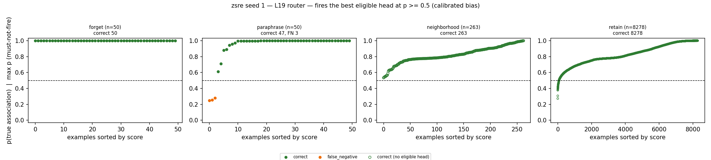
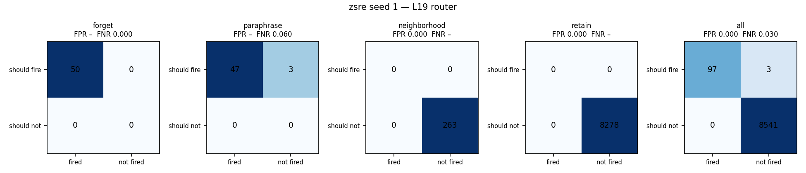
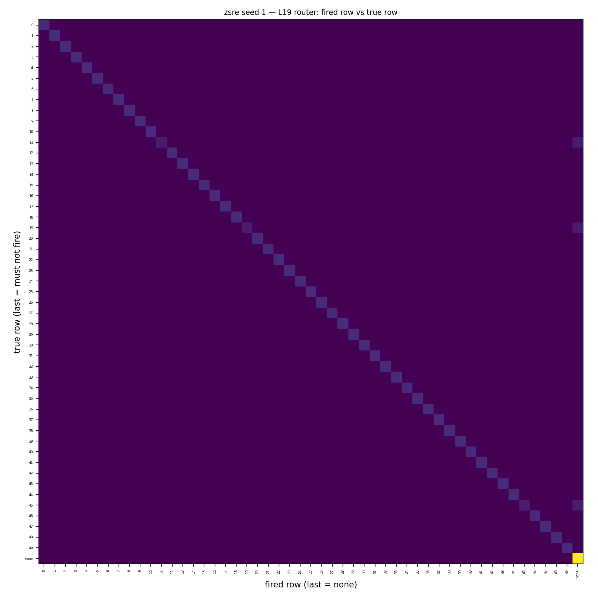
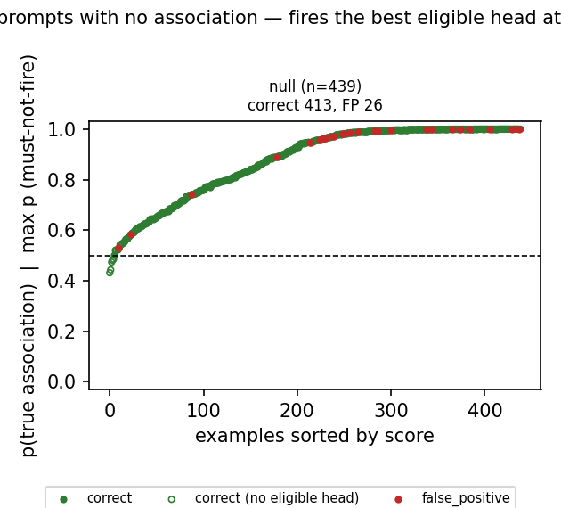
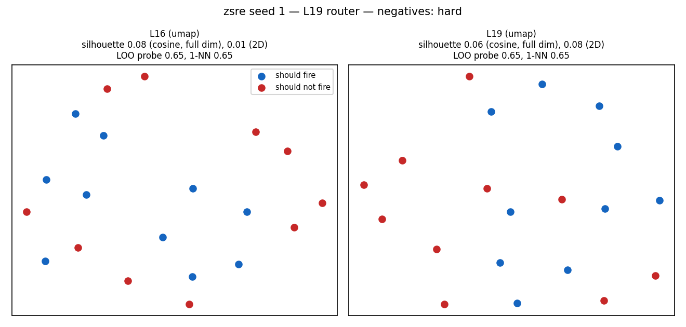
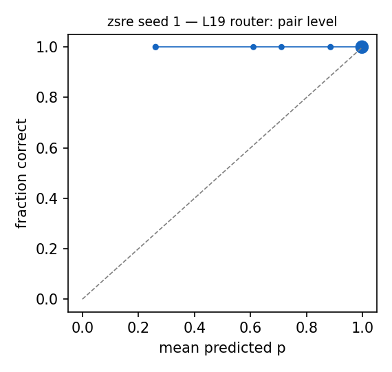

# Router diagnostics: zsre seed 1 — L19 router

Router: `/mmfs1/scratch/yl258/kp759/Unlearning/semantic-unlearning/outputs/zsre_multiseed_reworded_v2/seed1/L19/router` · gate `threshold` · fires the best eligible head at p >= 0.5 (calibrated bias).
Probes: eval 8641. Hook parity (real bank hook vs cached decision): {"batched": 0, "single": 0} mismatches.

## 1. Scores against the decision line

### False negatives (lowest p(true)): 3 shown

| split/group | score | fired | true | reason | prompt |
|---|---|---|---|---|---|
| paraphrase/forget_paraphrase | 0.249 | - | 45 | below_threshold | Who was the discoverer of the 557 Violetta? |
| paraphrase/forget_paraphrase | 0.257 | - | 19 | below_threshold | What company is known as Nuffield Universal? |
| paraphrase/forget_paraphrase | 0.279 | - | 11 | below_threshold | The 14 Irene has been discovered by whom? |

### False positives (highest score): 0 shown

none

### Misroutes: 0 shown

none

## 2. Confusion matrices

| set | n | TP | FN | FP | TN | FPR | FNR | precision | recall | F1 | correct row |
|---|---|---|---|---|---|---|---|---|---|---|---|
| forget | 50 | 50 | 0 | 0 | 0 | – | 0.000 | 1.000 | 1.000 | 1.000 | 1.000 |
| neighborhood | 263 | 0 | 0 | 0 | 263 | 0.000 | – | – | – | – | – |
| paraphrase | 50 | 47 | 3 | 0 | 0 | – | 0.060 | 1.000 | 0.940 | 0.969 | 0.940 |
| retain | 8278 | 0 | 0 | 0 | 8278 | 0.000 | – | – | – | – | – |
| all | 8641 | 97 | 3 | 0 | 8541 | 0.000 | 0.030 | 1.000 | 0.970 | 0.985 | 0.970 |

Error reasons: false_negative:below_threshold 3

## 4. Prompts with no association

| group | n | should fire | fired | fire rate [95% CI] | ungated heads p >= 0.5 |
|---|---|---|---|---|---|
| null_generic | 40 | 0 | 0 | 0.000 [0.000, 0.088] | 40 |
| null_ppl_prefix | 99 | 0 | 0 | 0.000 [0.000, 0.037] | 94 |
| null_protected_other_relation | 150 | 0 | 26 | 0.173 [0.121, 0.242] | 150 |
| null_unseen_subject | 150 | 0 | 0 | 0.000 [0.000, 0.025] | 150 |

**Deployment false-positive rate** (fires on a must-not-fire null prompt): 0.059 [0.041, 0.085], 26/439.

Generations on the 26 fired null prompts (ours `outputs/l16_paper_v1/zsre/seed1/ours`): output changed on 26, 'I don't know'-like on 1.

### False negatives (lowest p(true)): 0 shown

none

### False positives (highest score): 15 shown

| split/group | score | fired | true | reason | prompt |
|---|---|---|---|---|---|
| null/null_protected_other_relation | 1.000 | 45 | - | eligible_head_above_threshold | Who was behind the discovery of 557 Violetta? |
| null/null_protected_other_relation | 1.000 | 14 | - | eligible_head_above_threshold | What is Roland Gransart's country of original? |
| null/null_protected_other_relation | 1.000 | 49 | - | eligible_head_above_threshold | Who is in Help I'm Alive as a cast member? |
| null/null_protected_other_relation | 1.000 | 6 | - | eligible_head_above_threshold | Which artist is Soul Merchant co-written and recorded by? |
| null/null_protected_other_relation | 1.000 | 2 | - | eligible_head_above_threshold | Where was Oliver Welden born? |
| null/null_protected_other_relation | 1.000 | 27 | - | eligible_head_above_threshold | What university did Sheikh Jamal Dhanmondi Club attend? |
| null/null_protected_other_relation | 0.999 | 43 | - | eligible_head_above_threshold | What is Le Quotidien de Paris a tributary of? |
| null/null_protected_other_relation | 0.999 | 10 | - | eligible_head_above_threshold | The mother of Ille is whom? |
| null/null_protected_other_relation | 0.996 | 20 | - | eligible_head_above_threshold | When was the birth of Timothy M. Lohman? |
| null/null_protected_other_relation | 0.993 | 43 | - | eligible_head_above_threshold | What team does Le Quotidien de Paris belong to? |
| null/null_protected_other_relation | 0.992 | 40 | - | eligible_head_above_threshold | What is the home arena of Igor Ardašev? |
| null/null_protected_other_relation | 0.988 | 0 | - | eligible_head_above_threshold | What is the gender 17th Busan International Film Festival is associated with? |
| null/null_protected_other_relation | 0.985 | 1 | - | eligible_head_above_threshold | What team is WMC-FM associated with? |
| null/null_protected_other_relation | 0.981 | 43 | - | eligible_head_above_threshold | Whom is Le Quotidien de Paris named after? |
| null/null_protected_other_relation | 0.981 | 9 | - | eligible_head_above_threshold | Who is Landscape with the Ashes of Phocion's sister? |

### Misroutes: 0 shown

none

## 5. Perturbed forget / paraphrase prompts (recall under surface noise)

| family | n | recall | correct row | FN reasons |
|---|---|---|---|---|
| context_double_space | 19 | 0.105 | 0.105 | subject_in_text_not_token_matched 17 |
| context_lowercase | 13 | 0.846 | 0.846 | below_threshold 2 |
| context_no_punctuation | 13 | 0.769 | 0.769 | subject_in_text_not_token_matched 1, below_threshold 2 |
| context_prefixed | 10 | 0.900 | 0.900 | below_threshold 1 |
| context_suffixed | 11 | 0.727 | 0.727 | below_threshold 3 |
| context_typo_delete | 20 | 0.950 | 0.950 | below_threshold 1 |
| context_typo_double | 30 | 1.000 | 1.000 |  |
| context_typo_substitute | 22 | 0.727 | 0.727 | below_threshold 6 |
| context_typo_transpose | 18 | 1.000 | 1.000 |  |
| subject_given_only | 13 | 0.000 | 0.000 | subject_absent_from_prompt 13 |
| subject_lowercase | 13 | 0.000 | 0.000 | subject_in_text_not_token_matched 13 |
| subject_possessive | 18 | 0.833 | 0.833 | below_threshold 3 |
| subject_surname_only | 15 | 0.000 | 0.000 | subject_absent_from_prompt 15 |
| subject_typo_delete | 11 | 0.000 | 0.000 | subject_absent_from_prompt 11 |
| subject_typo_double | 23 | 0.043 | 0.043 | subject_absent_from_prompt 20, subject_in_text_not_token_matched 2 |
| subject_typo_substitute | 24 | 0.000 | 0.000 | subject_absent_from_prompt 24 |
| subject_typo_transpose | 18 | 0.000 | 0.000 | subject_absent_from_prompt 18 |
| subject_uppercase | 9 | 0.000 | 0.000 | subject_in_text_not_token_matched 9 |

## 6. Positives vs negatives at L16 and L19

| layer | silhouette (cosine, full dim) | silhouette (2D) | LOO logistic | LOO 1-NN |
|---|---|---|---|---|
| L16 | 0.077 | 0.007 | 0.650 | 0.650 |
| L19 | 0.060 | 0.079 | 0.650 | 0.650 |

20 points: each LOO error moves accuracy by 0.05. Negatives (hard) prefer must-not-fire prompts that contain a protected subject.

## 7. Calibration

ECE over 100 subject-eligible (prompt, head) pairs: 0.033. deployed probabilities: the calibrated bias moves the cutoff to 0.5 for recall, so they are not meant to be calibrated probabilities.

